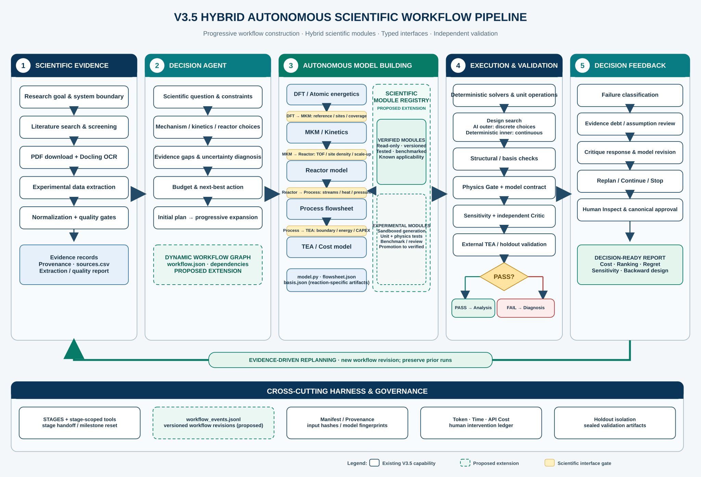

# V3.5-design-opt Architecture Audit and Progressive Workflow Construction Proposal

**Date:** 2026-11-15  
**Status:** Architecture proposal; not supervisor-approved and not yet implemented or validated.  
**Repository baseline:** `analysis/v34-lean-chem-2026-11-15`  
**Notion source:** [Page 42 — V3.5-design-opt architecture audit](https://app.notion.com/p/419c0ee7c03e8180a735dc8128a37fea)

---

## 最新 Pipeline 总览（2026-11-15）

下图是基于当前 V3.5-design-opt 代码审计与本页提案绘制的端到端流程。实线框表示当前已有能力；绿色虚线框表示建议新增的能力；黄色节点表示跨尺度 Scientific Interface Contract。

> 文档性质：基于 GitHub 当前 V3.5-design-opt 分支的代码审计，以及 Notion 40/41 的架构讨论形成的扩展提案。**不是导师已批准的最终架构，也不代表新增能力已经实现或验证。** 本页保留现有五层架构和工程门控，不覆盖既有 canonical 科学结果。

## 一句话结论

**不推翻 V3.5，也不另造一套 Agent。** 当前系统已经具备“固定通用计算基础设施 + Agent 自主建立反应专属模型 + 确定性验证”的 Hybrid 雏形。真正缺少的是：

1. 一套显式的 **Progressive Workflow Construction** 机制：从粗粒度计划开始，只逐步展开当前需要的子流程，并根据科学结果增删、替换或分支后续节点。
2. 一套轻量的 **Scientific Module Registry**：把现有 unitops、MKM solver、optimizer 等能力登记为有输入/输出、单位、假设、适用范围和测试的模块。
3. 一套 **Scientific Interface Contract**：在 DFT→MKM→Reactor→Process→TEA 的交接处检查数据和模型假设是否兼容。

这三项应作为横向能力叠加在现有五层架构之上，而不是再增加一个架构层。

## 1. 本次审计的 V3.5 代码基线

本次实际检查的 GitHub 分支：

[analysis/v34-lean-chem-2026-11-15](https://github.com/stloendays/Catalyst-Essay/tree/analysis/v34-lean-chem-2026-11-15/agent/new_reactions/auto_agent)

| 文件 | 已确认的实现 | 本次审计识别的作用 |
| --- | --- | --- |
| `build_mode.py` | BUILD\_MODE\_VERSION = V3.5-design-opt；STAGES、model contract、record\_decision、basis、feedback、Critic | Build Mode 主入口 |
| `lean_chem.py` | stage\_tools、workspace\_digest、model\_skeleton、read cache、批量反馈动作 | 阶段权限和上下文管理 |
| `design_opt.py` | design 参数登记、候选方案检查、最多 40 次确定性评估、L-BFGS-B bounded search | 连续设计变量优化 |
| `unitops.py` | UO-1.1；压缩、泵、热负荷、冷却、热回收、循环/吹扫、理想 split、分离压力能耗、CAPEX 和账本 | 固定通用工程模块 |
| `mkm_solver.py` | 单位点 mean-field steady-state MKM，含 site balance、detailed balance、coverage、TOF 和 DRC | 通用动力学求解器 |
| `physics_gate.py` / `basis_gate.py` | 物理、工程、边界和证据检查 | 独立验证基础设施 |
| `runner.py` | stage handoff、stage-scoped tools、holdout 防泄漏、超时、输出封存、ledger | 执行与审计 Harness |

代码入口：

- [build\_mode.py](https://github.com/stloendays/Catalyst-Essay/blob/analysis/v34-lean-chem-2026-11-15/agent/new_reactions/auto_agent/build_mode.py)（本次读取文件 SHA：c9d61ea6）
- [design\_opt.py](https://github.com/stloendays/Catalyst-Essay/blob/analysis/v34-lean-chem-2026-11-15/agent/new_reactions/auto_agent/design_opt.py)（SHA：f7e8e890）
- [lean\_chem.py](https://github.com/stloendays/Catalyst-Essay/blob/analysis/v34-lean-chem-2026-11-15/agent/new_reactions/auto_agent/lean_chem.py)（SHA：b4ac2006）
- [unitops.py](https://github.com/stloendays/Catalyst-Essay/blob/analysis/v34-lean-chem-2026-11-15/agent/new_reactions/auto_agent/unitops.py)（SHA：f8570aae）
- [mkm\_solver.py](https://github.com/stloendays/Catalyst-Essay/blob/analysis/v34-lean-chem-2026-11-15/agent/new_reactions/auto_agent/mkm_solver.py)（SHA：0999db1d）
- [runner.py](https://github.com/stloendays/Catalyst-Essay/blob/analysis/v34-lean-chem-2026-11-15/agent/new_reactions/auto_agent/runner.py)

### 版本命名需要先澄清

当前代码里的实现标签是 **V3.5-design-opt**；但 Notion 41 的路线图把 **V3.5** 用作后续的 Decision-aware Resource Allocation 阶段，V3.4 则是 Autonomous Process Optimization。当前分支名又是 v34-lean-chem。

这三个名称不能直接视为同一个版本序列。建议后续明确区分：

- **Build Mode implementation version**：例如 V3.5-design-opt；
- **Roadmap milestone**：例如 Autonomous Process Optimization、Decision-aware Resource Allocation；
- **Scientific module version**：例如 UO-1.1、MKM solver 版本。

在版本注册表同步前，不建议直接重命名或将当前分支视为 canonical。

另一个状态差异：GitHub 当前分支的 V3.3 performance roadmap 记录 V3.3.1 Engineering Audit 已完成、V3.3.2 Reproducibility 仍待至少三次独立运行；Notion 41 的快照仍把 Engineering Audit 标为当前优先事项。实施新架构前应先同步这两个状态，避免在可复现性未闭合时叠加新变量。

## 2. V3.5 已有能力：五层映射

| 五层职责 | 当前代码映射 | 当前判断 |
| --- | --- | --- |
| Layer 1 — Evidence | OpenAlex / 下载 / Docling / extraction / normalize / check\_records / sources.csv | 已有较完整基础 |
| Layer 2 — Decision | METHOD\_BUILD、record\_decision、证据和模型选择、阶段内工具选择 | 有决策记录，但没有独立的动态 Workflow Graph |
| Layer 3 — Model Building | flowsheet.json、basis.json、[model.py](http://model.py)、可选 [atomic.py](http://atomic.py)、`model_skeleton.py` | Agent 已能建立反应专属模型 |
| Layer 4 — Execution & Validation | unitops、physics\_gate、basis\_gate、check\_model、design\_opt、run\_analysis、sensitivity、Critic、holdout | 已有多种确定性门控 |
| Layer 5 — Feedback | assess\_assumptions、resolve\_debt、request\_critique、respond\_critique、stage\_handoff | 已有反馈和阶段交接，但反馈尚未成为一等的流程重规划对象 |

**关键判断：当前 V3.5 是“阶段化自主建模 + 确定性验证”，还不是完整的“动态自主 Workflow Construction”。**

当前 STAGES 是预设顺序；lean\_chem.stage\_tools 根据当前 stage 限制工具；runner 在若干 milestone 做 stage\_handoff。它们已经提供了阶段权限、上下文压缩和状态恢复，但 Agent 尚不能把“新增一个 DFT 核验分支”“将 Scaling MKM 替换为 Direct Energetics MKM”“跳过不适用节点并给出理由”作为正式的图结构变更来记录和验证。

因此，Progressive Workflow Construction 应建立在现有 STAGES / handoff 机制之上，不替换它们。

## 3. 最重要的改进判断

### 3.1 从固定阶段序列升级为渐进式 Workflow Graph

建议保留 STAGES 作为生命周期和硬门控；新增 workflow.json 作为每个研究 run 的任务图。

工作方式：

1. **Initial plan**：Agent 先生成粗粒度计划，说明研究目标、必要输出、依赖关系、候选模块、预算和验证门槛，不要求一次性决定所有细节。
2. **Progressive expansion**：只展开当前阶段需要执行的子图。例如先完成证据和机理判断，再决定需要 Reduced MKM 还是 Direct Energetics MKM。
3. **Execute**：只有依赖已满足、输入通过接口检查的节点才能运行。
4. **Validate**：每个关键节点有独立验证条件；失败时必须分类为证据、模型、接口、数值或代码问题。
5. **Replan**：根据结果新增、替换、跳过或分支后续节点，并记录原因。
6. **Stop / human inspect**：当预算耗尽、证据不足或模型适用性无法确认时，明确停止或请求人工检查。

每次 replan 生成新的 workflow revision；旧图和旧运行产物保留，不覆盖历史。单个 revision 内仍保持 DAG，反馈通过新 revision 表达，避免在图中形成不可审计的循环。

建议节点至少包含：

- node\_id / node\_type / stage；
- module\_id + module\_version；
- input\_refs / output\_schema / units；
- depends\_on；
- preconditions / assumptions / evidence\_refs；
- validation\_policy；
- budget\_estimate；
- status：planned / ready / running / validated / blocked / failed / skipped；
- branch\_condition / skip\_reason。

另建 append-only 的 workflow\_events.jsonl，记录每次新增节点、替换模块、失败诊断、人工介入和 replan 原因。

### 3.2 建立轻量 Scientific Module Registry，而不是把模块做成 MCP

当前已有的 `unitops.py`、`mkm_solver.py`、`design_opt.py` 是有价值的确定性模块，不应重写。下一步是为它们增加统一的描述和契约。

建议每个模块登记：

| 字段 | 含义 |
| --- | --- |
| module\_id / version | 稳定标识和版本 |
| capability | 能解决什么计算问题 |
| inputs / outputs | 数据结构、物理量、单位和必需字段 |
| assumptions | 模型假设 |
| applicability\_domain | 温度、压力、相态、位点、材料或其他适用范围 |
| required\_evidence | 运行前需要的证据 |
| validation | 单元测试、benchmark、守恒和极限检查 |
| cost\_profile | 运行时间、计算预算或外部 API 成本 |
| provenance | 方程、参数和实现依据 |

模块分两类：

- **Verified Module**：只读、固定版本、已有测试和适用范围；Agent 只能选择和组合，不能静默修改内部方程。
- **Experimental Module**：Agent 在独立 run workspace 中创建或修改；必须经过测试、benchmark、物理检查和必要的人工审核，才能申请晋升为 Verified Module。

Agent 可以自由写 adapter、数据转换和流程 glue code。若需要新科学方程或新求解器，应建立 Experimental Module，而不是直接塞进 [model.py](http://model.py) 并把“代码能运行”当作科学验证。

MCP 仍可用于连接外部系统、数据源或软件服务；但内部科学模块应通过 Python/API contract 组合。**模块的价值来自科学语义、适用范围和验证，不来自它是否被包装成 MCP。**

### 3.3 增加 Scientific Interface Contract

模块能被调用，不代表它们之间的数据可以科学地传递。每个跨尺度接口都应有输入条件、转换规则和验证结果。

| 接口 | 必须检查的内容 |
| --- | --- |
| DFT → MKM | energy reference、facet/site、覆盖度假设、ZPE/熵修正、TS 数据、scaling/BEP 适用性 |
| MKM → Reactor | TOF 与 coverage 如何转换为有效生产率；active-site density、dispersion、effectiveness factor、传热传质限制是否有依据 |
| Reactor → Process | conversion、selectivity、热负荷、压力、压降、循环和分离的物流接口 |
| Process → TEA | battery limit、产品规格、购电/燃料口径、CAPEX basis、币种和成本年份、产能利用率 |

接口结果分为：

- **Pass**：满足必要条件，可继续；
- **Warning**：可继续，但必须传播不确定性并在报告中披露；
- **Block**：缺少必要数据或存在不兼容假设，禁止直接向下一层传递。

这会把导师强调的“软件不报错、科学答案却可能错”的接缝问题，变成可执行的检查对象。

### 3.4 收紧 [model.py](http://model.py) 的职责

当前 [model.py](http://model.py) 是 Agent 生成的反应专属成本模型，灵活性很高，但也把机理、动力学、工艺逻辑、成本方程和模块适配放在同一个自由代码文件里，增加了错误定位和复用难度。

建议逐步调整为：

- [model.py](http://model.py) 负责反应专属配置、模块组合、数据映射和 plant\_cost contract；
- 已验证的通用计算尽量调用 Verified Modules；
- 反应专属方程可以由 Agent 建立，但必须记录来源、假设和验证；
- 任何改变 Verified Module 方程的行为都必须产生新版本，不能覆盖原模块。

不建议现在禁止 Agent 写代码。目标是把“自由写所有核心代码”收敛成“自由组合已验证能力 + 有条件扩展新能力”。

## 4. 对当前 V3.5 代码的具体改进意见

### P0 — 先解决版本和验证基线

- 同步 Notion 41 与 GitHub roadmap 对 V3.3.1 Engineering Audit 的完成状态。
- 按冻结输入完成 V3.3.2 / 当前基线的至少三次独立运行，报告 median、IQR、pass rate、wall time、成本和人工介入。
- 冻结本次 V3.5-design-opt 分支、prompt、unitops、physics\_gate、basis、sources、model contract 和运行输入的 hashes。
- 在 Version Registry 区分 Build Mode implementation version 与 roadmap milestone。

### P1 — 优先做 Workflow Graph 和 Module Registry 的最小实现

- 先不改 STAGES；新增 workflow.json 和 workflow\_events.jsonl。
- 复用 stage\_tools、stage\_handoff、workspace\_digest、record\_decision，不再另造一套上下文管理。
- 先把 unitops 的主要函数、mkm\_solver.solve 和 design\_opt.optimize 包装成 registry entries。
- 第一版只需要支持“选择已有模块、检查接口、记录 replan”，不急着做复杂的自动模块市场。

### P1 — 修正 design\_opt 的离散/连续变量边界

当前 `design_opt.py` 将 type=design 的变量统一交给 L-BFGS-B，并把模型评估次数限制在 40 次。它适合有界连续变量的初步搜索，但不能直接正确处理类别变量或整数变量；例如 separation technology、reactor topology、compression stage count 不应被当成普通连续变量优化。

建议采用：

- **AI 外层离散决策**：提出 2–3 个候选流程拓扑或分离方案，给出证据、能耗和 CAPEX；
- **确定性内层连续优化**：在每个候选拓扑内优化 T、P、recovery、purge ratio 等连续变量；
- **整数变量**：对压缩级数等有限选项显式枚举；
- **验证与比较**：每个候选独立运行 physics gate，比较成本、能耗、可行性和 Pareto trade-off。

另一个需要明确的范围问题：当前 design\_opt.optimize 以 model.reference() 作为目标评估对象。它适合优化“参考工厂”，但不能自动代表每个催化剂的最优工况。催化剂排序任务必须事先声明采用哪一种策略：

1. shared design：所有催化剂在同一流程和工况下比较；
2. per-catalyst optimization：每个催化剂允许在相同约束下独立优化；
3. reference reconstruction：只优化参考工厂，用于重建任务。

这三种任务回答不同科学问题，不能混用同一排名。

此外，L-BFGS-B 是局部有界优化；40 次评估不构成全局最优证明。应记录初始点、边界点、收敛状态、失败点和重复起点结果，并在低维场景用网格或独立搜索交叉检查。

### P2 — 给现有模块补充适用范围

- unitops.split() 是理想组分分割函数，不等于完整 PSA、膜或吸收设备模型；应明确标记为 mass-balance-only。
- unitops.heat_recovery() 是基于 approach fraction 的简化热回收，不等于完整 pinch analysis。
- `mkm_solver.py` 是 single-site mean-field solver；不应默认覆盖多活性位、侧向相互作用或传热传质耦合。
- `physics_gate.py` 是独立检查层，不应被当作模型正确性的完整证明。

这些限制应进入 registry 的 applicability\_domain，并在不适用时触发 Warning 或 Block。

### P3 — 后续再加入 Decision-aware Resource Allocation

有限预算下选择下一项 DFT、实验、文献核验或工程计算，应该建立在 Workflow Graph、模块验证和可复现性稳定之后。它可以复用 DISCOVER / VOI 思路，但不应抢在第一阶段成为主开发任务。

不建议当前新增 Multi-Agent、fine-tuning 或额外 Critic。现有独立 artifact-only Critic、Physics Gate、holdout 和 finish checks 应先通过真实错误案例验证其有效性。

## 5. 建议的目标运行方式

**Progressive Workflow Construction：**

1. 接收工业目标和约束，生成粗粒度 workflow revision。
2. 检索证据，形成 evidence records 和 basis。
3. 只展开当前需要的科学子图，选择模块并检查输入/适用范围。
4. 执行当前节点，保存产物和 provenance。
5. 运行接口检查、物理检查和工程验证。
6. 根据失败类型或新结果，决定继续、增加节点、替换模块、补证据、请求人工 Inspect 或停止。
7. 每次修改生成新的 workflow revision，旧结果保留。
8. 最终输出研究结论、决策依据、未解决不确定性和完整运行记录。

**硬约束仍由现有 Harness 保留：** flowsheet 先于 [model.py](http://model.py)；当前输入变更后必须重新 check\_model；holdout 对 Agent 隔离；固定验证产物不可由 Agent 直接写入；未解决的 evidence debt 必须显式保留；finish 前检查当前 fingerprint 和验证状态。

## 6. 论文层面的科学创新点

主创新建议聚焦：

**Progressive Scientific Workflow Construction under Typed Scientific Interface Constraints**

研究问题不是“Agent 能不能生成 DAG”，而是：

> 在证据不完整、模型异质、科学接口存在隐含假设的工业研究任务中，Agent 能否逐步构建并调整一条科学上有效、可执行、可验证的多尺度工作流？

建议的贡献结构：

1. **Progressive workflow construction**：从粗计划到局部展开，再依据执行和验证结果动态调整。
2. **Interface-aware workflow adaptation**：把跨尺度模型兼容性、适用范围和证据要求变成工作流约束。
3. **Hybrid module composition and extension**：优先组合 Verified Modules；缺少能力时创建 Experimental Module，并经过验证晋升。

DAG、Module Registry 或 MCP 本身都不应单独宣称为科学创新。创新应体现在：工作流如何利用科学接口约束作出规划与重规划，以及这种机制是否降低错误模型传递并改善最终工业决策。

### 可检验假设

- H1：相较固定线性 workflow，渐进式构建能减少不必要节点，并提高遇到模型不适用或证据缺失时的恢复率。
- H2：相较完全自由 Coding Agent，Hybrid 模块体系能降低物理/接口错误，同时保留处理新反应任务的能力。
- H3：相较只调用固定工具的 Agent，接口感知的动态工作流能更准确识别何时需要升级模型或补充证据。

### 建议对照组

| 对照组 | 工作方式 |
| --- | --- |
| Fixed workflow | 固定 STAGES / 固定模型路径 |
| Free coding agent | Agent 自由编写主要计算代码 |
| Tool-only agent | 只选择和调用已有模块，不动态重构 workflow |
| Proposed hybrid progressive agent | 渐进式 workflow + registry + interface contract + 验证后扩展 |

评价指标至少包含 workflow validity、interface violation rate、replan recovery rate、物理/工程 benchmark、decision regret、跨反应迁移、运行成本和人工介入次数。不能只用任务完成率或 token 数证明系统更好。

## 7. 建议实施路线

| 阶段 | 目标 | 交付物 |
| --- | --- | --- |
| 0. Baseline audit | 冻结 V3.5-design-opt，确认工程核算和重复性基线 | hashes、三次运行统计、问题清单 |
| 1. Module Registry MVP | 登记现有 unitops / MKM / optimizer，不重写求解器 | registry schema、模块适用范围和测试 |
| 2. Progressive Workflow MVP | 在现有 STAGES 上叠加 workflow graph 和 replan events | workflow.json、events、状态检查 |
| 3. Interface stress tests | 测试 reference state、site mismatch、理想分离、能源边界等问题 | 盲测 case、错误率和恢复率 |
| 4. Cross-reaction evaluation | 在 PDH、CO₂ 甲烷化、NH₃、MeOH 等任务检验迁移 | 统一 benchmark 报告 |
| 5. Decision-aware allocation | 在流程稳定后再接 VOI / next-calculation selection | 预算决策实验 |

## 8. 需要进一步讨论、尚未定案的问题

1. workflow 的 mandatory gates 是否固定为 Evidence、Basis、Flowsheet、Model Check、Independent Validation、Report？哪些节点允许 Agent 跳过？
2. 首批 Verified Modules 是否只登记 unitops、mkm\_solver 和 design\_opt，还是加入现有的 Reactor / TEA 模型？
3. 催化剂排序的默认优化策略应采用 shared design 还是 per-catalyst optimization？是否同时保留两种 benchmark？
4. Experimental Module 晋升为 Verified Module，需要哪些自动测试和人工批准？
5. 第一阶段 benchmark 以 NH₃ 的 model-choice / interface mismatch 为主，还是以 PDH / CO₂ 甲烷化的流程拓扑选择为主？
6. 当前 V3.5-design-opt 与路线图中 V3.5 Decision-aware Resource Allocation 的命名如何统一？

## 9. 相关 Notion 与 GitHub 记录

- [40｜五层决策架构：整合旧 Harness、Decision Agent 与 Autonomous Build Mode（2026-11-13）](https://app.notion.com/p/416c0ee7c03e810fb49afe0ba5bd3cee)
- [41｜V3.3 性能提升计划：工程核算、可复现性与自主流程优化（2026-11-14）](https://app.notion.com/p/418c0ee7c03e818fa52fd99a34e4e0ad)
- [18｜Decision-aware Agent Harness：Layer B v0.5 / DRIFT v2 / TRANSFER v1 / DISCOVER V1](https://app.notion.com/p/3d1c0ee7c03e813d9fb5cfa5b93069d9)
- [V3.5-design-opt Build Mode](https://github.com/stloendays/Catalyst-Essay/tree/analysis/v34-lean-chem-2026-11-15/agent/new_reactions/auto_agent)
- [V3 five-layer design](https://github.com/stloendays/Catalyst-Essay/blob/analysis/v34-lean-chem-2026-11-15/agent/new_reactions/auto_agent/docs/V3_FIVE_LAYER_DESIGN.md)
- [V3.3 performance roadmap](https://github.com/stloendays/Catalyst-Essay/blob/analysis/v34-lean-chem-2026-11-15/agent/new_reactions/auto_agent/docs/V3_3_PERFORMANCE_ROADMAP.md)

**当前建议：先不改写 V3.5 核心代码。先完成版本/状态对齐与基线冻结，再实现 Module Registry MVP 和 Progressive Workflow Graph 的最小原型。**
