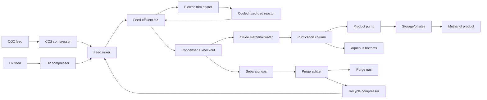

# Industrial catalyst choice for CO2 hydrogenation to methanol

## Executive answer

The laboratory ranking is **not a reliable predictor of the plant-selected operating point**. Across papers with enough within-paper alternatives, the plant optimum differed from the highest-productivity and highest-conversion laboratory point in **8/10 papers (80%)**; it differed from the highest-selectivity point in **4/10 (40%)**. At catalyst-family level the disagreement was smaller but still material: **2/8 (25%)** for productivity, **4/8 (50%)** for conversion, and **2/8 (25%)** for selectivity. The model costed **124 usable records from 12 papers**.

The least-cost individual record was **Ru/In2O3 at 200 °C** from DOI 10.1021/acscatal/2c06029, at **$934/t methanol**. The canonical sensitivity label for the winning family was In2O3, and it remained cheapest in **82/82** one-at-a-time cases; minimum rank Spearman correlation was **0.973**.

Across the observed catalyst dataset, **activity/productivity controlled 94.7% of one-at-a-time catalyst-property attribution**, versus 4.9% selectivity, 0.2% stability, 0.2% metal cost and 0.1% temperature. This does not mean selectivity is weak: at the reference point, +1 percentage point methanol selectivity changed cost by **$21.56/t**, while doubling activity changed it by **$16.15/t**. Activity dominates the observed ranking because reported productivity spans orders of magnitude; selectivity has the stronger local marginal effect because it changes hydrogen/CO2 consumption, CO accumulation, recycle, heating, separation and equipment together.

## 1. Literature search, screening and extraction

### Explicit screening criteria

- Included primary thermocatalytic gas-phase CO2 + H2 studies with catalyst identity, temperature, pressure, feed composition/ratio, and enough quantitative conversion, methanol selectivity and/or productivity to normalize a record.
- Favored multiple catalysts or temperatures, stability/time-on-stream data, open PDFs, and diversity across Cu/ZnO, In2O3, Pd/In, Co, Pt/MOF, Ru/In2O3 and promoted oxide families.
- Excluded reviews, process-only TEA/LCA, electrocatalysis/photocatalysis, homogeneous or DFT-only work, tandem methanol conversion, intentional CO cofeed without a pure CO2/H2 baseline, duplicate datasets, and records missing required numerical fields.
- Download cap: 18 PDFs were successfully parsed, below the limit of 20; 12 papers yielded usable records.

### Included papers and usable records

| DOI | Paper | Usable records |
|---|---|---:|
| 10.1007/s10562-016-1960-x | Methanol Synthesis from Industrial CO2 Sources: A Contribution to Chemical Energy Conversion | 16 |
| 10.1016/j.cej.2024.153204 | Cr as a promoter for the In2O3-catalyzed hydrogenation of CO2 to methanol | 16 |
| 10.1016/j.jcat.2016.03.017 | Pd/ZnO catalysts for direct CO2 hydrogenation to methanol | 30 |
| 10.1021/acscatal.2c06029 | Atomic Structural Origin of the High Methanol Selectivity over In2O3–Metal Interfaces: Metal–Support Interactions and the Formation of a InOx Overlayer in Ru/In2O3 Catalysts during CO2 Hydrogenation | 18 |
| 10.1021/jacs.9b10873 | Hydrogenation of CO2 to Methanol by Pt Nanoparticles Encapsulated in UiO-67: Deciphering the Role of the Metal–Organic Framework | 7 |
| 10.1038/s41467-019-09072-6 | Exploring the ternary interactions in Cu–ZnO–ZrO2 catalysts for efficient CO2 hydrogenation to methanol | 4 |
| 10.1038/s41467-019-11349-9 | Atomic-scale engineering of indium oxide promotion by palladium for methanol production via CO2 hydrogenation | 4 |
| 10.1038/s41467-020-14817-9 | Silica accelerates the selective hydrogenation of CO2 to methanol on cobalt catalysts | 9 |
| 10.1038/s41467-024-46513-3 | A Ce-CuZn catalyst with abundant Cu/Zn-OV-Ce active sites for CO2 hydrogenation to methanol | 6 |
| 10.1038/s41467-024-47447-6 | Low-nuclearity CuZn ensembles on ZnZrOx catalyze methanol synthesis from CO2 | 1 |
| 10.1038/s41467-025-63932-y | Metal organic framework derived In2O3/ZrO2 heterojunctions with interfacial oxygen vacancies for highly selective CO2-to-methanol hydrogenation | 1 |
| 10.1038/s41467-025-65929-z | Inverse In2O3-x/Ni interfaces via Ni3InC0.5 surface reconstruction for efficient CO2 hydrogenation to methanol | 12 |

### Parsed papers excluded after extraction

| Paper key | Extracted records | Reason |
|---|---:|---|
| 10_1021_acs_jpcc_5b12012 | 34 | Records lacked a required normalized conversion, selectivity, productivity, or feed/condition field. |
| 10_1021_acsomega_8b00211 | 22 | Records lacked a required normalized conversion, selectivity, productivity, or feed/condition field. |
| 10_1038_s41467_020_19438_w | 16 | Records lacked a required normalized conversion, selectivity, productivity, or feed/condition field. |
| 10_1038_s41467_022_33391_w | 13 | Records lacked a required normalized conversion, selectivity, productivity, or feed/condition field. |
| 10_1016_j_chempr_2019_10_023 | 0 | No in-scope quantitative pure-CO2/H2 catalyst records were extractable. |
| 10_1016_j_nanoen_2017_11_021 | 0 | No in-scope quantitative methanol catalyst records were extractable. |

### Search candidates excluded at screening

| DOI | Title | Screening reason |
|---|---|---|
| 10.1016/j.apenergy.2020.114672 | Wind power to methanol: Renewable methanol production using electricity, electrolysis of water and CO2 air capture | Process design and economic/energy assessment of wind-to-methanol production, not a primary catalyst reactor-performance study. |
| 10.1016/j.jcou.2020.101407 | Methanol synthesis through CO2 capture and hydrogenation: Thermal integration, energy performance and techno-economic assessment | Title indicates thermal integration, energy analysis, and techno-economic assessment rather than primary catalyst testing; no abstract is available. |
| 10.1016/j.cej.2020.127973 | How to make sustainable CO2 conversion to Methanol: Thermocatalytic versus electrocatalytic technology | Title suggests a comparative sustainability/technology assessment rather than a primary catalyst performance paper; no abstract is available. |
| 10.1016/j.rser.2019.03.022 | Renewable energy storage via CO2 and H2 conversion to methane and methanol: Assessment for small scale applications | Small-scale renewable-energy storage assessment, likely a review/process analysis rather than primary catalyst testing; no abstract is available. |
| 10.1007/s12274-021-3669-4 | Continuous dimethyl carbonate synthesis from CO2 and methanol over BixCe1−xOδ monoliths: Effect of bismuth doping on population of oxygen vacancies, activity, and reaction pathway | Produces dimethyl carbonate from CO2 and methanol rather than methanol from direct CO2 and H2 hydrogenation. |
| 10.1038/s41467-024-52168-x | Potential-driven structural distortion in cobalt phthalocyanine for electrocatalytic CO2/CO reduction towards methanol | Electrocatalytic CO2/CO reduction using cobalt phthalocyanine, outside thermocatalytic gas-phase hydrogenation. |
| 10.1016/j.jece.2022.107441 | Efficient photoelectrochemical conversion of CO2 to ethylene and methanol using a Cu cathode and TiO2 nanoparticles synthesized in supercritical medium as photoanode | Photoelectrochemical CO2 conversion, not thermocatalytic fixed-bed or comparable gas-phase CO2 + H2 hydrogenation. |
| 10.1016/j.cej.2015.08.101 | Novel efficient process for methanol synthesis by CO2 hydrogenation | Title emphasizes a methanol-synthesis process rather than catalyst testing, and no abstract is available to establish usable catalyst-level records. |
| 10.1016/j.nanoen.2017.11.021 | Optimum Cu nanoparticle catalysts for CO2 hydrogenation towards methanol | Density-functional-theory study of Cu cluster size and reaction intermediates without primary reactor-performance data. |
| 10.1016/j.apcatb.2022.121530 | A generalized machine learning framework to predict the space-time yield of methanol from thermocatalytic CO2 hydrogenation | Machine-learning framework trained to predict literature methanol space-time yields, not a primary experimental catalyst study. |
| 10.3390/catal12040403 | Catalytic Hydrogenation of CO2 to Methanol: A Review | Review article on catalytic CO2 hydrogenation to methanol. |
| 10.1016/j.cej.2022.134946 | Kinetic modelling of the methanol synthesis from CO2 and H2 over a CuO/CeO2/ZrO2 catalyst: The role of CO2 and CO hydrogenation | Identified as a conference poster rather than a full primary paper with an accessible, complete catalyst dataset. |
| 10.53894/ijirss.v3i2.31 | A brief review on the reaction mechanisms of CO2 hydrogenation into methanol | Brief review of CO2-to-methanol reaction mechanisms, not a primary experimental catalyst-performance study. |
| 10.1038/s41467-025-61851-6 | In-situ synthesis of interfacial In-O-Mn lewis acid-base pairs for low-temperature photothermal CO2 hydrogenation to methanol | Photothermal CO2 hydrogenation study, explicitly excluded under the photothermal-only criterion. |
| 10.1016/j.fuel.2023.128298 | Effect of water and methanol concentration in the feed on the deactivation of In2O3-ZrO2/SAPO-34 catalyst in the conversion of CO2/CO to olefins by hydrogenation | Tandem In2O3-ZrO2/SAPO-34 study targeting olefins from CO2, CO, or mixed feeds and examining deactivation under water/methanol co-feeding; tandem hydrocarbon products are excluded. |
| 10.3390/catal13111452 | Catalysis for CO2 Hydrogenation—What We Have Learned/Should Learn from the Hydrogenation of Syngas to Methanol | Review article rather than a primary experimental catalyst-performance study. |

## 2. Mechanism, kinetics and transfer to plant conditions

- **Reaction network:** desired CO2 + 3H2 → CH3OH + H2O plus a lumped RWGS selectivity byproduct CO2 + H2 → CO + H2O. Record selectivity partitions converted carbon between methanol and CO.
- **Activity transfer:** each measured productivity is converted to a far-from-equilibrium apparent productivity, `r0 = r_lab/(1-X_lab/Xeq)`. At a candidate plant conversion, `r = r0(1-X/Xeq)`, with a floor only for numerical feasibility. This prevents low-conversion tests from receiving an artificial activity advantage and enforces thermodynamic slowdown.
- **Deactivation:** reported time to 10% activity loss determines replacement; otherwise 16,000 h is used with 4,000–40,000 h sensitivity. Average cycle activity is 0.95.
- **Important limitation:** the contract and independent heat gate define reactor duty for the contracted methanol reaction. CO/RWGS is represented in carbon, hydrogen, water, purge and recycle balances, but secondary-reaction heat is not independently parameterized across the heterogeneous literature corpus.

## 3. Reactor and flowsheet

A cooled multitubular fixed bed was selected because methanol synthesis is exothermic and equilibrium-limited. For every record the plant keeps the reported temperature and pressure, but jointly optimizes per-pass conversion and purge fraction. The accepted flowsheet hash is `bddd395cdce159ff`.

Represented units: both fresh-feed compressors, mixer, feed-effluent exchanger, trim heater, cooled reactor, condenser/knockout, purge splitter, recycle compressor, methanol-water purification, product pump and storage/offsites. Catalyst regeneration is excluded because the corpus did not provide a transferable regeneration protocol; replacement is costed instead.

## 4. Economic and physical model

- Basis: 100,000 t/y final stored methanol, 8,000 h/y; gate-to-gate synthesis island. Upstream CO2 capture and H2 production enter through fixed transfer prices.
- The model closes C/H/O and total mass balances, enforces equilibrium, calculates fresh-feed and recycle compression from stream flows, computes heat recovery and residual cooling without double counting, and scales unit capital from each unit load.
- Methanol recovery is 99.5%; cost denominator is exactly 1.000 t final methanol. The boundary also reports 0.005 t/t methanol loss in aqueous bottoms for mass closure.
- Catalyst inventory is production rate divided by transferred productivity and average activity. Catalyst price is support/manufacturing plus price-table metal values at reported loadings; missing loadings use a 10 wt% total active-component proxy with 1–30 wt% sensitivity.
- Annualized capital uses the fixed-table capital recovery factor and fixed O&M fraction. Electricity, H2, CO2, catalyst support and elemental metal prices all come from `prices.json` and were not changed.

## 5. Reference plant

Reference catalyst: published commercial Cu/ZnO/Al2O3 record at 493 K and 30 bar. Optimized per-pass conversion: 0.1142. Total cost: **$1592.60/t**.

| Cost part | USD/t | Share |
|---|---:|---:|
| feed | 1081.83 | 67.9% |
| energy | 287.07 | 18.0% |
| capital | 208.18 | 13.1% |
| catalyst | 15.53 | 1.0% |
| other | 0.00 | 0.0% |

Feed is the largest part at **67.9%**, so even large catalyst improvements are attenuated by the stoichiometric H2/CO2 cost floor. Reference purchased energy is **12.92 GJ/t**, and **28/124** literature records cost less than the reference.

## 6. Plant ranking

### Ten lowest-cost operating records

| Rank | Catalyst | DOI key | T (°C) | P (bar) | Lab X | Lab S | Productivity | Plant X/pass | Cost (USD/t) |
|---:|---|---|---:|---:|---:|---:|---:|---:|---:|
| 1 | Ru/In2O3 | 10_1021_acscatal_2c06029 | 200 | 50 | 0.005 | 1.000 | 76.4 | 0.227 | 934 |
| 2 | In2O3 | 10_1021_acscatal_2c06029 | 200 | 50 | 0.001 | 1.000 | 15.3 | 0.216 | 949 |
| 3 | Ru/In2O3 | 10_1021_acscatal_2c06029 | 225 | 50 | 0.015 | 0.910 | 214 | 0.180 | 1043 |
| 4 | 0.75 wt.% Pd-In2O3 prepared by co-precipitation (CP) | 10_1038_s41467_019_11349_9 | 280 | 50 | 0.030 | 0.970 | 1.35e+03 | 0.111 | 1076 |
| 5 | In2O3 | 10_1021_acscatal_2c06029 | 225 | 50 | 0.005 | 0.840 | 61.2 | 0.180 | 1118 |
| 6 | Deg In-Zr (3:8) | 10_1038_s41467_025_63932_y | 220 | 40 | 0.278 | 0.814 | 2.64 | 0.129 | 1144 |
| 7 | Ru/In2O3 | 10_1021_acscatal_2c06029 | 250 | 50 | 0.038 | 0.850 | 489 | 0.143 | 1147 |
| 8 | In2O3 | 10_1038_s41467_019_11349_9 | 280 | 50 | 0.030 | 0.890 | 262 | 0.111 | 1162 |
| 9 | M-CZZ(16) 3DOM Cu-ZnO-ZrO2 (Cu/Zn/Zr molar ratio 5:2:3) | 10_1038_s41467_019_09072_6 | 220 | 30 | 0.182 | 0.802 | 0.305 | 0.102 | 1189 |
| 10 | Cu-ZnZrOx | 10_1038_s41467_024_47447_6 | 300 | 50 | 0.090 | 0.900 | 0.55 | 0.094 | 1208 |

### Ranking disagreement with laboratory metrics

| Laboratory metric | Point-level changes | Catalyst-level changes | Median regret when changed | Main type of point change |
|---|---:|---:|---:|---|
| productivity | 8/10 (80%) | 2/8 (25%) | 31.3% | same catalyst, other temperature: 6, other catalyst: 2 |
| conversion | 8/10 (80%) | 4/8 (50%) | 128.4% | same catalyst, other temperature: 4, other catalyst: 4 |
| selectivity | 4/10 (40%) | 2/8 (25%) | 30.6% | other catalyst: 2, same catalyst, other temperature: 2 |

The ranking changes most often at the **operating-condition level**: a higher-temperature point may show greater conversion or productivity in the laboratory yet lose in the plant because equilibrium conversion falls, recycle and preheat rise, and selectivity can deteriorate. At catalyst level, conversion is the weakest standalone predictor because a conversion number conflates residence time, equilibrium approach and activity.

### Why effects are attenuated

- **Feedstock floor:** H2 and CO2 dominate total cost, limiting the value of extra activity once catalyst and reactor costs are small.
- **Equilibrium:** higher temperature can raise intrinsic rate but lowers feasible per-pass methanol conversion; the plant optimizes below equilibrium rather than reproducing lab conversion.
- **Recycle/purge:** poor selectivity generates CO, which accumulates in recycle unless purged; this increases fresh H2/CO2 loss, compressor load, sensible heating and equipment size.
- **Separation:** water production is unavoidable and poor selectivity increases water per tonne methanol; methanol-water purification and dissolved-CO2 stabilization reduce the benefit of high apparent conversion.
- **Equipment:** activity primarily reduces catalyst inventory and reactor volume. Once those are a minority of cost, further activity improvements have diminishing economic value.
- **Stability and metal:** they contribute little in this corpus because catalyst replacement is a small reference cost share and many papers omit industrial-duration deactivation/loadings; this is an evidence limitation, not proof that they never matter.

## 7. Deterministic sensitivity

All 82 sourced ranges, assumptions and price-table ranges were perturbed one at a time. The cheapest family remained unchanged in 82/82 cases.

| Parameter | Kind | Low cost | High cost | Reference swing | Cheapest changes? | Minimum Spearman |
|---|---|---:|---:|---:|---|---:|
| price.hydrogen | price_table | 1178 | 2657 | 92.9% | no | 0.998 |
| price.carbon_dioxide | price_table | 1380 | 1857 | 30.0% | no | 0.999 |
| price.electricity | price_table | 1445 | 1837 | 24.6% | no | 0.999 |
| thermo.equilibrium_reaction_entropy_J_per_mol_K | assumption | 1763 | 1489 | 17.2% | no | 0.973 |
| heat_recovery.feed_effluent_fraction | assumption | 1684 | 1492 | 12.0% | no | 0.999 |
| thermo.equilibrium_reaction_heat_kJ_per_mol | assumption | 1533 | 1666 | 8.4% | no | 0.984 |
| basis.feeds.H2.P_bar | assumption | 1618 | 1506 | 7.0% | no | 1.000 |
| capital.heat_exchanger_USD_per_kW | assumption | 1556 | 1662 | 6.6% | no | 1.000 |
| thermo.gas_cp_GJ_per_kmol_K | assumption | 1557 | 1640 | 5.2% | no | 1.000 |
| price.capital_recovery_factor | price_table | 1570 | 1647 | 4.8% | no | 1.000 |
| basis.capacity_t_per_y | assumption | 1621 | 1551 | 4.4% | no | 1.000 |
| capital.compressor_USD_per_kW | assumption | 1570 | 1638 | 4.3% | no | 1.000 |
| price.fixed_om_fraction_of_capex | price_table | 1562 | 1623 | 3.9% | no | 1.000 |
| price.catalyst_support_and_manufacturing | price_table | 1581 | 1638 | 3.6% | no | 0.994 |
| capital.reference_capacity_t_per_y | assumption | 1625 | 1571 | 3.4% | no | 1.000 |
| recycle.purge_min_fraction | assumption | 1593 | 1645 | 3.3% | no | 0.995 |
| capital.knockout_reference_USD | assumption | 1579 | 1630 | 3.2% | no | 1.000 |
| capital.reactor_volume_reference_USD | assumption | 1578 | 1625 | 3.0% | no | 0.999 |
| catalyst.default_life_h | assumption | 1630 | 1583 | 2.9% | no | 0.977 |
| capital.reactor_reference_m3 | assumption | 1623 | 1577 | 2.8% | no | 0.999 |
| capital.scale_exponent | assumption | 1578 | 1622 | 2.7% | no | 1.000 |
| basis.feeds.CO2.P_bar | assumption | 1602 | 1559 | 2.7% | no | 1.000 |
| capital.reference_gas_kmol_per_t | assumption | 1618 | 1578 | 2.6% | no | 1.000 |
| compressor.isentropic_efficiency | assumption | 1615 | 1576 | 2.5% | no | 1.000 |
| recycle.pressure_drop_fraction | assumption | 1579 | 1617 | 2.4% | no | 1.000 |
| capital.offsites_fraction_direct | assumption | 1583 | 1620 | 2.3% | no | 1.000 |
| separation.methanol_recovery | assumption | 1616 | 1586 | 1.9% | no | 1.000 |
| separation.distillation_base_GJ_per_t_methanol | assumption | 1584 | 1610 | 1.7% | no | 1.000 |
| basis.feeds.CO2.T_K | assumption | 1603 | 1577 | 1.7% | no | 1.000 |
| capital.column_reference_USD | assumption | 1586 | 1606 | 1.3% | no | 1.000 |
| basis.operating_hours_per_y | assumption | 1602 | 1586 | 1.0% | no | 1.000 |
| capital.reactor_fixed_USD | assumption | 1589 | 1603 | 0.9% | no | 1.000 |
| catalyst.bulk_density_kg_per_m3 | assumption | 1601 | 1588 | 0.8% | no | 1.000 |
| capital.offsites_fixed_USD | assumption | 1589 | 1602 | 0.8% | no | 1.000 |
| capital.mixer_reference_USD | assumption | 1590 | 1602 | 0.8% | no | 1.000 |
| utilities.cooling_electricity_fraction | assumption | 1589 | 1601 | 0.7% | no | 1.000 |
| capital.splitter_reference_USD | assumption | 1591 | 1599 | 0.5% | no | 1.000 |
| separation.dissolved_CO2_fraction_of_reactor_feed | assumption | 1591 | 1599 | 0.5% | no | 1.000 |
| basis.feeds.H2.T_K | assumption | 1590 | 1597 | 0.5% | no | 1.000 |
| compressor.gamma_H2 | assumption | 1588 | 1594 | 0.4% | no | 1.000 |
| capital.reference_liquid_kmol_per_t | assumption | 1596 | 1590 | 0.4% | no | 1.000 |
| capital.reactor_heat_removal_USD_per_kW | assumption | 1591 | 1596 | 0.3% | no | 1.000 |
| basis.feeds.CO2.purity_mol_frac | assumption | 1597 | 1592 | 0.3% | no | 1.000 |
| compressor.gamma_CO2 | assumption | 1591 | 1595 | 0.3% | no | 1.000 |
| basis.feeds.H2.purity_mol_frac | assumption | 1596 | 1592 | 0.3% | no | 1.000 |
| catalyst.average_activity_factor | assumption | 1594 | 1591 | 0.2% | no | 1.000 |
| offsites.energy_GJ_per_t | assumption | 1592 | 1594 | 0.1% | no | 1.000 |
| capital.pump_reference_USD | assumption | 1592 | 1594 | 0.1% | no | 1.000 |
| catalyst.unspecified_active_fraction | assumption | 1592 | 1594 | 0.1% | no | 0.999 |
| basis.utilities.cooling_water_supply_temperature | assumption | 1592 | 1593 | 0.1% | no | 1.000 |
| price.metal_Cu | price_table | 1592 | 1593 | 0.0% | no | 1.000 |
| thermo.methanol_reaction_heat_kJ_per_mol | assumption | 1593 | 1592 | 0.0% | no | 1.000 |
| separation.stabilization_GJ_per_kmol_dissolved_CO2 | assumption | 1593 | 1593 | 0.0% | no | 1.000 |
| price.metal_Zn | price_table | 1593 | 1593 | 0.0% | no | 1.000 |
| compressor.gamma_recycle | assumption | 1593 | 1593 | 0.0% | no | 1.000 |
| basis.product.CH3OH.P_bar | assumption | 1593 | 1593 | 0.0% | no | 1.000 |
| pump.column_outlet_pressure_bar | assumption | 1593 | 1593 | 0.0% | no | 1.000 |
| pump.isentropic_efficiency | assumption | 1593 | 1593 | 0.0% | no | 1.000 |
| pump.methanol_density_kg_per_m3 | assumption | 1593 | 1593 | 0.0% | no | 1.000 |
| recycle.purge_max_fraction | assumption | 1593 | 1593 | 0.0% | no | 1.000 |
| basis.product.CH3OH.purity_mol_frac | assumption | 1593 | 1593 | 0.0% | no | 1.000 |
| basis.utilities.cooling_water_return_temperature | assumption | 1593 | 1593 | 0.0% | no | 1.000 |
| basis.utilities.low_pressure_steam_pressure | assumption | 1593 | 1593 | 0.0% | no | 1.000 |
| price.metal_Zr | price_table | 1593 | 1593 | 0.0% | no | 1.000 |
| price.metal_In | price_table | 1593 | 1593 | 0.0% | no | 1.000 |
| price.metal_Pd | price_table | 1593 | 1593 | 0.0% | no | 0.995 |
| price.metal_Pt | price_table | 1593 | 1593 | 0.0% | no | 1.000 |
| price.metal_Co | price_table | 1593 | 1593 | 0.0% | no | 1.000 |
| price.metal_Au | price_table | 1593 | 1593 | 0.0% | no | 1.000 |
| price.metal_Rh | price_table | 1593 | 1593 | 0.0% | no | 1.000 |
| price.metal_Ni | price_table | 1593 | 1593 | 0.0% | no | 1.000 |
| price.metal_Sn | price_table | 1593 | 1593 | 0.0% | no | 1.000 |
| price.metal_Cr | price_table | 1593 | 1593 | 0.0% | no | 1.000 |
| price.metal_Ce | price_table | 1593 | 1593 | 0.0% | no | 1.000 |
| price.metal_Al | price_table | 1593 | 1593 | 0.0% | no | 1.000 |
| price.metal_Si | price_table | 1593 | 1593 | 0.0% | no | 1.000 |
| price.metal_Ga | price_table | 1593 | 1593 | 0.0% | no | 1.000 |
| price.metal_Fe | price_table | 1593 | 1593 | 0.0% | no | 1.000 |
| capital.compressor_min_USD | assumption | 1593 | 1593 | 0.0% | no | 1.000 |
| capital.heat_exchanger_min_USD | assumption | 1593 | 1593 | 0.0% | no | 1.000 |
| thermo.rwgs_reaction_heat_kJ_per_mol | assumption | 1593 | 1593 | 0.0% | no | 1.000 |
| thermo.reaction_heat_temperature_coefficient_kJ_per_mol_K | assumption | 1593 | 1593 | 0.0% | no | 1.000 |

The largest absolute cost uncertainty is hydrogen price (92.9% reference-cost swing), followed by CO2 price and electricity price. The largest process-model uncertainty is equilibrium thermodynamics, followed by heat recovery. These change the cost level much more than the ordering: even the minimum rank correlation is 0.973 and the winner does not change.

## 8. Open evidence debts retained as uncertainty

- **basis.feeds.CO2.P_bar** — CO2 can cross the synthesis-island boundary near atmospheric pressure after capture or above 100 bar after pipeline compression; retaining 0.5–30 bar isolates this battery-limit allocation and lets sensitivity show whether upstream compression materially changes catalyst choice. Evidence searched: NETL CO2 Compression process documentation states captured CO2 is compressed from atmospheric pressure to 15.2 MPa for pipelines; NETL CO2 Compression webpage gives 1,500–2,200 psi transport pressure.
- **basis.feeds.H2.P_bar** — Hydrogen delivery pressure depends on the electrolyzer and storage interface; retaining 0.5–30 bar covers low-pressure merchant supply through pressurized PEM output while making the boundary-pressure penalty explicit in sensitivity. Evidence searched: DOE Hydrogen Shot Water Electrolysis Technology Assessment (2024) and pressurized PEM electrolyzer specifications report hydrogen delivery near 30 bar, while unpressurized production remains possible.
- **recycle.purge_min_fraction** — The minimum feasible purge depends on CO formation selectivity and allowable loop accumulation, which differ sharply among catalysts; the 0.2–2% bound remains uncertain and is optimized jointly with conversion rather than fixed at a literature flowsheet value. Evidence searched: Campos et al., Processes 2022, DOI 10.3390/pr10081535, demonstrates that recycle flow changes strongly with single-pass conversion; no universal purge fraction is transferable across the catalyst records.
- **heat_recovery.feed_effluent_fraction** — Heat recovery is configuration-specific and depends on temperature approach, recycle flow, fouling and startup bypass; the 0.60–0.90 range is retained because published integrated methanol studies report system savings rather than one universal exchanger effectiveness. Evidence searched: Methanol synthesis through CO2 capture and hydrogenation: Thermal integration and economic assessment reports 81% heating-demand reduction; published feed-effluent exchanger examples report large but flowsheet-specific recovered duties.
- **thermo.gas_cp_GJ_per_kmol_K** — A single loop-average heat capacity necessarily varies with temperature and CO-rich recycle composition; 28–40 kJ kmol−1 K−1 is retained to bracket NIST species heat capacities over the modeled range and expose the reduced-order approximation. Evidence searched: NIST Chemistry WebBook SRD 69, DOI 10.18434/T4D303, gas-phase heat-capacity tables for H2, CO2, CO, H2O and methanol.
- **thermo.equilibrium_reaction_entropy_J_per_mol_K** — The effective constant entropy substitutes for temperature-dependent heat capacities and nonideal fugacity coefficients, so it is deliberately retained as an uncertainty rather than claimed as a fundamental constant across 400–600 K and 1–50 bar. Evidence searched: NIST Chemistry WebBook SRD 69 DOI 10.18434/T4D303 provides species thermochemistry; equilibrium studies such as DOI 10.1007/s11814-022-1302-1 explicitly treat temperature and pressure dependence.
- **thermo.equilibrium_reaction_heat_kJ_per_mol** — The gas-phase equilibrium enthalpy is represented by a constant only to transfer one-point laboratory activity records; retaining −52 to −47 kJ mol−1 quantifies this approximation separately from the reactor-duty thermochemistry. Evidence searched: NIST Chemistry WebBook SRD 69 DOI 10.18434/T4D303 provides reaction thermochemistry and species heat-capacity data; DOI 10.1007/s11814-022-1302-1 discusses CO2-to-methanol equilibrium.

## 9. What the evidence could not support

- A universal elementary-step or Langmuir–Hinshelwood kinetic model across Cu, In, Pd, Ru, Co, Pt and MOF-derived catalysts; most records are one-point or sparse temperature series.
- Reliable industrial deactivation/regeneration models for most catalysts; short laboratory time-on-stream is not equivalent to multi-year catalyst life.
- Complete catalyst formulations and shaped-pellet properties for every record; the component-cost model therefore carries an explicit missing-loading uncertainty.
- A rigorous nonideal equation of state and full methanol/water/CO2 distillation design for every optimized record. The model uses an equilibrium surrogate and load-dependent separation correlations, both exposed to sensitivity.
- Scale-up penalties for pellet diffusion, thermal gradients, poisoning, catalyst shaping and mechanical strength. Literature powder productivity is therefore optimistic unless those effects are already reflected in the reported rate.
- Cross-paper absolute comparability free from analytical and reactor-protocol bias. Paper bootstrap and within-paper ranking comparisons reduce but cannot eliminate this limitation.

## 10. Parameter ledger

The complete `sources.csv` ledger is reproduced below. `price_table` rows are fixed by `prices.json`; assumptions include explicit low/high bounds.

| Parameter | Value | Unit | Type | Source | Location | Low | High |
|---|---:|---|---|---|---|---:|---:|
| basis.capacity_t_per_y | 100000 | t/y | assumption | basis.json | capacity_t_per_y | 50000 | 500000 |
| basis.operating_hours_per_y | 8000 | h/y | assumption | basis.json | operating_hours_per_y | 7500 | 8400 |
| basis.feeds.CO2.T_K | 298.15 | K | assumption | basis.json | feeds.CO2.T_K | 288.15 | 313.15 |
| basis.feeds.CO2.P_bar | 0.9 | bar | assumption | basis.json | feeds.CO2.P_bar | 0.5 | 30 |
| basis.feeds.CO2.purity_mol_frac | 0.995 | fraction | assumption | basis.json | feeds.CO2.purity_mol_frac | 0.98 | 0.999 |
| basis.feeds.H2.T_K | 298.15 | K | assumption | basis.json | feeds.H2.T_K | 288.15 | 313.15 |
| basis.feeds.H2.P_bar | 0.9 | bar | assumption | basis.json | feeds.H2.P_bar | 0.5 | 30 |
| basis.feeds.H2.purity_mol_frac | 0.999 | fraction | assumption | basis.json | feeds.H2.purity_mol_frac | 0.995 | 0.9999 |
| basis.product.CH3OH.P_bar | 2 | bar | assumption | basis.json | product.CH3OH.P_bar | 1 | 5 |
| basis.product.CH3OH.purity_mol_frac | 0.999 | fraction | assumption | basis.json | product.CH3OH.purity_mol_frac | 0.995 | 0.9999 |
| basis.utilities.cooling_water_supply_temperature | 298.15 | K | assumption | basis.json | utilities.cooling_water_supply_temperature | 288.15 | 303.15 |
| basis.utilities.cooling_water_return_temperature | 313.15 | K | assumption | basis.json | utilities.cooling_water_return_temperature | 308.15 | 323.15 |
| basis.utilities.low_pressure_steam_pressure | 4 | bar | assumption | basis.json | utilities.low_pressure_steam_pressure | 3 | 10 |
| price.electricity | 80 | USD/MWh | price_table | prices.json:electricity | prices.electricity | 40 | 150 |
| price.hydrogen | 3 | USD/kg | price_table | prices.json:hydrogen | prices.hydrogen | 1.5 | 7 |
| price.carbon_dioxide | 100 | USD/t | price_table | prices.json:carbon_dioxide | prices.carbon_dioxide | 20 | 200 |
| price.catalyst_support_and_manufacturing | 20 | USD/kg | price_table | prices.json:catalyst_support_and_manufacturing | prices.catalyst_support_and_manufacturing | 5 | 100 |
| price.metal_Cu | 13.889122517655 | USD/kg | price_table | prices.json:metal_Cu | prices.metal_Cu | 6.9445612588275 | 27.77824503531 |
| price.metal_Zn | 3.2849 | USD/kg | price_table | prices.json:metal_Zn | prices.metal_Zn | 1.64245 | 6.5698 |
| price.metal_Zr | 22 | USD/kg | price_table | prices.json:metal_Zr | prices.metal_Zr | 11 | 44 |
| price.metal_In | 370 | USD/kg | price_table | prices.json:metal_In | prices.metal_In | 185 | 740 |
| price.metal_Pd | 40670.694409279 | USD/kg | price_table | prices.json:metal_Pd | prices.metal_Pd | 20335.3472046395 | 81341.388818558 |
| price.metal_Pt | 51508.71107755406 | USD/kg | price_table | prices.json:metal_Pt | prices.metal_Pt | 25754.35553877703 | 103017.42215510811 |
| price.metal_Co | 56.28401553583051 | USD/kg | price_table | prices.json:metal_Co | prices.metal_Co | 28.142007767915256 | 112.56803107166103 |
| price.metal_Au | 128732.2322756058 | USD/kg | price_table | prices.json:metal_Au | prices.metal_Au | 64366.1161378029 | 257464.4645512116 |
| price.metal_Rh | 265243.65919095 | USD/kg | price_table | prices.json:metal_Rh | prices.metal_Rh | 132621.829595475 | 530487.3183819 |
| price.metal_Ni | 16.9094555095895 | USD/kg | price_table | prices.json:metal_Ni | prices.metal_Ni | 8.45472775479475 | 33.818911019179 |
| price.metal_Sn | 35.274 | USD/kg | price_table | prices.json:metal_Sn | prices.metal_Sn | 17.637 | 70.548 |
| price.metal_Cr | 13.007 | USD/kg | price_table | prices.json:metal_Cr | prices.metal_Cr | 6.5035 | 26.014 |
| price.metal_Ce | 2.1005306603773586 | USD/kg | price_table | prices.json:metal_Ce | prices.metal_Ce | 1.0502653301886793 | 4.201061320754717 |
| price.metal_Al | 3.9683 | USD/kg | price_table | prices.json:metal_Al | prices.metal_Al | 1.98415 | 7.9366 |
| price.metal_Si | 2.866006 | USD/kg | price_table | prices.json:metal_Si | prices.metal_Si | 1.433003 | 5.732012 |
| price.metal_Ga | 580 | USD/kg | price_table | prices.json:metal_Ga | prices.metal_Ga | 290 | 1160 |
| price.metal_Fe | 8 | USD/kg | price_table | prices.json:metal_Fe | prices.metal_Fe | 4 | 16 |
| price.capital_recovery_factor | 0.0944 | 1/y | price_table | prices.json:capital_recovery_factor | prices.capital_recovery_factor | 0.08 | 0.13 |
| price.fixed_om_fraction_of_capex | 0.04 | 1/y | price_table | prices.json:fixed_om_fraction_of_capex | prices.fixed_om_fraction_of_capex | 0.02 | 0.06 |
| compressor.isentropic_efficiency | 0.75 | fraction | assumption |  | industrial compressor design basis | 0.65 | 0.85 |
| compressor.gamma_CO2 | 1.30 | ratio | assumption |  | ideal-gas engineering approximation | 1.25 | 1.35 |
| compressor.gamma_H2 | 1.40 | ratio | assumption |  | ideal-gas engineering approximation | 1.35 | 1.42 |
| compressor.gamma_recycle | 1.35 | ratio | assumption |  | mixed-gas engineering approximation | 1.28 | 1.40 |
| recycle.pressure_drop_fraction | 0.05 | fraction | assumption |  | reactor-loop pressure-drop allowance | 0.02 | 0.10 |
| recycle.purge_min_fraction | 0.005 | fraction | assumption |  | optimization bound preventing inert accumulation | 0.002 | 0.02 |
| recycle.purge_max_fraction | 0.20 | fraction | assumption |  | optimization bound limiting reactant loss | 0.10 | 0.40 |
| separation.methanol_recovery | 0.995 | fraction | assumption |  | column recovery design target | 0.98 | 0.999 |
| separation.dissolved_CO2_fraction_of_reactor_feed | 0.001 | fraction | assumption |  | pressure-dependent liquid entrainment proxy | 0.0001 | 0.005 |
| heat_recovery.feed_effluent_fraction | 0.75 | fraction | assumption |  | temperature-approach and fouling allowance | 0.60 | 0.90 |
| thermo.gas_cp_GJ_per_kmol_K | 0.000033 | GJ/kmol/K | assumption |  | mean syngas heat-capacity approximation | 0.000028 | 0.000040 |
| utilities.cooling_electricity_fraction | 0.025 | GJ electricity/GJ removed | assumption |  | cooling-water pumping and fan allowance | 0.01 | 0.06 |
| separation.distillation_base_GJ_per_t_methanol | 1.2 | GJ/t | assumption |  | methanol-water purification duty allowance | 0.8 | 2.0 |
| separation.stabilization_GJ_per_kmol_dissolved_CO2 | 0.02 | GJ/kmol | assumption |  | dissolved-CO2 flashing and stabilization heat proxy | 0.01 | 0.05 |
| pump.column_outlet_pressure_bar | 1.2 | bar | assumption |  | purification-column liquid outlet pressure | 1.0 | 1.8 |
| offsites.energy_GJ_per_t | 0.05 | GJ/t | assumption |  | storage and balance-of-plant electricity allowance | 0.02 | 0.12 |
| catalyst.default_life_h | 16000 | h | assumption |  | two-year continuous-service assumption | 4000 | 40000 |
| catalyst.average_activity_factor | 0.95 | fraction | assumption |  | linear decline to ten percent activity loss over a cycle | 0.90 | 1.0 |
| catalyst.unspecified_active_fraction | 0.10 | mass fraction | assumption |  | cost proxy where paper omits component loading | 0.01 | 0.30 |
| capital.scale_exponent | 0.60 | dimensionless | assumption |  | six-tenths scaling rule | 0.50 | 0.75 |
| capital.compressor_USD_per_kW | 2000 | USD/kW | assumption |  | installed compressor cost allowance | 1000 | 4000 |
| capital.compressor_min_USD | 1000000 | USD | assumption |  | minimum installed compressor train cost | 500000 | 3000000 |
| capital.mixer_reference_USD | 500000 | USD | assumption |  | installed mixing and piping allowance | 200000 | 1500000 |
| capital.heat_exchanger_USD_per_kW | 500 | USD/kW | assumption |  | installed high-pressure exchanger allowance | 250 | 1000 |
| capital.heat_exchanger_min_USD | 750000 | USD | assumption |  | minimum installed exchanger cost | 300000 | 2000000 |
| capital.reactor_fixed_USD | 5000000 | USD | assumption |  | high-pressure cooled reactor fixed allowance | 2500000 | 12000000 |
| capital.reactor_volume_reference_USD | 5000000 | USD | assumption |  | reactor volume-dependent reference allowance | 2000000 | 12000000 |
| capital.reactor_heat_removal_USD_per_kW | 300 | USD/kW | assumption |  | boiling-water cooling surface allowance | 150 | 700 |
| catalyst.bulk_density_kg_per_m3 | 1000 | kg/m3 | assumption |  | shaped catalyst bulk-density assumption | 600 | 1400 |
| capital.knockout_reference_USD | 3000000 | USD | assumption |  | condenser and high-pressure separator reference cost | 1500000 | 7000000 |
| capital.splitter_reference_USD | 300000 | USD | assumption |  | purge control and piping allowance | 100000 | 1000000 |
| capital.column_reference_USD | 8000000 | USD | assumption |  | methanol purification column reference cost | 4000000 | 16000000 |
| capital.pump_reference_USD | 500000 | USD | assumption |  | product pump installed allowance | 200000 | 1500000 |
| capital.offsites_fixed_USD | 5000000 | USD | assumption |  | storage and utility fixed allowance | 2500000 | 12000000 |
| capital.offsites_fraction_direct | 0.10 | fraction | assumption |  | balance-of-plant fraction of direct equipment cost | 0.05 | 0.25 |
| capital.reference_capacity_t_per_y | 100000 | t/y | assumption |  | cost-correlation reference capacity | 50000 | 200000 |
| capital.reference_gas_kmol_per_t | 200 | kmol/t | assumption |  | cost-correlation reference recycle throughput | 80 | 500 |
| capital.reference_liquid_kmol_per_t | 70 | kmol/t | assumption |  | cost-correlation reference crude-liquid throughput | 50 | 100 |
| thermo.methanol_reaction_heat_kJ_per_mol | -58.7 | kJ/mol | assumption |  | effective fixed-thermochemistry heat at 493 K for contracted methanol reaction | -62 | -55 |
| thermo.rwgs_reaction_heat_kJ_per_mol | 41.2 | kJ/mol | assumption |  | standard reverse-water-gas-shift heat approximation | 38 | 43 |
| thermo.equilibrium_reaction_entropy_J_per_mol_K | -194.5 | J/mol/K | assumption |  | effective gas-phase equilibrium entropy including heat-capacity correction | -205 | -185 |
| thermo.equilibrium_reaction_heat_kJ_per_mol | -49.5 | kJ/mol | assumption |  | gas-phase equilibrium enthalpy approximation | -52 | -47 |
| capital.reactor_reference_m3 | 20 | m3 | assumption |  | reference packed catalyst volume for scaling | 5 | 100 |
| thermo.reaction_heat_temperature_coefficient_kJ_per_mol_K | -0.055 | kJ/mol/K | assumption |  | linear heat-capacity correction over catalyst test temperatures | -0.08 | -0.03 |
| pump.isentropic_efficiency | 0.70 | fraction | assumption |  | liquid pump efficiency allowance | 0.55 | 0.85 |
| pump.methanol_density_kg_per_m3 | 792 | kg/m3 | assumption |  | ambient liquid methanol density approximation | 760 | 810 |

## 11. Reproducibility and checks

- `flowsheet.json` passed submission; accepted hash `bddd395cdce159ff`.
- `model.py` passed the contract and independent physics checks on the reference and all 124 usable records: elements, mass, equilibrium, heat, compression, separation, unit accounting, finite cost, parts sum, conversion range, stoichiometry, monotonicity and determinism.
- Analysis artifacts: `costs.csv`, `analysis.json`, `sensitivity.json`, `evidence_debt.json`, `sources.csv`, `basis.json`, `flowsheet.json`, and `model.py`.