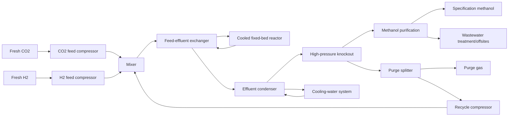

# Industrial economic model and catalyst choice for CO2 hydrogenation to methanol

**Date:** 13 November 2026  
**Reaction:** CO2 + 3 H2 → CH3OH + H2O  
**Model artifacts:** `model.py`, `basis.json`, `flowsheet.json`, `sources.csv`, `costs.csv`, `analysis.json`, `sensitivity.json`  
**Validated model hash:** bd5c81ebc044d60c

## Executive answer

The laboratory ranking is **not a reliable predictor of the plant choice**. Across the 10 papers and 116 usable operating points, the plant-optimal operating point differed from the highest-productivity laboratory point in **7/10 papers (70%, bootstrap 95% CI 40–100%)**, from the highest-conversion point in **8/10 (80%, 50–100%)**, and from the highest-selectivity point in **3/10 (30%, 0–60%)**. At catalyst level, productivity and conversion rankings each changed in **4/10 papers**, while selectivity changed in only **1/10**.

The modeled plant chooses **Ru/In2O3 reported at 200 °C** from DOI 10.1021/acscatal.2c06029, at **$914.90/t CH3OH**, versus **$1230.13/t** for the defined reference. This winner is driven by the extracted 100% methanol selectivity and high productivity, not by its very low reported single-pass conversion. It must be treated cautiously because the point has only 0.5% laboratory conversion and no plant-duration stability evidence.

The controlling catalyst property is **methanol selectivity**: one-at-a-time attribution assigns **90.1%** of modeled cross-record cost variation to selectivity, versus 4.0% activity, 3.9% metal composition, 1.5% stability and 0.5% temperature. Feed cost is the largest reference contribution (77.2%), so every carbon atom sent to CO through RWGS also carries avoidable H2/CO2 purchase, purge and recycle penalties. Activity is attenuated because it mainly changes catalyst inventory and reactor capital, which together are much smaller than feed cost; laboratory conversion is attenuated by equilibrium-constrained optimization and recycle.

## 1. Literature search, screening and exclusions

OpenAlex searches targeted primary heterogeneous thermal CO2/H2 methanol experiments. Explicit inclusion required T, P, feed composition, CO2 conversion, methanol selectivity, and reported or derivable kg CH3OH kg-catalyst−1 h−1. Reviews, simulations-only studies, homogeneous/electro/photo routes, tandem products, surface-science-only work and records lacking the quantitative fields were excluded.

Twenty download slots were used: 15 papers were successfully parsed and extracted, and 10 papers produced usable records. The intended 12-paper target could not be reached without inventing productivity or exceeding the download cap. The final evidence base is **116 usable records from 10 papers**.

### Extracted-paper usability

| paper | records | usable |
| --- | --- | --- |
| 10_1016_j_jcat_2016_03_017 | 34 | 30 |
| 10_1021_acscatal_2c06029 | 20 | 15 |
| 10_1021_acscatal_6c02907 | 7 | 0 |
| 10_1021_jacs_9b10873 | 13 | 0 |
| 10_1038_s41467_019_09072_6 | 4 | 4 |
| 10_1038_s41467_019_11349_9 | 7 | 5 |
| 10_1038_s41467_020_14817_9 | 40 | 31 |
| 10_1038_s41467_020_19438_w | 11 | 5 |
| 10_1038_s41467_020_19634_8 | 5 | 5 |
| 10_1038_s41467_021_22224_x | 10 | 7 |
| 10_1038_s41467_022_33391_w | 10 | 0 |
| 10_1038_s41467_023_41362_y | 9 | 8 |
| 10_1038_s41467_024_46513_3 | 6 | 6 |
| 10_17576_jsm_2018_4701_24 | 5 | 0 |
| 10_3390_ma17030697 | 19 | 0 |

### Parsed/downloaded papers with zero usable records

| DOI | Main missing field or reason |
|---|---|
| 10_1021_acscatal_6c02907 | No reported or derivable catalyst-mass-normalized rate/flow. |
| 10_1021_jacs_9b10873 | Conversion absent for extracted operating points. |
| 10_17576_jsm_2018_4701_24 | Batch yield/selectivity reported but initial CO2 inventory/continuous flow insufficient for productivity. |
| 10_3390_ma17030697 | Quantitative record set lacked a usable normalized productivity. |
| 10_1038_s41467_022_33391_w | Extracted points did not pass the complete conversion/selectivity/productivity usability gate. |

### Screened-out candidates

| doi | title | reason |
| --- | --- | --- |
| 10.1016/j.jcat.2014.12.016 | Hydrogenation of CO2 to methanol and CO on Cu/ZnO/Al2O3: Is there a common intermediate or not? | Title indicates relevant Cu/ZnO/Al2O3 experiments, but without an abstract it is unclear whether sufficiently complete conversion, selectivity, pressure, feed, and productivity/flow data are extractab |
| 10.1016/j.chempr.2019.10.023 | Strong Evidence of the Role of H2O in Affecting Methanol Selectivity from CO2 Hydrogenation over Cu-ZnO-ZrO2 | Title is relevant to Cu–ZnO–ZrO2 methanol selectivity, but the absent abstract prevents confirming a complete reactor-performance dataset with productivity or sufficient flow information. |
| 10.1016/j.jcat.2016.03.020 | Enhanced CO2 hydrogenation to methanol over CuZn nanoalloy in Ga modified Cu/ZnO catalysts | The title strongly suggests relevant Ga-modified Cu/ZnO reactor experiments, but without an abstract the availability of all required feed, pressure, conversion, selectivity, and productivity/flow fie |
| 10.1021/jacs.5b06150 | Low Pressure CO2 Hydrogenation to Methanol over Gold Nanoparticles Activated on a CeOx/TiO2 Interface | Although it reports low-pressure methanol formation over Au/CeOx/TiO2, the work is heavily interface/surface-science oriented and is less likely to provide a conventional reactor-scale productivity re |
| 10.1021/acs.jpcc.5b12012 | Hydrogenation of CO2 to Methanol on CeOx/Cu(111) and ZnO/Cu(111) Catalysts: Role of the Metal–Oxide Interface and Importance of Ce3+ Sites | Predominantly model-surface/interface work on CeOx/Cu(111) and ZnO/Cu(111); not a conventional supported-powder reactor study suitable for the requested catalyst-performance database. |
| 10.1021/acsomega.8b00211 | Ni–Sn-Supported ZrO2 Catalysts Modified by Indium for Selective CO2 Hydrogenation to Methanol | Uses a fixed-bed reactor and reports selectivity, but the study centers on Ni/NiSn systems with strong methanation tendencies; it is less likely to provide a sufficiently methanol-selective and comple |
| 10.1016/j.jcou.2020.101407 | Methanol synthesis through CO2 capture and hydrogenation: Thermal integration, energy performance and techno-economic assessment | Process integration, energy, and techno-economic assessment rather than a primary catalyst reactor experiment. |
| 10.1038/s41467-019-09918-z | Optimizing reaction paths for methanol synthesis from CO2 hydrogenation via metal-ligand cooperativity | Primary heterogeneous Pt single-atom/MIL-101 work, but its metal–ligand-cooperativity and pathway emphasis makes it uncertain that it supplies a complete conventional methanol productivity record; dep |
| 10.1021/acs.jpcb.7b06901 | Hydrogenation of CO2 on ZnO/Cu(100) and ZnO/Cu(111) Catalysts: Role of Copper Structure and Metal–Oxide Interface in Methanol Synthesis | Model ZnO/Cu single-crystal study coupled to AP-XPS; primarily surface-science rather than reactor-scale powder-catalyst performance suitable for the database. |
| 10.1016/j.apcatb.2022.121530 | A generalized machine learning framework to predict the space-time yield of methanol from thermocatalytic CO2 hydrogenation | Machine-learning framework and compiled-data analysis, explicitly excluded rather than a new primary catalyst experiment. |
| 10.3390/catal12040403 | Catalytic Hydrogenation of CO2 to Methanol: A Review | Review article, explicitly excluded. |
| 10.1016/j.jngse.2014.11.010 | Direct CO2 hydrogenation to methane or methanol from post-combustion exhaust streams – A thermodynamic study | Thermodynamic study without primary catalyst experiments. |
| 10.1016/j.cej.2015.08.101 | Novel efficient process for methanol synthesis by CO2 hydrogenation | The title indicates process development rather than a catalyst-performance study, and without an abstract primary reactor experiments with extractable catalyst metrics cannot be confirmed. |
| 10.1016/j.nanoen.2017.11.021 | Optimum Cu nanoparticle catalysts for CO2 hydrogenation towards methanol | DFT study of Cu nanoparticle size effects without reactor-scale catalyst-performance experiments. |
| 10.1038/s41467-020-16336-z | Black indium oxide a photothermal CO2 hydrogenation catalyst | Photothermal CO2 hydrogenation is the central operating mode; photothermal-only or light-assisted performance is excluded from the thermocatalytic database. |
| 10.1016/j.jcat.2018.03.014 | Mechanism and microkinetics of methanol synthesis via CO2 hydrogenation on indium oxide | Title emphasizes mechanism and microkinetics; without an abstract it cannot be confirmed that the paper contains sufficiently complete original reactor-scale performance records rather than mainly mod |
| 10.1038/s41467-020-19997-y | Bismuth atom tailoring of indium oxide surface frustrated Lewis pairs boosts heterogeneous CO2 photocatalytic hydrogenation | Photocatalytic hydrogenation study, explicitly outside the requested thermocatalytic scope. |
| 10.1038/s41467-023-40412-9 | Modulating adsorbed hydrogen drives electrochemical CO2-to-C2 products | Electrochemical CO2 reduction to C2 products, not direct thermocatalytic CO2 + H2 hydrogenation to methanol. |
| 10.1016/j.apcatb.2021.120073 | Catalysts design for higher alcohols synthesis by CO2 hydrogenation: Trends and future perspectives | Review/perspective focused on higher-alcohol synthesis, both an excluded publication type and an excluded product focus. |
| 10.1038/s41467-019-10524-2 | Polymorph selection towards photocatalytic gaseous CO2 hydrogenation | Photocatalytic gaseous CO2 hydrogenation, outside the thermocatalytic inclusion criteria. |
| 10.1038/s41467-024-53529-2 | Hydrogen radical-boosted electrocatalytic CO2 reduction using Ni-partnered heteroatomic pairs | Electrocatalytic CO2 reduction to CO, not thermal CO2 + H2 conversion to methanol. |
| 10.1038/s41467-024-46388-4 | Copper nanoparticles encapsulated in zeolitic imidazolate framework-8 as a stable and selective CO2 hydrogenation catalyst | Relevant primary Cu@ZIF-8 thermal catalysis, but deprioritized to maintain the targeted set because completeness of a calculable productivity record is less certain from the truncated abstract than fo |
| 10.1038/s41467-024-52547-4 | Hydroxylated TiO2-induced high-density Ni clusters for breaking the activity-selectivity trade-off of CO2 hydrogenation | Focused on reverse water-gas shift/syngas formation over Ni rather than methanol-selective hydrogenation. |
| 10.1016/j.gee.2021.05.004 | The feasibility study of the indium oxide supported silver catalyst for selective hydrogenation of CO2 to methanol | The abstract identifies a density-functional-theory feasibility study rather than primary reactor-scale catalyst experiments. |
| 10.1016/j.jcou.2020.101405 | Direct aromatization of CO2 via combined CO2 hydrogenation and zeolite-based acid catalysis | Tandem CO2 hydrogenation–zeolite aromatization focused on aromatic products, explicitly outside the direct methanol-performance scope. |
| 10.1016/j.cej.2022.134946 | Kinetic modelling of the methanol synthesis from CO2 and H2 over a CuO/CeO2/ZrO2 catalyst: The role of CO2 and CO hydrogenation | Identified as a conference poster rather than a full primary research paper and therefore unlikely to provide obtainable, complete full-text records. |
| 10.1021/jacs.4c01077 | Enhanced Methanol Synthesis from CO2 Hydrogenation Achieved by Tuning the Cu–ZnO Interaction in ZnO/Cu2O Nanocube Catalysts Supported on ZrO2 and SiO2 | Clearly relevant primary Cu–ZnO catalyst work, but deprioritized after reaching the targeted set; the supplied abstract is incomplete and does not establish all required performance fields. |
| 10.3390/catal13091244 | Mechanism of Methanol Synthesis from CO2 Hydrogenation over Cu/γ-Al2O3 Interface: Influences of Surface Hydroxylation | Density-functional-theory study of CO2 adsorption and hydrogenation on model Cu/γ-Al2O3 interfaces; no reactor-scale heterogeneous catalytic performance experiments are indicated. |
| 10.1038/s41467-025-65623-0 | Indirect methanol synthesis from CO2 through high-efficient dimethyl carbonate hydrogenation as a bridge below 100°C | Uses an indirect tandem pathway in which CO2-derived dimethyl carbonate is hydrogenated as a bridge to methanol, rather than direct CO2 + H2 hydrogenation. |
| 10.3390/en16072973 | The Role of Carbonate Formation during CO2 Hydrogenation over MgO-Supported Catalysts: A Review on Methane and Methanol Synthesis | Review article rather than a primary reactor experiment. |
| 10.1038/s41467-025-63191-x | Room-temperature methanol synthesis via CO2 hydrogenation catalyzed by cooperative molybdenum centres in covalent triazine frameworks | Although it reports heterogeneous CO2 hydrogenation, the room-temperature cooperative-site study does not clearly provide the continuous thermal-reactor conversion, selectivity, and kg-methanol/kg-cat |
| 10.3390/nano13040635 | Performance of Cu/ZnO Nanosheets on Electrospun Al2O3 Nanofibers in CO2 Catalytic Hydrogenation to Methanol and Dimethyl Ether | Targets combined methanol and dimethyl ether production over a bifunctional system, placing it outside the methanol-only screen and within excluded tandem/secondary-conversion work. |
| 10.1515/revce-2025-0003 | Low-temperature hydrogenation of CO2 to methanol: progress in constructing catalytic active sites | Review of progress in low-temperature CO2-to-methanol catalysts, not a primary reactor experiment. |
| 10.1007/s44344-024-00004-1 | Exploring heterogeneous Ru-based catalysts: CO2 hydrogenation towards formic acid, formaldehyde, and methanol | Explicitly identified as a review rather than primary experimental reactor research. |

## 2. Mechanism, kinetics and transfer to plant conditions

The productive reaction is represented explicitly. Carbon not selected to methanol is assigned to CO through RWGS. For total CO2 conversion `X` and methanol selectivity `S`, the methanol extent is `S·X` and the RWGS extent is `(1−S)·X`. At steady state, CO formed by RWGS accumulates in the recycle until its purge equals formation; this is why the reference reactor feed contains recycled CO even though fresh boundary feeds are only CO2 and H2.

A universal elementary kinetic model was rejected because the records span Cu/Zn/Zr, Pd/ZnO, In2O3-derived, Ru/In2O3, Co and sulfide catalysts. Each record's measured methanol productivity anchors activity. The transfer model applies an Arrhenius correction, CO2/H2 partial-pressure factors, and an approach-to-equilibrium term. Plant catalyst inventory is annual production divided by transferred productivity and cycle-average activity. Reported time to 10% activity loss is converted to exponential deactivation and replacement at the sourced threshold; otherwise a bounded default life and average activity are used.

This is a comparative semi-empirical model, not a claim that all catalyst families share one elementary mechanism. Atomistic descriptors were not imposed because no common descriptor is measured and validated across the dataset. Elemental composition is used only for catalyst material cost.

## 3. Reactor and complete process flowsheet

A parallel multitubular packed-bed reactor with integrated boiling-water heat removal was selected. Free operating variables are reactor temperature, pressure and per-pass conversion. The model searches feasible values, constrains conversion below equilibrium and a selectivity-dependent conservative cap, and minimizes total cost.

Catalyst is replaced rather than regenerated in situ because the literature does not establish a transferable regeneration procedure. Product compression is excluded because the purified liquid product leaves at the specified 5 bar. Upstream CO2 capture and H2 production are outside the battery limit but their fixed-table prices are charged.

**Normalization:** all costs and duties are per metric tonne of CH3OH component delivered in the specification product. The product is 99.7 mol% CH3OH; water in that product and methanol losses are additional boundary flows, not part of the one-tonne denominator.

### Reference unit accounting

| unit | type | purchased_GJ/t | recovered_GJ/t | capex_USD |
| --- | --- | --- | --- | --- |
| CO2 feed compressor | compressor | 2.12 | 0 | 5.889e+06 |
| H2 feed compressor | compressor | 5.28 | 0 | 1.467e+07 |
| Synthesis feed mixer | other | 0 | 0 | 3e+05 |
| Feed effluent exchanger | heat_exchanger | 0 | 5.811 | 1.211e+07 |
| Methanol synthesis reactor | reactor | 0 | 0 | 1.954e+07 |
| Effluent condenser | heat_exchanger | 0 | 0 | 1.256e+07 |
| High pressure knockout | knockout | 0 | 0 | 4.398e+06 |
| Recycle purge splitter | other | 0 | 0 | 2e+05 |
| Recycle compressor | compressor | 0.2694 | 0 | 7.484e+05 |
| Methanol purification | separation | 3.245 | 0 | 2.2e+07 |
| Cooling water system | offsites | 0.3014 | 0 | 8.08e+06 |
| Wastewater treatment and plant offsites | offsites | 0.03981 | 0 | 1.299e+07 |

The reactor's negative heat duty is integrated tube-side heat removal; no steam export credit is taken. Feed-effluent recovery is internal and is not counted as purchased energy. Compressor electricity is converted to primary energy only in the energy balance, while cash cost uses the fixed electricity price.

## 4. Parameters and sources

Every numeric model input is exposed through `PARAMS`. Price, metal, capital-recovery and fixed-O&M entries come unchanged from `prices.json`; assumptions have explicit low/high bounds. Basis-state values are in `basis.json` and are included by the deterministic sensitivity.

| parameter | value | unit | source | location | type | low | high |
| --- | --- | --- | --- | --- | --- | --- | --- |
| price.natural_gas | 2.5 | USD/GJ | prices.json:natural_gas | workspace fixed price table | price_table | 2 | 12 |
| price.electricity | 80 | USD/MWh | prices.json:electricity | workspace fixed price table | price_table | 40 | 150 |
| price.hydrogen | 3 | USD/kg | prices.json:hydrogen | workspace fixed price table | price_table | 1.5 | 7 |
| price.carbon_dioxide | 100 | USD/t | prices.json:carbon_dioxide | workspace fixed price table | price_table | 20 | 200 |
| price.catalyst_support_and_manufacturing | 20 | USD/kg | prices.json:catalyst_support_and_manufacturing | workspace fixed price table | price_table | 5 | 100 |
| finance.capital_recovery_factor | 0.0944 | 1/y | prices.json:capital_recovery_factor | workspace fixed price table | price_table | 0.08 | 0.13 |
| finance.fixed_om_fraction_of_capex | 0.04 | 1/y | prices.json:fixed_om_fraction_of_capex | workspace fixed price table | price_table | 0.02 | 0.06 |
| price.metal_Al | 3.968 | USD/kg | prices.json:metal_Al | workspace fixed price table | price_table | 1.984 | 7.937 |
| price.metal_Ce | 2.101 | USD/kg | prices.json:metal_Ce | workspace fixed price table | price_table | 1.05 | 4.201 |
| price.metal_Co | 56.28 | USD/kg | prices.json:metal_Co | workspace fixed price table | price_table | 28.14 | 112.6 |
| price.metal_Cu | 13.89 | USD/kg | prices.json:metal_Cu | workspace fixed price table | price_table | 6.945 | 27.78 |
| price.metal_Fe | 8 | USD/kg | prices.json:metal_Fe | workspace fixed price table | price_table | 4 | 16 |
| price.metal_Ga | 580 | USD/kg | prices.json:metal_Ga | workspace fixed price table | price_table | 290 | 1160 |
| price.metal_In | 370 | USD/kg | prices.json:metal_In | workspace fixed price table | price_table | 185 | 740 |
| price.metal_Mo | 91.23 | USD/kg | prices.json:metal_Mo | workspace fixed price table | price_table | 45.61 | 182.5 |
| price.metal_Ni | 16.91 | USD/kg | prices.json:metal_Ni | workspace fixed price table | price_table | 8.455 | 33.82 |
| price.metal_Pd | 4.067e+04 | USD/kg | prices.json:metal_Pd | workspace fixed price table | price_table | 2.034e+04 | 8.134e+04 |
| price.metal_Pt | 5.151e+04 | USD/kg | prices.json:metal_Pt | workspace fixed price table | price_table | 2.575e+04 | 1.03e+05 |
| price.metal_Si | 2.866 | USD/kg | prices.json:metal_Si | workspace fixed price table | price_table | 1.433 | 5.732 |
| price.metal_Zn | 3.285 | USD/kg | prices.json:metal_Zn | workspace fixed price table | price_table | 1.642 | 6.57 |
| price.metal_Zr | 22 | USD/kg | prices.json:metal_Zr | workspace fixed price table | price_table | 11 | 44 |
| thermo.dH_methanol_kJ_per_mol | -49.5 | kJ/mol | 10.18434/T4D303 | NIST Chemistry WebBook gas-phase formation enthalpies at 298.15 K for CO2, H2, CH3OH and H2O; reaction difference | published | -52 | -47 |
| thermo.dH_rwgs_kJ_per_mol | 41.2 | kJ/mol | 10.18434/T4D303 | NIST Chemistry WebBook gas-phase formation enthalpies at 298.15 K for CO2, H2, CO and H2O; reaction difference | published | 39 | 43 |
| thermo.dG_methanol_298_kJ_per_mol | 3.8 | kJ/mol | 10.18434/T4D303 | NIST Chemistry WebBook gas-phase Gibbs formation energies at 298.15 K for CO2, H2, CH3OH and H2O; reaction difference | published | 2 | 6 |
| thermo.dCp_methanol_J_per_molK | -56 | J/mol/K | 10.18434/T4D303 | NIST Chemistry WebBook ideal-gas heat capacities near 500 K; products minus reactants for CO2+3H2=CH3OH+H2O | published | -75 | -35 |
| process.purge_fraction | 0.03 | fraction |  |  | assumption | 0.01 | 0.1 |
| process.methanol_recovery | 0.995 | fraction |  |  | assumption | 0.98 | 0.999 |
| process.methanol_condensation_fraction | 0.995 | fraction |  |  | assumption | 0.98 | 0.999 |
| process.water_condensation_fraction | 0.999 | fraction |  |  | assumption | 0.98 | 1 |
| process.recycle_pressure_drop_bar | 3 | bar |  |  | assumption | 1 | 8 |
| process.feed_preheat_recovery_fraction | 0.7 | fraction |  |  | assumption | 0.5 | 0.9 |
| process.distillation_energy_GJ_per_t_feed | 1.8 | GJ/t crude liquid |  |  | assumption | 0.8 | 4 |
| process.wastewater_energy_GJ_per_t | 0.05 | GJ/t water |  |  | assumption | 0.01 | 0.2 |
| process.cooling_electricity_GJ_per_GJ | 0.02 | GJ electricity/GJ heat rejected |  |  | assumption | 0.005 | 0.05 |
| process.electricity_primary_energy_factor | 2.5 | GJ primary/GJ electricity |  |  | assumption | 2 | 3.2 |
| compressor.isentropic_efficiency | 0.75 | fraction |  |  | assumption | 0.65 | 0.85 |
| compressor.intercool_temperature_K | 313.1 | K |  |  | assumption | 298.1 | 323.1 |
| kinetics.activation_energy_J_per_mol | 6e+04 | J/mol |  |  | assumption | 3e+04 | 1e+05 |
| kinetics.order_CO2 | 0.5 | dimensionless |  |  | assumption | 0 | 1 |
| kinetics.order_H2 | 0.5 | dimensionless |  |  | assumption | 0 | 1.5 |
| kinetics.max_activity_extrapolation_factor | 10 | dimensionless |  |  | assumption | 3 | 30 |
| kinetics.minimum_driving_force | 0.05 | fraction |  |  | assumption | 0.01 | 0.2 |
| operation.T_min_K | 473.1 | K |  |  | assumption | 453.1 | 493.1 |
| operation.T_max_K | 573.1 | K |  |  | assumption | 543.1 | 603.1 |
| operation.P_min_bar | 30 | bar |  |  | assumption | 20 | 50 |
| operation.P_max_bar | 100 | bar |  |  | assumption | 80 | 150 |
| operation.minimum_conversion | 0.02 | fraction |  |  | assumption | 0.005 | 0.05 |
| operation.equilibrium_fraction | 0.95 | fraction |  |  | assumption | 0.85 | 0.99 |
| catalyst.default_life_y | 4 | y |  |  | assumption | 1 | 8 |
| catalyst.default_average_activity | 0.9 | fraction |  |  | assumption | 0.7 | 1 |
| catalyst.replacement_activity_fraction | 0.5 | fraction |  |  | assumption | 0.3 | 0.8 |
| catalyst.bulk_density_kg_per_m3 | 1000 | kg/m3 |  |  | assumption | 500 | 1500 |
| capital.scaling_exponent | 0.65 | dimensionless |  |  | assumption | 0.55 | 0.8 |
| capital.compressor_usd_per_MW | 2e+06 | USD/MW |  |  | assumption | 1e+06 | 4e+06 |
| capital.compressor_min_usd | 1e+06 | USD |  |  | assumption | 5e+05 | 2.5e+06 |
| capital.mixer_usd | 3e+05 | USD |  |  | assumption | 1e+05 | 1e+06 |
| capital.heat_exchanger_usd_per_MW | 6e+05 | USD/MW |  |  | assumption | 3e+05 | 1.2e+06 |
| capital.heat_exchanger_min_usd | 5e+05 | USD |  |  | assumption | 2e+05 | 1.5e+06 |
| capital.reactor_base_usd | 1.5e+07 | USD at basis capacity |  |  | assumption | 8e+06 | 3e+07 |
| capital.knockout_base_usd | 2e+06 | USD at basis capacity |  |  | assumption | 1e+06 | 5e+06 |
| capital.splitter_usd | 2e+05 | USD |  |  | assumption | 5e+04 | 5e+05 |
| capital.distillation_base_usd | 1.5e+07 | USD at 100000 t/y crude |  |  | assumption | 8e+06 | 3e+07 |
| capital.cooling_system_base_usd | 5e+06 | USD at 10 MW rejected |  |  | assumption | 2e+06 | 1e+07 |
| capital.wastewater_base_usd | 3e+06 | USD at basis capacity |  |  | assumption | 1e+06 | 8e+06 |
| capital.offsites_fraction_direct | 0.1 | fraction of direct unit capital |  |  | assumption | 0.05 | 0.25 |
| capital.reference_capacity_t_per_y | 1e+05 | t/y |  |  | assumption | 5e+04 | 2e+05 |
| capital.reference_cooling_MW | 10 | MW |  |  | assumption | 5 | 30 |
| capital.reactor_inventory_factor | 0.5 | dimensionless |  |  | assumption | 0.2 | 1.5 |
| capital.reference_catalyst_volume_m3 | 100 | m3 |  |  | assumption | 40 | 300 |
| operation.selectivity_conversion_cap_intercept | 0.05 | fraction |  |  | assumption | 0.02 | 0.1 |
| operation.selectivity_conversion_cap_slope | 0.3 | fraction/fraction |  |  | assumption | 0.15 | 0.6 |

## 5. Reference plant

**Basis:** 100,000 t/y CH3OH component, 8000 operating h/y.  
**Optimized operation:** 240.0 °C, 100.0 bar, 22.98% per-pass CO2 conversion.  
**Installed capital:** $113.48 million.  
**Purchased primary energy:** 11.256 GJ/t.  
**CO2 boundary feed:** 2.147 t/t CH3OH.

| Cost part | USD/t CH3OH | Share |
|---|---:|---:|
| Feed | 949.68 | 77.2% |
| Energy | 79.06 | 6.4% |
| Capital + fixed O&M | 152.52 | 12.4% |
| Catalyst replacement | 48.87 | 4.0% |
| Other | 0.00 | 0.0% |
| **Total** | **1230.13** | **100%** |

The reference catalyst cost is elevated because its reported `t_cycle_h=294.87 h` is interpreted as a 10% activity-loss time and converted to a much shorter effective replacement interval than the four-year default. The catalyst price also includes elemental Cu/Zn plus support/manufacturing, not only the support-table value.

## 6. Plant ranking of literature catalysts

### Fifteen cheapest operating points

| paper | catalyst | T_C | P_bar | X | S | r | cost | part_feed | part_energy | part_capital | part_catalyst | plant_T_C | plant_P_bar | per_pass |
| --- | --- | --- | --- | --- | --- | --- | --- | --- | --- | --- | --- | --- | --- | --- |
| 10_1021_acscatal_2c06029 | Ru/In2O3 | 200 | 50 | 0.005 | 1 | 76.45 | 914.9 | 750.7 | 57.26 | 106.9 | 0.01686 | 200 | 75 | 0.3497 |
| 10_1021_acscatal_2c06029 | In2O3 | 200 | 50 | 0.002 | 1 | 30.58 | 915.8 | 750.7 | 57.26 | 107.2 | 0.6873 | 200 | 75 | 0.3497 |
| 10_1038_s41467_019_11349_9 | 0.75 wt.% Pd-In2O3 (co-precipitated, CP) | 279.9 | 50 | 0.03 | 0.97 | 1345 | 931 | 763.7 | 58.42 | 108.9 | 0.08389 | 200 | 75 | 0.341 |
| 10_1021_acscatal_2c06029 | Ru/In2O3 | 225 | 50 | 0.1 | 0.91 | 1391 | 968.2 | 793.5 | 61.08 | 113.6 | 0.002512 | 200 | 75 | 0.323 |
| 10_1038_s41467_019_11349_9 | In2O3 | 279.9 | 50 | 0.03 | 0.89 | 262.4 | 982.6 | 804.4 | 62.06 | 115.7 | 0.4314 | 200 | 75 | 0.317 |
| 10_1021_acscatal_2c06029 | Ru/In2O3 | 250 | 50 | 0.03765 | 0.85 | 489.3 | 1011 | 828 | 64.16 | 119.3 | 0.01419 | 200 | 75 | 0.305 |
| 10_1021_acscatal_2c06029 | In2O3 | 225 | 50 | 0.1 | 0.84 | 1284 | 1019 | 834.2 | 64.72 | 120 | 0.04146 | 200 | 75 | 0.302 |
| 10_1021_acscatal_2c06029 | Ru/In2O3 | 275 | 50 | 0.07654 | 0.81 | 948 | 1044 | 854.1 | 66.5 | 123.3 | 0.007326 | 200 | 75 | 0.293 |
| 10_1038_s41467_019_09072_6 | M-CZZ(16) 3DOM Cu-ZnO-ZrO2 | 219.9 | 30 | 0.182 | 0.802 | 0.3055 | 1057 | 859.7 | 67 | 128.8 | 1.297 | 200 | 75 | 0.2906 |
| 10_1038_s41467_019_11349_9 | 0.75 wt.% Pd-In2O3 (dry-impregnated, DI) | 279.9 | 50 | 0.03 | 0.78 | 996.7 | 1071 | 875.7 | 68.42 | 126.6 | 0.1132 | 200 | 75 | 0.284 |
| 10_1021_acscatal_2c06029 | In2O3 | 250 | 50 | 0.01667 | 0.78 | 198.8 | 1072 | 875.7 | 68.42 | 126.9 | 0.5041 | 200 | 75 | 0.284 |
| 10_1038_s41467_019_09072_6 | M-CZZ(19) 3DOM Cu-ZnO-ZrO2 | 219.9 | 30 | 0.165 | 0.77 | 0.2659 | 1090 | 883.3 | 69.1 | 135.2 | 2.711 | 200 | 75 | 0.281 |
| 10_1038_s41467_020_19634_8 | ZrO2/Cu-0.9 (Cu/ZrO2-0.1) | 220 | 30 | 0.012 | 0.77 | 0.159 | 1103 | 883.3 | 72.83 | 140.9 | 5.762 | 200 | 100 | 0.281 |
| 10_1021_acscatal_2c06029 | Ru/In2O3 | 300 | 50 | 0.1392 | 0.747 | 0.59 | 1110 | 901.7 | 70.74 | 136 | 1.608 | 200 | 75 | 0.2741 |
| 10_1038_s41467_020_19634_8 | ZrO2/Cu-0.5 | 220 | 30 | 0.031 | 0.75 | 0.41 | 1115 | 899.2 | 74.28 | 138.3 | 3.61 | 200 | 100 | 0.275 |

### Best plant point from each paper

| paper | catalyst | cost | X | S | r | plant_T_C | plant_P_bar | per_pass |
| --- | --- | --- | --- | --- | --- | --- | --- | --- |
| 10_1021_acscatal_2c06029 | Ru/In2O3 | 914.9 | 0.005 | 1 | 76.45 | 200 | 75 | 0.3497 |
| 10_1038_s41467_019_11349_9 | 0.75 wt.% Pd-In2O3 (co-precipitated, CP) | 931 | 0.03 | 0.97 | 1345 | 200 | 75 | 0.341 |
| 10_1038_s41467_019_09072_6 | M-CZZ(16) 3DOM Cu-ZnO-ZrO2 | 1057 | 0.182 | 0.802 | 0.3055 | 200 | 75 | 0.2906 |
| 10_1038_s41467_020_19634_8 | ZrO2/Cu-0.9 (Cu/ZrO2-0.1) | 1103 | 0.012 | 0.77 | 0.159 | 200 | 100 | 0.281 |
| 10_1038_s41467_020_14817_9 | Co@Si0.95 | 1135 | 0.06 | 0.73 | 0.0769 | 200 | 75 | 0.269 |
| 10_1038_s41467_023_41362_y | Cu/MoS2@SiO2 (nominally 1.5 wt% Cu) | 1165 | 0.09 | 0.725 | 0.4253 | 200 | 100 | 0.2675 |
| 10_1038_s41467_021_22224_x | 1Ni-In2O3 DI | 1170 | 0.081 | 0.72 | 0.4002 | 200 | 100 | 0.266 |
| 10_1038_s41467_024_46513_3 | Ce-CuZn | 1230 | 0.08 | 0.711 | 0.4003 | 240 | 100 | 0.2298 |
| 10_1016_j_jcat_2016_03_017 | 5 wt% Pd/ZnO SI, H2-reduced at 400 °C (PdZn/ZnO phase) | 1257 | 0.065 | 0.83 | 0.06941 | 300 | 100 | 0.1534 |
| 10_1038_s41467_020_19438_w | Cu/UiO-66-a | 2475 | 0.05 | 0.29 | 2.099 | 200 | 75 | 0.137 |

Thirty of 116 usable points cost less than the reference. The best family is In2O3-based under the extracted data. High-selectivity In2O3 and promoted In2O3 points outrank many higher-conversion points because the plant can recover low per-pass conversion through recycle, whereas low selectivity irreversibly consumes feed into CO and increases purge/recycle load.

### Laboratory ranking versus plant choice

| Laboratory metric | Point-level changed | Catalyst-level changed | Point-level median regret when changed |
|---|---:|---:|---:|
| Productivity | 7/10 (70%; CI 40–100%) | 4/10 (40%; CI 10–70%) | 13.95% |
| Conversion | 8/10 (80%; CI 50–100%) | 4/10 (40%; CI 10–70%) | 41.68% |
| Selectivity | 3/10 (30%; CI 0–60%) | 1/10 (10%; CI 0–30%) | 5.50% |

For productivity changes, four papers switch to another catalyst and three to another temperature of the same catalyst. For conversion changes, the split is four and four. Thus the ranking changes both **between formulations** and **along a catalyst's temperature curve**.

## 7. Why rankings change and which effects are attenuated

1. **Selectivity is amplified by feedstock cost.** At the reference, a one-percentage-point selectivity increase changes cost by **−$11.50/t**. Lower selectivity increases CO2 and H2 consumption, water production, CO recycle inventory and purge loss.
2. **Activity is economically attenuated.** Doubling activity changes the reference by only **−$26.72/t** because it reduces catalyst inventory and reactor size, not the dominant stoichiometric feed demand.
3. **Laboratory conversion is strongly attenuated.** It is confounded by space velocity and proximity to equilibrium. The plant independently optimizes per-pass conversion against recycle compression, purge loss, separation and catalyst volume.
4. **Temperature has competing effects.** Higher temperature accelerates kinetics but lowers methanol equilibrium conversion and can reduce selectivity through RWGS. Heat recovery and optimized pressure mute a simple laboratory temperature ranking.
5. **Stability matters when measured, but evidence is sparse.** A short measured decay time can dominate replacement cost; most records lack plant-duration deactivation, so the default-life uncertainty remains important but does not overturn the winner in deterministic sensitivity.
6. **Metal price is usually attenuated by low catalyst replacement share.** It matters for Pd/Ru-rich catalysts only when inventory is large or life is short. High activity can make even precious-metal inventory cost small per tonne.
7. **Separation and equipment penalize low selectivity and low per-pass conversion**, but their cost shares remain smaller than H2 and CO2 feed under the fixed price table.

Attribution across records: selectivity **90.1%**, activity **4.0%**, metal **3.9%**, stability **1.5%**, temperature **0.5%**.

## 8. Deterministic sensitivity

Every sourced range, assumption range and price-table range was varied one at a time. The cheapest catalyst family remained In2O3 in **87/87** cases; the minimum rank Spearman correlation was **0.9738**. The conclusion about the winner and broad ranking is therefore robust to the parameter ranges, although absolute cost is highly sensitive to H2 price.

| parameter | kind | low | high | cost_low_USD/t | cost_high_USD/t | swing_% | winner_changes | min_Spearman |
| --- | --- | --- | --- | --- | --- | --- | --- | --- |
| price.hydrogen | price_table | 1.5 | 7 | 862 | 2210 | 109.6 | False | 0.993 |
| price.carbon_dioxide | price_table | 20 | 200 | 1058 | 1445 | 31.42 | False | 0.9977 |
| process.purge_fraction | assumption | 0.01 | 0.1 | 1213 | 1408 | 15.84 | False | 0.9924 |
| price.catalyst_support_and_manufacturing | price_table | 5 | 100 | 1203 | 1312 | 8.8 | False | 0.9979 |
| price.electricity | price_table | 40 | 150 | 1195 | 1292 | 7.919 | False | 0.9998 |
| capital.reference_capacity_t_per_y | assumption | 5e+04 | 2e+05 | 1271 | 1204 | 5.501 | False | 0.9997 |
| operation.P_max_bar | assumption | 80 | 150 | 1260 | 1193 | 5.414 | False | 0.9966 |
| catalyst.replacement_activity_fraction | assumption | 0.3 | 0.8 | 1217 | 1280 | 5.153 | False | 0.9998 |
| finance.capital_recovery_factor | price_table | 0.08 | 0.13 | 1214 | 1271 | 4.612 | False | 0.9998 |
| kinetics.order_H2 | assumption | 0 | 1.5 | 1255 | 1200 | 4.527 | False | 0.9967 |
| capital.heat_exchanger_usd_per_MW | assumption | 3e+05 | 1.2e+06 | 1212 | 1267 | 4.446 | False | 0.9995 |
| basis.feeds.H2.P_bar | assumption | 1 | 30 | 1230 | 1180 | 4.124 | False | 1 |
| basis.capacity_t_per_y | assumption | 5e+04 | 5e+05 | 1250 | 1200 | 4.106 | False | 0.9998 |
| capital.distillation_base_usd | assumption | 8e+06 | 3e+07 | 1215 | 1263 | 3.878 | False | 1 |
| capital.compressor_usd_per_MW | assumption | 1e+06 | 4e+06 | 1214 | 1262 | 3.84 | False | 0.9999 |
| operation.selectivity_conversion_cap_slope | assumption | 0.15 | 0.6 | 1276 | 1230 | 3.765 | False | 0.994 |
| finance.fixed_om_fraction_of_capex | price_table | 0.02 | 0.06 | 1207 | 1253 | 3.69 | False | 1 |
| kinetics.order_CO2 | assumption | 0 | 1 | 1255 | 1212 | 3.536 | False | 0.997 |
| capital.reactor_base_usd | assumption | 8e+06 | 3e+07 | 1217 | 1259 | 3.444 | False | 0.9996 |
| kinetics.activation_energy_J_per_mol | assumption | 3e+04 | 1e+05 | 1200 | 1238 | 3.017 | False | 0.9957 |
| price.natural_gas | price_table | 2 | 12 | 1228 | 1261 | 2.671 | False | 1 |
| capital.offsites_fraction_direct | assumption | 0.05 | 0.25 | 1223 | 1251 | 2.254 | False | 1 |
| compressor.isentropic_efficiency | assumption | 0.65 | 0.85 | 1245 | 1218 | 2.2 | False | 1 |
| thermo.dG_methanol_298_kJ_per_mol | published | 2 | 6 | 1213 | 1205 | 2.061 | False | 0.9965 |
| process.methanol_recovery | assumption | 0.98 | 0.999 | 1247 | 1226 | 1.759 | False | 1 |
| process.methanol_condensation_fraction | assumption | 0.98 | 0.999 | 1247 | 1226 | 1.733 | False | 1 |
| price.metal_Cu | price_table | 6.945 | 27.78 | 1224 | 1243 | 1.597 | False | 1 |
| capital.cooling_system_base_usd | assumption | 2e+06 | 1e+07 | 1223 | 1242 | 1.554 | False | 1 |
| capital.reactor_inventory_factor | assumption | 0.2 | 1.5 | 1226 | 1244 | 1.418 | False | 0.9986 |
| process.distillation_energy_GJ_per_t_feed | assumption | 0.8 | 4 | 1226 | 1240 | 1.173 | False | 1 |
| thermo.dH_methanol_kJ_per_mol | published | -52 | -47 | 1235 | 1221 | 1.071 | False | 0.9975 |
| capital.knockout_base_usd | assumption | 1e+06 | 5e+06 | 1227 | 1240 | 1.057 | False | 1 |
| capital.reference_cooling_MW | assumption | 5 | 30 | 1237 | 1224 | 1.048 | False | 1 |
| thermo.dCp_methanol_J_per_molK | published | -75 | -35 | 1233 | 1223 | 0.7882 | False | 0.9978 |
| capital.wastewater_base_usd | assumption | 1e+06 | 8e+06 | 1227 | 1237 | 0.7507 | False | 1 |
| basis.operating_hours_per_y | assumption | 7500 | 8400 | 1235 | 1226 | 0.7405 | False | 0.9998 |
| process.recycle_pressure_drop_bar | assumption | 1 | 8 | 1228 | 1236 | 0.6903 | False | 0.9999 |
| capital.reference_catalyst_volume_m3 | assumption | 40 | 300 | 1235 | 1227 | 0.663 | False | 0.9996 |
| capital.scaling_exponent | assumption | 0.55 | 0.8 | 1227 | 1235 | 0.5787 | False | 1 |
| process.cooling_electricity_GJ_per_GJ | assumption | 0.005 | 0.05 | 1228 | 1234 | 0.49 | False | 1 |
| process.feed_preheat_recovery_fraction | assumption | 0.5 | 0.9 | 1233 | 1227 | 0.4699 | False | 1 |
| basis.feeds.H2.T_K | assumption | 288.1 | 313.1 | 1228 | 1234 | 0.4677 | False | 1 |
| catalyst.bulk_density_kg_per_m3 | assumption | 500 | 1500 | 1234 | 1229 | 0.3991 | False | 0.9998 |
| basis.feeds.CO2.P_bar | assumption | 1 | 2 | 1230 | 1226 | 0.3026 | False | 1 |
| compressor.intercool_temperature_K | assumption | 298.1 | 323.1 | 1232 | 1229 | 0.2809 | False | 1 |
| basis.feeds.CO2.T_K | assumption | 288.1 | 313.1 | 1229 | 1232 | 0.1878 | False | 1 |
| operation.minimum_conversion | assumption | 0.005 | 0.05 | 1230 | 1231 | 0.1399 | False | 1 |
| capital.mixer_usd | assumption | 1e+05 | 1e+06 | 1230 | 1231 | 0.1082 | False | 1 |
| operation.selectivity_conversion_cap_intercept | assumption | 0.02 | 0.1 | 1231 | 1230 | 0.0983 | False | 0.9985 |
| operation.equilibrium_fraction | assumption | 0.85 | 0.99 | 1231 | 1231 | 0.08364 | False | 1 |
| capital.splitter_usd | assumption | 5e+04 | 5e+05 | 1230 | 1231 | 0.05408 | False | 1 |
| process.wastewater_energy_GJ_per_t | assumption | 0.01 | 0.2 | 1230 | 1230 | 0.03075 | False | 1 |
| process.water_condensation_fraction | assumption | 0.98 | 1 | 1230 | 1230 | 0.0245 | False | 1 |
| price.metal_Zn | price_table | 1.642 | 6.57 | 1230 | 1230 | 0.008009 | False | 1 |
| basis.product.CH3OH.purity_mol_frac | assumption | 0.995 | 0.999 | 1230 | 1230 | 0.0004801 | False | 1 |
| price.metal_Al | price_table | 1.984 | 7.937 | 1230 | 1230 | 0 | False | 1 |
| price.metal_Ce | price_table | 1.05 | 4.201 | 1230 | 1230 | 0 | False | 1 |
| price.metal_Co | price_table | 28.14 | 112.6 | 1230 | 1230 | 0 | False | 1 |
| price.metal_Fe | price_table | 4 | 16 | 1230 | 1230 | 0 | False | 1 |
| price.metal_Ga | price_table | 290 | 1160 | 1230 | 1230 | 0 | False | 1 |
| price.metal_In | price_table | 185 | 740 | 1230 | 1230 | 0 | False | 0.9994 |
| price.metal_Mo | price_table | 45.61 | 182.5 | 1230 | 1230 | 0 | False | 1 |
| price.metal_Ni | price_table | 8.455 | 33.82 | 1230 | 1230 | 0 | False | 1 |
| price.metal_Pd | price_table | 2.034e+04 | 8.134e+04 | 1230 | 1230 | 0 | False | 0.9882 |
| price.metal_Pt | price_table | 2.575e+04 | 1.03e+05 | 1230 | 1230 | 0 | False | 1 |
| price.metal_Si | price_table | 1.433 | 5.732 | 1230 | 1230 | 0 | False | 1 |
| price.metal_Zr | price_table | 11 | 44 | 1230 | 1230 | 0 | False | 1 |
| thermo.dH_rwgs_kJ_per_mol | published | 39 | 43 | 1230 | 1230 | 0 | False | 1 |
| process.electricity_primary_energy_factor | assumption | 2 | 3.2 | 1230 | 1230 | 0 | False | 1 |
| kinetics.max_activity_extrapolation_factor | assumption | 3 | 30 | 1230 | 1230 | 0 | False | 0.9824 |
| kinetics.minimum_driving_force | assumption | 0.01 | 0.2 | 1230 | 1230 | 0 | False | 0.999 |
| operation.T_min_K | assumption | 453.1 | 493.1 | 1230 | 1230 | 0 | False | 0.9999 |
| operation.T_max_K | assumption | 543.1 | 603.1 | 1230 | 1230 | 0 | False | 0.9991 |
| operation.P_min_bar | assumption | 20 | 50 | 1230 | 1230 | 0 | False | 1 |
| catalyst.default_life_y | assumption | 1 | 8 | 1230 | 1230 | 0 | False | 0.9738 |
| catalyst.default_average_activity | assumption | 0.7 | 1 | 1230 | 1230 | 0 | False | 0.9983 |
| capital.compressor_min_usd | assumption | 5e+05 | 2.5e+06 | 1230 | 1230 | 0 | False | 1 |
| capital.heat_exchanger_min_usd | assumption | 2e+05 | 1.5e+06 | 1230 | 1230 | 0 | False | 1 |
| basis.feeds.CO2.purity_mol_frac | assumption | 0.95 | 0.999 | 1230 | 1230 | 0 | False | 1 |
| basis.feeds.H2.purity_mol_frac | assumption | 0.97 | 1 | 1230 | 1230 | 0 | False | 1 |
| basis.feeds.H2O.T_K | assumption | 283.1 | 308.1 | 1230 | 1230 | 0 | False | 1 |
| basis.feeds.H2O.P_bar | assumption | 1 | 3 | 1230 | 1230 | 0 | False | 1 |
| basis.feeds.H2O.purity_mol_frac | assumption | 0.99 | 1 | 1230 | 1230 | 0 | False | 1 |
| basis.product.CH3OH.P_bar | assumption | 1 | 10 | 1230 | 1230 | 0 | False | 1 |
| basis.utilities.cooling_water_supply_temperature | assumption | 288.1 | 308.1 | 1230 | 1230 | 0 | False | 1 |
| basis.utilities.cooling_water_return_temperature | assumption | 303.1 | 323.1 | 1230 | 1230 | 0 | False | 1 |
| basis.utilities.reactor_steam_pressure | assumption | 4 | 20 | 1230 | 1230 | 0 | False | 1 |

Largest absolute-cost drivers are H2 price (109.6% reference-cost swing), CO2 price (31.4%), purge fraction (15.8%), catalyst support/manufacturing price (8.8%), electricity price (7.9%), scale/capacity, maximum pressure and replacement threshold. Distillation duty and electricity primary-energy factor strongly change the reported energy total but have smaller or zero cash-cost effects under the model's accounting.

## 9. Retained evidence debts and limitations

The following assessed items were deliberately kept as bounded uncertainty after targeted evidence searches:

- **Purge fraction (0.01–0.10):** depends on impurities, selectivity and recycle design; no universal value transfers across all catalysts.
- **Distillation energy (0.8–4.0 GJ/t crude):** depends on crude water content, column pressure, purity and heat integration.
- **Electricity primary-energy factor (2.0–3.2):** depends on generation mix and accounting convention; it affects energy reporting, not modeled electricity cash cost.
- **Compressor isentropic efficiency (0.65–0.85):** depends on compressor type, stage loading, gas composition and scale.
- **H2 battery-limit pressure (1–30 bar):** covers near-atmospheric supply through pressurized electrolyzer output.

Evidence could not support: a universal elementary kinetic law; a universal atomistic descriptor; plant-duration deactivation for most catalysts; common pellet density/shape and transport corrections; catalyst regeneration; impurity poisoning; detailed VLE/column design; steam-export credit; or upstream capture/electrolysis capital. These omissions are why the numerical ranking should be interpreted as a transparent comparative screen, not a bankable FEED estimate.

Only 10 papers met the complete usability gate, below the requested target of 12. Several apparent high-performing papers lacked conversion or enough flow/catalyst information to calculate productivity. No missing values were invented.

## 10. Conclusion

Laboratory activity and conversion rankings frequently fail to predict plant choice. Selectivity is the most reliable of the three laboratory metrics, but even it is not perfectly predictive because activity, stability, precious-metal loading, equilibrium, recycle and operating temperature still interact. Under the fixed feed prices, **methanol selectivity controls plant economics**, chiefly through H2/CO2 consumption and purge/recycle burdens. Activity gains are valuable but economically attenuated once catalyst inventory and reactor capital are a minority of total cost. The model therefore favors very selective In2O3-based catalysts and chooses an operating condition that is often not the laboratory condition with maximum conversion or productivity.
