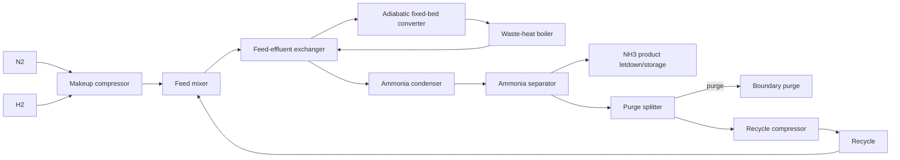

# Industrial catalyst selection for ammonia synthesis from N₂ and H₂

## Executive answer

**No: the laboratory ranking does not reliably predict the plant choice.** Across **273 usable operating points from 11 papers**, the top operating point changed in **11/22 comparison groups (50.0%; 95% interval 25.0–86.7%)** when productivity was replaced by modeled plant cost. At catalyst level the winner changed in **4/21 groups (19.0%; 10 papers)**. The same result was obtained if laboratory conversion rather than productivity was used. Selectivity caused no ranking changes because the direct N₂/H₂ datasets were effectively all NH₃-selective and supplied no useful selectivity variation.

The measured plant optimum was **Co(40)/Mg–La at 400 °C and 63 bar**, costing **$708.96/t NH₃**. The fastest laboratory point was **Mo₂CTₓ**, 2.023 kg NH₃ kg-cat⁻¹ h⁻¹, but its modeled plant cost was **$4011.53/t** because the experiment operated near 1 bar: equilibrium forced only about 0.8% optimized per-pass conversion, greatly increasing circulation, compression, refrigeration/separation, and capital.

**Activity is the controlling catalyst property, but its economic leverage is strongly attenuated.** One-at-a-time attribution assigned 94.7% of catalyst-dependent cost variation to activity, 4.5% to metal cost, 0.8% to temperature, and 0% to selectivity or documented stability. Yet doubling reference activity reduced cost by only **$6.39/t**, because purchased H₂/N₂ dominates the total and recycle/equilibrium/equipment costs remain.

## Literature search, screening, and extraction

- 144 candidate records were screened with explicit criteria: primary experimental, heterogeneous, steady thermocatalytic N₂ + H₂ synthesis; identifiable catalyst; T, P, feed and quantitative rate/conversion sufficient for normalization.
- Electrochemical, nitrate/nitrite, plasma, photo-, microwave-, mechanochemical, chemical-looping, decomposition, review/theory-only, wrong-feed, and data-incomplete studies were excluded.
- 19 DOI download attempts were made, respecting the 20-download cap; 15 PDFs were parsed, 14 yielded extracted records, and 11 papers yielded usable normalized operating points.
- The requested 12 usable papers could not be reached without inventing conversion or figure values. Three parsed papers (10.1002/advs.202410313, 10.1038/ncomms7731, 10.1155/2023/9919748) lacked machine-recoverable conversion/rate-flow combinations; one parsed perspective/data paper yielded no catalyst records. This shortfall is retained rather than filling missing values.

### Usable papers

| DOI key | usable points | title |
|---|---:|---|
| `10_1002_aenm_202003845` | 41 | Exceeding Single‐Pass Equilibrium with Integrated Absorption Separation for Ammonia Synthesis Using Renewable Energy—Redefining the Haber‐Bosch Loop |
| `10_1016_j_apcatb_2020_119843` | 41 | Cation doped cerium oxynitride with anion vacancies for Fe-based catalyst with improved activity and oxygenate tolerance for efficient synthesis of ammonia |
| `10_1016_j_ijhydene_2024_08_408` | 34 | Development of ruthenium-based catalysts for ammonia synthesis via polyol reduction method |
| `10_1021_jacs_2c13015` | 20 | Low-Temperature Ammonia Synthesis on Iron Catalyst with an Electron Donor |
| `10_1021_jacs_4c03875` | 10 | Unlocking the Potential of MXene in Catalysis: Decorated Mo2CTx Catalyst for Ammonia Synthesis under Mild Conditions |
| `10_1021_jacs_5c09736` | 16 | Ru Single Atom and Nanoparticle Tandem Catalyst Unlocking High-Efficiency Ammonia Synthesis under Mild Conditions |
| `10_1038_s41467_020_15868_8` | 6 | Solid solution for catalytic ammonia synthesis from nitrogen and hydrogen gases at 50 °C |
| `10_1038_s41467_023_42050_7` | 51 | Multiple reaction pathway on alkaline earth imide supported catalysts for efficient ammonia synthesis |
| `10_1038_s41929_022_00754_x` | 34 | Potassium hydride-intercalated graphite as an efficient heterogeneous catalyst for ammonia synthesis |
| `10_1039_c6sc00767h` | 10 | Essential role of hydride ion in ruthenium-based ammonia synthesis catalysts |
| `10_1039_d2ra06053a` | 10 | On the effect of metal loading on the performance of Co catalysts supported on mixed MgO–La 2 O 3 oxides for ammonia synthesis |

### Main exclusion classes

| class | screened exclusions |
|---|---:|
| other scope failure | 40 |
| non-thermal assistance (plasma/photo/microwave/mechanochemical) | 32 |
| electrochemical or nitrate/nitrite feed | 25 |
| review/theory/process-only | 23 |

Conversions absent from the source tables were calculated only when NH₃ productivity, normalized normal-gas flow, and feed composition were all reported, using N₂ + 3H₂ → 2NH₃ stoichiometry. No missing figure rate was guessed.

## Mechanism and kinetic transfer

- Conventional Fe/Co/Ru catalysts were represented by dissociative N₂ activation followed by sequential hydrogenation. Electride/hydride-promoted Ru was allowed to shift the bottleneck toward N–H formation; no universal irreversible rate-determining step was imposed.
- Each operating point’s measured NH₃ productivity anchors local forward capacity at its reported T and P. Plant net productivity is corrected by a reversible `(1 − Q/K)` approach-to-equilibrium factor normalized at the laboratory conversion.
- Plant T and P remain those demonstrated by the record; unsupported Arrhenius extrapolation to a universal condition was avoided. The plant optimizes per-pass N₂ conversion below equilibrium, trading catalyst inventory against recycle, compression, separation and capital.
- Reported time to 10% activity loss is used when present; otherwise a bounded catalyst-life assumption is used. Evidence was insufficient for a catalyst-specific deactivation law across all papers.

## Reactor and flowsheet

Battery limit: pure N₂ and H₂ at the plant boundary through synthesis compression, heat recovery, fixed-bed conversion, NH₃ condensation/separation, purge and recycle to pressurized NH₃ product. Upstream H₂ generation and air separation are excluded as equipment, but delivered H₂ and an electricity-derived N₂ supply cost are charged.

The submitted flowsheet includes exactly 11 units: makeup compressor, mixer, feed-effluent exchanger, converter, waste-heat boiler, condenser/knockout, separator, purge splitter, recycle compressor, product letdown/storage and utilities/offsites. No catalyst regenerator is included because literature catalysts are replaced rather than regenerated; no product compressor is required because condensed product remains above the 20-bar product boundary.

## Reference plant result

- Capacity: 330,000 t/y; operating point: 700.0 K, 150.0 bar, optimized per-pass N₂ conversion 0.344.
- Total cost: **$714.48/t NH₃**. Installed capital: **$223.4 million**. Purchased primary energy: **7.058 GJ/t**.

| cost part | USD/t | share |
|---|---:|---:|
| feed | 556.23 | 77.9% |
| energy | 62.74 | 8.8% |
| capital | 90.97 | 12.7% |
| catalyst | 4.54 | 0.6% |
| other | 0.00 | 0.0% |

Feed dominates (77.9% of cost), so even large kinetic improvements have limited impact once catalyst inventory is no longer dominant. Heat recovery attenuates the exothermic reactor duty; recycle attenuates low single-pass conversion but increases loop flow; equilibrium caps usable conversion; condensation/separation and compressor sizing penalize low-pressure “fast” catalysts.

## Ranking results

### Does laboratory ranking predict plant choice?

| laboratory metric | level | changed / denominator | fraction | papers changed | median regret among changes |
|---|---|---:|---:|---:|---:|
| productivity | point level | 11/22 | 0.500 | 8 | 0.586% |
| productivity | catalyst level | 4/21 | 0.191 | 4 | 2.897% |
| conversion | point level | 11/22 | 0.500 | 8 | 0.377% |
| conversion | catalyst level | 4/21 | 0.191 | 4 | 1.787% |
| selectivity | point level | 0/22 | 0.000 | 0 | 0.000% |
| selectivity | catalyst level | 0/21 | 0.000 | 0 | 0.000% |

For productivity at operating-point level, 7 of the 11 changes selected another temperature of the same catalyst and 4 selected another catalyst. Thus the more common failure is not catalyst identity but laboratory choice of operating condition. Ten of the 11 point-level changes exceeded 5% regret and ten exceeded 10% regret.

### Best measured candidates

| basis | catalyst/point | productivity | modeled cost | reason |
|---|---|---:|---:|---|
| plant-cost optimum | Co(40)/Mg–La, 673.15 K, 63 bar | 0.686 kg kg-cat⁻¹ h⁻¹ | $708.96/t | moderate/high pressure permits useful per-pass conversion with inexpensive Co |
| laboratory-rate optimum | Mo₂CTₓ, 673.15 K, 1.013 bar | 2.023 kg kg-cat⁻¹ h⁻¹ | $4011.53/t | near-atmospheric pressure drives very low optimized per-pass conversion and huge circulation/separation/capital |
| industrial Fe reference | promoted Fe, 700 K, 150 bar | 0.500 kg kg-cat⁻¹ h⁻¹ assumption | $714.48/t | feed-dominated benchmark |

Only 8 of 273 literature points beat the reference cost. The best measured catalyst improves on the reference by only about $5.52/t (0.8%), despite large laboratory-rate differences.

## Atomic, laboratory and industrial optima

- Atomic TOF optimum: **D = -1.4605 eV per N**, log₁₀(TOF/s/site) = 1.711 at 700 K and 150-bar stoichiometric reactants.
- Atomic optimum under laboratory mapping conditions: **D = -1.3975 eV**.
- Laboratory optimum: **Mo₂CTₓ**, but its main metal was excluded from descriptor mapping where no compatible elemental descriptor was declared; 241/273 records were mapped.
- Industrial descriptor optimum: **D = −1.3975 eV**. At this descriptor the modeled metal-cost variants range from **$689.97/t** (cheap metal) to **$740.69/t** (Rh).
- Pairwise disagreements: atomic vs laboratory 10798/18013; atomic vs industrial 14087/18042; laboratory vs industrial 7503/28872.
- Descriptor-only counterfactual: moving the mapped reference from D = -2.055 to the atomic optimum lowers its modeled cost from $3952.85/t to $709.73/t, but 5% and 10% reductions below the reference plant cost were **not reachable** within the descriptor model once common feed/process costs were retained.

The atom-scale optimum and plant optimum differ because TOF alone ignores metal price and because the plant objective becomes flat after activity is sufficient: cheap Fe/Ni/Co/Mo-like realizations near the descriptor optimum are preferred over expensive Ru/Rh realizations with the same predicted TOF.

## Sensitivity

Deterministic one-at-a-time sensitivity covered all sourced ranges, assumptions and fixed-price-table ranges. The base cheapest catalyst remained unchanged in **85/86** cases; minimum rank Spearman correlation was **0.962**.

| parameter | range | reference cost at low/high (USD/t) | cost swing | cheapest changes? | min rank ρ |
|---|---:|---:|---:|---|---:|
| price.hydrogen | 1.5–7 | 443.0 / 1437.9 | 139.3% | no | 0.997 |
| base_capacity_t_per_y | 100000–1e+06 | 790.1 / 679.4 | 15.5% | no | 0.999 |
| price.electricity | 40–150 | 676.4 / 781.1 | 14.7% | no | 0.997 |
| reference_r | 0.05–2 | 775.4 / 703.9 | 10.0% | no | 1.000 |
| basis.capacity_t_per_y | 100000–1e+06 | 749.8 / 695.7 | 7.6% | no | 0.999 |
| purge_fraction | 0.002–0.05 | 705.0 / 758.2 | 7.4% | no | 0.992 |
| capex.ammonia_converter | 1e+07–7e+07 | 703.3 / 745.9 | 6.0% | no | 0.995 |
| compressor_installed_usd_per_kW | 700–5000 | 702.3 / 742.6 | 5.6% | no | 0.999 |
| reference_T_K | 650–775 | 702.8 / 737.5 | 4.9% | no | 1.000 |
| price.capital_recovery_factor | 0.08–0.13 | 704.7 / 738.6 | 4.7% | no | 1.000 |
| capex.ammonia_condenser | 7e+06–5e+07 | 706.0 / 739.0 | 4.6% | no | 1.000 |
| capex.utilities_offsites | 1e+07–8e+07 | 708.4 / 736.9 | 4.0% | no | 1.000 |
| price.fixed_om_fraction_of_capex | 0.02–0.06 | 700.9 / 728.0 | 3.8% | no | 1.000 |
| capex.feed_effluent_exchanger | 5e+06–4e+07 | 706.7 / 733.7 | 3.8% | no | 1.000 |
| equilibrium_deltaS_J_per_molK_rxn | -215–-195 | 723.5 / 699.2 | 3.4% | no | 0.962 |
| **pressure_capex_exponent** | 0.15–0.5 | 714.5 / 714.5 | 0.0% | **yes: co(40)/mg-la → 80wt%fe–20wt%ce0.5sm0.5o2−xny** | 1.000 |

Hydrogen price dominates absolute cost (139% reference-cost swing) but barely changes catalyst ordering. Plant scale and electricity price affect absolute cost by about 15%, again without changing the winner. The only winner change occurs at the high pressure-capex exponent, where 80 wt% Fe–20 wt% Ce₀.₅Sm₀.₅O₂₋ₓNᵧ replaces Co(40)/Mg–La; global ordering remains almost identical (ρ = 0.9997).

## Retained evidence debt and limitations

- **Electricity primary-energy factor:** affects the reported GJ/t denominator (4.24–9.03 GJ/t for the reference) but not cost/ranking.
- **Reference Fe activity:** 0.05–2.0 kg kg-cat⁻¹ h⁻¹ changes reference cost by about 10%; it does not determine literature ranking.
- **Refrigeration COP:** 1.5–5.0 changes reference cost by about 2% and energy by about 23%.
- **Reduced-order separation electricity:** 0.05–0.40 GJ/t at reference changes cost by about 2.5% and energy by about 28%.
- **Base capacity/economy of scale:** 0.1–1.0 Mt/y changes reference cost by about 15.5%.
- Full NH₃/N₂/H₂ EOS/VLE, catalyst pellet diffusion, detailed multi-bed interstage cooling, impurity poisoning and plant-wide upstream H₂/ASU integration were not supported consistently by the open catalyst papers.
- Most papers supplied no comparable long-duration deactivation data; stability attribution is therefore zero because of missing evidence, not proof that stability is economically irrelevant.
- All usable direct-synthesis records were effectively NH₃-selective; the model cannot infer an empirical selectivity-cost tradeoff from this literature set.
- Descriptor mapping is a simplified single-site nitrogen-binding volcano. Promoter/support effects appear as residual multipliers, and 32 records lacked a declared main-metal descriptor.

## Complete parameter table

All prices and financial factors are fixed entries from `prices.json`; no price was replaced. Published/measured rows give DOI/URL and location; assumptions carry low/high bounds.

| parameter | value | unit | type | low | high | source | location |
|---|---:|---|---|---:|---:|---|---|
| `price.hydrogen` | 3.0 | USD/kg | price_table | 1.5 | 7.0 | prices.json:hydrogen | prices.hydrogen |
| `price.electricity` | 80.0 | USD/MWh | price_table | 40.0 | 150.0 | prices.json:electricity | prices.electricity |
| `price.catalyst_support_and_manufacturing` | 20.0 | USD/kg | price_table | 5.0 | 100.0 | prices.json:catalyst_support_and_manufacturing | prices.catalyst_support_and_manufacturing |
| `price.metal_Ru` | 53852.5 | USD/kg | price_table | 26926.25 | 107705.0 | prices.json:metal_Ru | prices.metal_Ru |
| `price.metal_Fe` | 8.0 | USD/kg | price_table | 4.0 | 16.0 | prices.json:metal_Fe | prices.metal_Fe |
| `price.metal_Co` | 56.28401553583051 | USD/kg | price_table | 28.142007767915256 | 112.56803107166104 | prices.json:metal_Co | prices.metal_Co |
| `price.metal_Mo` | 91.227284092153 | USD/kg | price_table | 45.61364204607651 | 182.45456818430603 | prices.json:metal_Mo | prices.metal_Mo |
| `price.metal_Ni` | 16.9094555095895 | USD/kg | price_table | 8.45472775479475 | 33.818911019179 | prices.json:metal_Ni | prices.metal_Ni |
| `price.metal_W` | 149.97 | USD/kg | price_table | 74.985 | 299.94 | prices.json:metal_W | prices.metal_W |
| `price.metal_Cu` | 13.889122517655 | USD/kg | price_table | 6.9445612588275 | 27.77824503531 | prices.json:metal_Cu | prices.metal_Cu |
| `price.metal_Al` | 3.9683 | USD/kg | price_table | 1.98415 | 7.9366 | prices.json:metal_Al | prices.metal_Al |
| `price.metal_La` | 1.1728 | USD/kg | price_table | 0.5864 | 2.3456 | prices.json:metal_La | prices.metal_La |
| `price.metal_Mn` | 0.45 | USD/kg | price_table | 0.225 | 0.9 | prices.json:metal_Mn | prices.metal_Mn |
| `price.metal_Y` | 40.0 | USD/kg | price_table | 20.0 | 80.0 | prices.json:metal_Y | prices.metal_Y |
| `price.metal_Zr` | 22.0 | USD/kg | price_table | 11.0 | 44.0 | prices.json:metal_Zr | prices.metal_Zr |
| `price.metal_Ce` | 2.1005306603773586 | USD/kg | price_table | 1.0502653301886793 | 4.201061320754717 | prices.json:metal_Ce | prices.metal_Ce |
| `price.metal_Si` | 2.866006 | USD/kg | price_table | 1.433003 | 5.732012 | prices.json:metal_Si | prices.metal_Si |
| `price.metal_Mg` | 2.5 | USD/kg | price_table | 1.25 | 5.0 | prices.json:metal_Mg | prices.metal_Mg |
| `price.metal_Ca` | 0.3637940925436203 | USD/kg | price_table | 0.1818970462718101 | 0.7275881850872405 | prices.json:metal_Ca | prices.metal_Ca |
| `price.metal_K` | 1.4455393066229791 | USD/kg | price_table | 0.7227696533114896 | 2.8910786132459583 | prices.json:metal_K | prices.metal_K |
| `price.metal_Ba` | 0.3569000679809653 | USD/kg | price_table | 0.1784500339904826 | 0.7138001359619306 | prices.json:metal_Ba | prices.metal_Ba |
| `price.metal_B` | 1.0 | USD/kg | price_table | 0.5 | 2.0 | prices.json:metal_B | prices.metal_B |
| `price.capital_recovery_factor` | 0.0944 | 1/y | price_table | 0.08 | 0.13 | prices.json:capital_recovery_factor | prices.capital_recovery_factor |
| `price.fixed_om_fraction_of_capex` | 0.04 | 1/y | price_table | 0.02 | 0.06 | prices.json:fixed_om_fraction_of_capex | prices.fixed_om_fraction_of_capex |
| `basis.capacity_t_per_y` | 330000.0 | nan | assumption | 100000.0 | 1000000.0 | nan | nan |
| `basis.operating_hours_per_y` | 8000.0 | nan | assumption | 7200.0 | 8400.0 | nan | nan |
| `basis.feeds.N2.T_K` | 298.15 | nan | assumption | 288.15 | 313.15 | nan | nan |
| `basis.feeds.N2.P_bar` | 1.0 | nan | assumption | 1.0 | 30.0 | nan | nan |
| `basis.feeds.N2.purity_mol_frac` | 1.0 | nan | assumption | 0.995 | 1.0 | nan | nan |
| `basis.feeds.H2.T_K` | 298.15 | nan | assumption | 288.15 | 313.15 | nan | nan |
| `basis.feeds.H2.P_bar` | 1.0 | nan | assumption | 1.0 | 30.0 | nan | nan |
| `basis.feeds.H2.purity_mol_frac` | 1.0 | nan | assumption | 0.995 | 1.0 | nan | nan |
| `basis.feeds.H2O.T_K` | 298.15 | nan | assumption | 288.15 | 303.15 | nan | nan |
| `basis.feeds.H2O.P_bar` | 3.0 | nan | assumption | 2.0 | 6.0 | nan | nan |
| `basis.feeds.H2O.purity_mol_frac` | 1.0 | nan | assumption | 0.99 | 1.0 | nan | nan |
| `basis.product.NH3.P_bar` | 20.0 | nan | assumption | 10.0 | 30.0 | nan | nan |
| `basis.product.NH3.purity_mol_frac` | 1.0 | nan | assumption | 0.995 | 1.0 | nan | nan |
| `basis.utilities.ambient_temperature` | 298.15 | K | assumption | 288.15 | 308.15 | nan | nan |
| `basis.utilities.cooling_water_supply_temperature` | 298.15 | K | assumption | 288.15 | 303.15 | nan | nan |
| `basis.utilities.cooling_water_return_temperature` | 308.15 | K | assumption | 303.15 | 318.15 | nan | nan |
| `basis.utilities.electricity_primary_energy_factor` | 2.5 | GJ_primary/GJ_electric | assumption | 1.5 | 3.2 | nan | nan |
| `reaction_heat_GJ_per_t_NH3` | 2.708 | GJ/t NH3 | published | 2.65 | 2.8 | https://webbook.nist.gov/cgi/cbook.cgi?ID=C7664417&Mask=1#Thermo-Gas | Gas-phase thermochemistry: standard enthalpy of formation of NH3(g), approximately -45.9 kJ/mol |
| `reference_T_K` | 700.0 | K | published | 650.0 | 775.0 | https://www.epa.gov/sites/default/files/2020-07/documents/c_ammonia.pdf | Section 3.1 process description: synthesis reactor operates at high temperature and pressure |
| `reference_P_bar` | 150.0 | bar | published | 100.0 | 250.0 | https://www.epa.gov/sites/default/files/2020-07/documents/c_ammonia.pdf | Section 3.1 process description: compressed synthesis gas sent to ammonia synthesis converter |
| `reference_X` | 0.15 | fraction | assumption | 0.08 | 0.25 | nan | nan |
| `reference_r` | 0.5 | kg NH3/kgcat/h | assumption | 0.05 | 2.0 | nan | nan |
| `reference_t_cycle_h` | 24000.0 | h to 10% loss | assumption | 8000.0 | 80000.0 | nan | nan |
| `makeup_compressor_efficiency` | 0.75 | fraction | published | 0.72 | 0.82 | https://www.sciencedirect.com/topics/engineering/compressor-isentropic-efficiency | Overview: compressor isentropic efficiencies generally 70-90%, about 80% practical |
| `recycle_compressor_efficiency` | 0.78 | fraction | assumption | 0.65 | 0.88 | nan | nan |
| `loop_pressure_drop_bar` | 5.0 | bar | assumption | 2.0 | 12.0 | nan | nan |
| `feed_effluent_exchanger_effectiveness` | 0.8 | fraction | assumption | 0.65 | 0.92 | nan | nan |
| `waste_heat_recovery_fraction` | 0.7 | fraction | assumption | 0.4 | 0.9 | nan | nan |
| `separator_NH3_recovery` | 1.0 | fraction | assumption | 0.98 | 1.0 | nan | nan |
| `purge_fraction` | 0.01 | fraction | assumption | 0.002 | 0.05 | nan | nan |
| `condenser_temperature_K` | 248.15 | K | assumption | 233.15 | 273.15 | nan | nan |
| `condenser_COP` | 3.0 | GJ cooling/GJ electric | assumption | 1.5 | 5.0 | nan | nan |
| `NH3_condensation_duty_GJ_per_t` | 1.37 | GJ/t NH3 | assumption | 1.1 | 1.6 | nan | nan |
| `gas_sensible_heat_kJ_per_kmol_K` | 31.0 | kJ/kmol/K | assumption | 28.0 | 38.0 | nan | nan |
| `separation_electric_GJ_per_t_at_reference` | 0.15 | GJ electric/t NH3 | assumption | 0.05 | 0.4 | nan | nan |
| `offsites_electric_GJ_per_t` | 0.02 | GJ electric/t NH3 | assumption | 0.005 | 0.08 | nan | nan |
| `nitrogen_electricity_kWh_per_kg` | 0.2 | kWh/kg N2 | assumption | 0.1 | 0.4 | nan | nan |
| `catalyst_bulk_density_kg_per_m3` | 1000.0 | kg/m3 | assumption | 600.0 | 1800.0 | nan | nan |
| `default_catalyst_life_y` | 3.0 | y | assumption | 1.0 | 8.0 | nan | nan |
| `minimum_rate_kg_per_kg_h` | 1e-06 | kg/kg/h | assumption | 1e-07 | 0.0001 | nan | nan |
| `unknown_Ru_loading_fraction` | 0.05 | kg/kg catalyst | assumption | 0.01 | 0.15 | nan | nan |
| `unknown_Fe_loading_fraction` | 0.8 | kg/kg catalyst | assumption | 0.3 | 0.95 | nan | nan |
| `unknown_Co_loading_fraction` | 0.4 | kg/kg catalyst | assumption | 0.1 | 0.7 | nan | nan |
| `unknown_Mo_loading_fraction` | 0.2 | kg/kg catalyst | assumption | 0.05 | 0.5 | nan | nan |
| `capex_scale_exponent` | 0.6 | dimensionless | assumption | 0.5 | 0.8 | nan | nan |
| `pressure_capex_exponent` | 0.25 | dimensionless | assumption | 0.15 | 0.5 | nan | nan |
| `base_capacity_t_per_y` | 330000.0 | t/y | assumption | 100000.0 | 1000000.0 | nan | nan |
| `capex.makeup_compressor` | 20000000.0 | USD | assumption | 8000000.0 | 60000000.0 | nan | nan |
| `capex.feed_mixer` | 1000000.0 | USD | assumption | 300000.0 | 3000000.0 | nan | nan |
| `capex.feed_effluent_exchanger` | 15000000.0 | USD | assumption | 5000000.0 | 40000000.0 | nan | nan |
| `capex.ammonia_converter` | 25000000.0 | USD | assumption | 10000000.0 | 70000000.0 | nan | nan |
| `capex.waste_heat_boiler` | 12000000.0 | USD | assumption | 4000000.0 | 35000000.0 | nan | nan |
| `capex.ammonia_condenser` | 18000000.0 | USD | assumption | 7000000.0 | 50000000.0 | nan | nan |
| `capex.ammonia_separator` | 8000000.0 | USD | assumption | 3000000.0 | 25000000.0 | nan | nan |
| `capex.purge_splitter` | 500000.0 | USD | assumption | 100000.0 | 2000000.0 | nan | nan |
| `capex.recycle_compressor` | 12000000.0 | USD | assumption | 4000000.0 | 40000000.0 | nan | nan |
| `capex.product_letdown_storage` | 15000000.0 | USD | assumption | 5000000.0 | 50000000.0 | nan | nan |
| `capex.utilities_offsites` | 25000000.0 | USD | assumption | 10000000.0 | 80000000.0 | nan | nan |
| `equilibrium_deltaH_J_per_mol_rxn` | -92220.0 | J/mol reaction | assumption | -95000.0 | -90000.0 | nan | nan |
| `equilibrium_deltaS_J_per_molK_rxn` | -209.3 | J/mol/K reaction | assumption | -215.0 | -195.0 | nan | nan |
| `base_reactor_catalyst_volume_m3` | 100.0 | m3 | assumption | 30.0 | 500.0 | nan | nan |
| `compressor_installed_usd_per_kW` | 2000.0 | USD/kW | assumption | 700.0 | 5000.0 | nan | nan |

## Reproducibility and checks

- `flowsheet.json` accepted hash: `b8a5bf811a2bab2b`.
- `check_model`: passed on the reference and all 273 usable records, including independent elements, mass, equilibrium, heat, compression, separation, unit accounting, finite cost, monotonicity and determinism.
- `check_atomic`: passed thermodynamics, volcano, provenance and plant-link checks.
- Artifacts: `basis.json`, `flowsheet.json`, `sources.csv`, `records.csv`, `model.py`, `atomic.py`, `costs.csv`, `analysis.json`, `sensitivity.json`, `three_optima.json`, `evidence_debt.json`.

## Bottom line

A plant should not choose the catalyst or temperature with the largest laboratory NH₃ rate or conversion in isolation. It should choose the catalyst-condition pair that delivers adequate reversible activity at enough pressure to avoid excessive recycle and separation, while minimizing reactor/compressor capital and catalyst material cost. In this dataset that is Co(40)/Mg–La at 400 °C and 63 bar, not the fastest laboratory Mo₂CTₓ point. Activity controls the catalyst-dependent part of cost, but feedstock cost, equilibrium, recycle, separation and equipment flatten its plant-level value; after the kinetic bottleneck is relieved, inexpensive metal and pressure-compatible operation matter more than another order of magnitude of laboratory rate.