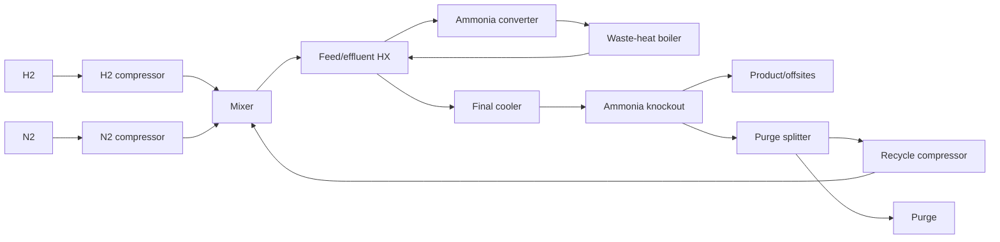

# Industrial ammonia synthesis catalyst-to-plant economic model

**Reaction:** N2 + 3 H2 → 2 NH3  
**Model date:** 2026-11-13  
**Final checked model fingerprint:** `af180a803ca3e8f6848aa101985d3230e5ad3c2b04ffa8729dc05d2b5a9ca91c`  
**Scope:** purchased purified H2/N2 at the plant gate through compression, catalytic synthesis, heat recovery, NH3 condensation, purge/recycle, and product/offsites; upstream H2 manufacture and downstream distribution are excluded.

## Executive conclusions

* **Laboratory operating-point rank is not reliably the plant rank.** Among the three within-catalyst comparison groups available, productivity and conversion rankings changed in 2/3 groups (66.67%); both changes were the same catalyst at another temperature. The median regret among changed groups was 1.86%, with one change above 1% and none above 5%.
* **The measured winner was Re/Mo2CTx at 400 °C:** 608.46 USD/t NH3, versus 618.88 USD/t for the promoted-Fe reference. Three of 19 records were below the reference.
* **Absolute plant cost is controlled by H2 feed price and stoichiometric H2 demand, not by catalyst activity.** The reference feed contribution is 563.56 USD/t of 618.88 USD/t total (91.1%). Doubling activity changes cost by only -5.00 USD/t because equilibrium, recycle, compressor/separation duties, and feed cost attenuate activity gains.
* **Within catalyst properties, metal/formulation cost dominates the modeled attribution:** metal 90.2%, activity 5.5%, temperature 4.2%, stability 0.1%, selectivity 0.0%. This is conditional on a very small three-family usable corpus and expensive Ru-containing formulations.
* **The main ranking changes occur where higher laboratory rate requires a costlier metal or unfavorable operating condition, and where equilibrium/recycle makes extra intrinsic activity economically redundant.** Feedstock cost sets a large floor; conversion mostly shifts recycle/compression/separation; equipment and catalyst inventory matter at the margin.
* **Evidence limitation:** although 18 papers were parsed after 20 download attempts, only 3 papers supplied all fields needed by the fixed record gate, yielding 19 costed records. Therefore catalyst-level cross-paper denominators were zero; broad claims across the ammonia-catalyst literature are not supported by this corpus.

## 1. Search, screening, and exclusions

Inclusion required a primary experimental, continuous/steady-state, heterogeneous thermocatalytic N2/H2 study with identifiable catalyst, temperature, pressure, feed composition, conversion/outlet NH3, and catalyst-normalized productivity or enough flow and catalyst mass to derive it. Electrochemical, plasma, photochemical, microwave, mechanochemical, chemical-looping/lattice-N, melt-mediated, review, and theory-only studies were excluded.

| Parsed paper | extracted records | records costed | principal disposition |
|---|---:|---:|---|
| 10_1002_aenm_202003845 | 25 | 17 | usable quantitative records |
| 10_1002_aenm_202402353 | 38 | 0 | not costed: principal missing gate field was conversion or rate/flow/catalyst basis |
| 10_1016_j_apcatb_2020_119843 | 15 | 0 | not costed: principal missing gate field was conversion or rate/flow/catalyst basis |
| 10_1021_acssuschemeng_7b02812 | 32 | 0 | not costed: principal missing gate field was conversion or rate/flow/catalyst basis |
| 10_1021_jacs_2c13015 | 30 | 0 | not costed: principal missing gate field was conversion or rate/flow/catalyst basis |
| 10_1021_jacs_4c03875 | 11 | 0 | not costed: principal missing gate field was conversion or rate/flow/catalyst basis |
| 10_1021_jacs_4c03998 | 23 | 1 | usable quantitative records |
| 10_1021_jacs_5c09736 | 24 | 0 | not costed: principal missing gate field was conversion or rate/flow/catalyst basis |
| 10_1038_ncomms7731 | 24 | 0 | not costed: principal missing gate field was conversion or rate/flow/catalyst basis |
| 10_1038_s41467_020_15868_8 | 6 | 0 | not costed: principal missing gate field was conversion or rate/flow/catalyst basis |
| 10_1038_s41467_023_42050_7 | 58 | 0 | not costed: principal missing gate field was conversion or rate/flow/catalyst basis |
| 10_1038_s41467_025_63061_6 | 0 | 0 | not costed: principal missing gate field was conversion or rate/flow/catalyst basis |
| 10_1038_s41467_025_63064_3 | 35 | 0 | not costed: principal missing gate field was conversion or rate/flow/catalyst basis |
| 10_1038_s41929_022_00754_x | 42 | 1 | usable quantitative records |
| 10_1039_c6sc00767h | 11 | 0 | not costed: principal missing gate field was conversion or rate/flow/catalyst basis |
| 10_1039_c9sc01539f | 54 | 0 | not costed: principal missing gate field was conversion or rate/flow/catalyst basis |
| 10_1039_d1sc00304f | 11 | 0 | not costed: principal missing gate field was conversion or rate/flow/catalyst basis |
| 10_1039_d2ra06053a | 10 | 0 | not costed: principal missing gate field was conversion or rate/flow/catalyst basis |

The included search set contained 26 papers; 0 screened candidates were excluded. Common exclusion reasons were non-thermal activation, electrochemical/nitrate chemistry, review or theory-only scope, decomposition rather than synthesis, or insufficient quantitative flow/conversion basis.

Screened exclusions and reasons

| DOI | title | reason |
|---|---|---|

## 2. Mechanism and kinetic transfer

The model uses a dissociative Haber–Bosch mechanism: N2 adsorption/dissociation, sequential N hydrogenation, and NH3 desorption. Each record calibrates a catalyst-specific forward productivity. Transfer to plant conditions applies Arrhenius temperature scaling, total-pressure scaling, and a reversible approach-to-equilibrium factor `max(0, 1-Q/Kp)`. The plant then optimizes pressure and per-pass N2 conversion subject to equilibrium and the laboratory feed stoichiometric ceiling. A reported 10% activity-loss cycle is used when available; otherwise the default life range is propagated.

This representation preserves the measured activity while preventing impossible above-equilibrium conversion. It does not claim a universal elementary rate law across Fe, Ru, Re/MXene, potassium hydride/carbon, and other families.

## 3. Reactor and accepted flowsheet

A high-pressure multibed fixed-bed converter is represented by an equilibrium-limited aggregate reactor with explicit catalyst inventory and reaction heat. The accepted synthesis loop contains: H2 and N2 feed compressors; synthesis-gas mixer; feed/effluent exchanger; ammonia converter; waste-heat boiler; final cooler; NH3 knockout; purge splitter; recycle compressor; and product/offsites handling. Catalyst regeneration and product compression are excluded because catalyst is replaced on a cycle and condensed NH3 already exceeds the 20 bar minimum product pressure.

## 4. Plant basis and reference result

* Capacity: 1,000,000 t/y NH3; 8,000 h/y.
* Feed states: H2 and N2 at 298.15 K, 30 bar, 99.9 mol% minimum purity.
* Product: liquid NH3 at at least 20 bar and 99.5 mol% minimum purity.
* Final reference operating point: 725.0 K, 250.0 bar, 0.3819 per-pass N2 conversion.
* Reference installed capital: 163.3 million USD; purchased primary energy: 3.036 GJ/t NH3.

| cost component | USD/t NH3 | share |
|---|---:|---:|
| feed | 563.562 | 91.06% |
| energy | 26.991 | 4.36% |
| capital | 21.944 | 3.55% |
| catalyst | 6.384 | 1.03% |
| other | 0.000 | 0.00% |
| **total** | **618.881** | **100%** |

## 5. Literature catalyst ranking

| rank | paper | catalyst | lab T (K) | lab P (bar) | lab productivity (kg/kgcat/h) | plant USD/t | optimized T (K) | optimized P (bar) | per-pass X |
|---:|---|---|---:|---:|---:|---:|---:|---:|---:|
| 1 | 10_1021_jacs_4c03998 | Re/Mo2CTx | 673.15 | 10.00 | 0.381494 | 608.456 | 673.15 | 201.43 | 0.4426 |
| 2 | 10_1038_s41929_022_00754_x | KH0.19C24 (from 15 wt% KH/graphite precursor) | 673.15 | 10.00 | 0.00645862 | 608.997 | 673.15 | 201.43 | 0.4426 |
| 3 | 10_1002_aenm_202003845 | 5%Ru/10%Cs/CeO2 | 693.15 | 20.00 | 0.048451 | 614.313 | 693.15 | 250.00 | 0.4391 |
| 4 | 10_1002_aenm_202003845 | 5%Ru/10%Cs/CeO2 | 663.15 | 20.00 | 0.0586747 | 631.373 | 688.15 | 250.00 | 0.3872 |
| 5 | 10_1002_aenm_202003845 | 5%Ru/10%Cs/CeO2 | 693.15 | 20.00 | 0.0844559 | 635.904 | 718.15 | 250.00 | 0.3333 |
| 6 | 10_1002_aenm_202003845 | 5%Ru/10%Cs/CeO2 | 613.15 | 20.00 | 0.129795 | 641.888 | 638.15 | 250.00 | 0.3333 |
| 7 | 10_1002_aenm_202003845 | 5%Ru/10%Cs/CeO2 | 643.15 | 20.00 | 0.109348 | 644.028 | 668.15 | 250.00 | 0.3333 |
| 8 | 10_1002_aenm_202003845 | 5%Ru/10%Cs/CeO2 | 593.15 | 20.00 | 0.117349 | 648.370 | 618.15 | 250.00 | 0.3333 |
| 9 | 10_1002_aenm_202003845 | 5%Ru/10%Cs/CeO2 | 643.15 | 20.00 | 0.0546741 | 670.997 | 668.15 | 250.00 | 0.3693 |
| 10 | 10_1002_aenm_202003845 | 5%Ru/10%Cs/CeO2 | 593.15 | 20.00 | 0.14699 | 679.685 | 618.15 | 250.00 | 0.1667 |
| 11 | 10_1002_aenm_202003845 | 5%Ru/10%Cs/CeO2 | 643.15 | 20.00 | 0.0972033 | 695.296 | 668.15 | 250.00 | 0.1667 |
| 12 | 10_1002_aenm_202003845 | 5%Ru/10%Cs/CeO2 | 693.15 | 20.00 | 0.0734952 | 705.731 | 718.15 | 250.00 | 0.1667 |
| 13 | 10_1002_aenm_202003845 | 5%Ru/10%Cs/CeO2 | 543.15 | 20.00 | 0.0382274 | 710.222 | 568.15 | 250.00 | 0.3333 |
| 14 | 10_1002_aenm_202003845 | 5%Ru/10%Cs/CeO2 | 543.15 | 20.00 | 0.0521579 | 722.664 | 568.15 | 250.00 | 0.1667 |
| 15 | 10_1002_aenm_202003845 | 5%Ru/10%Cs/CeO2 | 593.15 | 20.00 | 0.0235588 | 793.493 | 618.15 | 250.00 | 0.3994 |
| 16 | 10_1002_aenm_202003845 | 5%Ru/10%Cs/CeO2 | 493.15 | 20.00 | 0.0130395 | 878.924 | 518.15 | 250.00 | 0.1667 |
| 17 | 10_1002_aenm_202003845 | 5%Ru/10%Cs/CeO2 | 543.15 | 20.00 | 0.00666757 | 1154.138 | 568.15 | 250.00 | 0.4346 |
| 18 | 10_1002_aenm_202003845 | 5%Ru/10%Cs/CeO2 | 493.15 | 20.00 | 0.00533406 | 1167.455 | 518.15 | 250.00 | 0.3333 |
| 19 | 10_1002_aenm_202003845 | 5%Ru/10%Cs/CeO2 | 493.15 | 20.00 | 0.00088901 | 3922.283 | 518.15 | 250.00 | 0.4293 |

### Ranking denominators

* **productivity:** 3 comparison groups, 2 changes (66.67%); 1 papers represented; catalyst-level groups = 0.
* **conversion:** 3 comparison groups, 2 changes (66.67%); 1 papers represented; catalyst-level groups = 0.
* **selectivity:** 3 comparison groups, 0 changes (0.00%); 1 papers represented; catalyst-level groups = 0.

Interpretation: conversion and productivity do not map one-to-one to minimum plant cost because the plant can trade per-pass conversion against recycle, catalyst inventory, pressure, and equilibrium. Selectivity does not discriminate here because all direct ammonia records have S = 1.

## 6. Property attribution and attenuation

| catalyst property | attribution share | plant interpretation |
|---|---:|---|
| metal | 90.2% | active-metal and formulation price alters annual catalyst replacement cost |
| activity | 5.5% | higher rate reduces catalyst inventory and converter capital, but feed and equilibrium impose a floor |
| temperature | 4.2% | changes equilibrium, heat recovery, rate, and recycle duty |
| stability | 0.1% | changes annual replacement, weak in this corpus |
| selectivity | 0.0% | zero because direct N2/H2 ammonia records were all unity-selectivity |

Feedstock cost attenuates all catalyst improvements because stoichiometric H2 dominates the cash cost. Equilibrium attenuates high-temperature rate gains by limiting conversion. Recycle and separation attenuate low-conversion operation through larger loop flow and compressor/cooler duties. Equipment scaling attenuates activity once converter size is no longer dominant. Expensive active metals can reverse an activity advantage through catalyst fill and replacement.

## 7. Sensitivity and retained evidence debt

The mandated one-at-a-time sensitivity varied every sourced range, assumption, and price-table range. The base winner stayed unchanged in 107/119 cases; minimum rank Spearman correlation was 0.882.

| parameter | kind | low→high | reference cost swing | winner changes? | minimum Spearman |
|---|---|---|---:|---|---:|
| price.hydrogen | price_table | 1.5→7.0 | 162.73% | no | 0.989 |
| price.electricity | price_table | 40.0→150.0 | 8.86% | yes | 0.998 |
| operation.purge_fraction | assumption | 0.005→0.05 | 6.79% | yes | 0.989 |
| catalyst.reference_rate_kg_per_kg_h | assumption | 0.03→0.5 | 4.61% | no | 1.000 |
| heat.reaction_entropy_J_per_mol_reaction_K | assumption | -220.0→-198.0 | 3.34% | yes | 0.882 |
| feed.nitrogen_embodied_electricity_kWh_per_kg | assumption | 0.1→0.4 | 3.29% | no | 1.000 |
| price.catalyst_support_and_manufacturing | price_table | 5.0→100.0 | 3.20% | yes | 0.998 |
| operation.reference_T_K | assumption | 650.0→750.0 | 2.97% | no | 1.000 |
| capital.reference_capacity_t_per_y | assumption | 500000.0→1500000.0 | 2.77% | yes | 0.998 |
| basis.capacity_t_per_y | assumption | 200000.0→1500000.0 | 2.74% | yes | 0.998 |
| catalyst.default_cycle_h | assumption | 8000.0→60000.0 | 2.39% | yes | 0.988 |
| basis.feeds.H2.P_bar | assumption | 20.0→40.0 | 1.40% | no | 1.000 |
| price.capital_recovery_factor | price_table | 0.08→0.13 | 1.32% | no | 1.000 |
| capital.product_and_offsites_usd | assumption | 18000000.0→75000000.0 | 1.24% | no | 1.000 |
| operation.reference_P_bar | assumption | 100.0→220.0 | 1.16% | no | 1.000 |
| price.fixed_om_fraction_of_capex | price_table | 0.02→0.06 | 1.06% | yes | 0.998 |
| catalyst.reference_inventory_kg | assumption | 500000.0→5000000.0 | 0.97% | yes | 0.998 |
| capital.hydrogen_feed_compressor_usd | assumption | 12000000.0→50000000.0 | 0.96% | no | 1.000 |
| operation.reference_selectivity | assumption | 0.99→1.0 | 0.94% | no | 1.000 |
| capital.ammonia_converter_usd | assumption | 20000000.0→90000000.0 | 0.92% | yes | 0.998 |

The largest uncertainty is H2 price (162.7% reference-cost swing), but it does not change the winner. Electricity price, purge fraction, reaction entropy/equilibrium representation, support/manufacturing price, scale, and catalyst life can switch the very close Re/Mo2CTx versus KH0.19C24 ordering. Retained evidence debts are H2 delivery pressure (20–40 bar), purge fraction (0.5–5%), and electricity primary-energy factor (2.0–3.0).

## 8. Atom, laboratory, and plant optima

* Descriptor: N adsorption energy relative to 1/2 N2 + *, with more-negative values binding N more strongly.
* Atomic optimum at the final plant state: D = -0.240 eV, log10(TOF/s/site) = 5.461.
* Atomic optimum at declared laboratory conditions: D = -0.520 eV, log10(TOF/s/site) = 6.120.
* Measured laboratory and industrial optimum among costed records: Re/Mo2CTx, r = 0.381494 kg/kgcat/h, 608.456 USD/t.
* Descriptor-based industrial optimum: D = -0.520 eV and 591.701 USD/t on the fixed reference-metal-price counterfactual.
* 17/19 records mapped to an effective descriptor; Re/Mo2CTx and KH0.19C24 were excluded from metal-descriptor mapping because their main active-material labels were absent from DESCRIPTORS.
* Atomic-versus-lab and atomic-versus-plant pairwise denominators were zero because all mapped atomic scores tied after inversion; lab-versus-industrial had 30 disagreements among 136 pairs. These zero denominators must not be interpreted as agreement.
* Backward-design targets at 95% and 90% of the reference cost were not reachable by descriptor optimization alone; feed cost and non-catalyst plant costs set the floor.

## 9. What the evidence could not support

1. The target of 12 papers with fully usable records was not achieved: only 3 papers and 19 operating points passed all fixed fields after the 20-download cap. Most otherwise relevant studies omitted conversion or enough flow/catalyst basis to derive it.
2. No catalyst-level ranking denominator was available, so the analysis supports operating-point conclusions more strongly than broad catalyst-family conclusions.
3. Stability was rarely measured on a comparable 10% activity-loss basis; default life dominates many records.
4. The rate-transfer law is a calibrated reversible surrogate, not a family-specific validated industrial kinetic expression.
5. Feed purities and product minimum purity are declared in the basis but inert species are not explicitly tracked; purge uncertainty partly covers this omission.
6. The atomistic model is a reduced two-step dissociative cycle using nitrogen binding, BEP, and scaling assumptions. Its descriptor-metal cost counterfactual is not independently discriminating across metals under the fixed price-table linkage, so metal-specific atomic plant rankings are ties.
7. Upstream H2 production is outside the boundary. Thus the report compares synthesis-loop catalyst choices, not full blue/green/grey ammonia pathways.

## 10. Complete parameter table

Every numeric model and basis input is exposed in `PARAMS`; price rows are frozen entries from `prices.json`. Blank source/location fields denote explicit assumptions and include low/high ranges.

| parameter | value | unit | type | source | location | low | high |
|---|---:|---|---|---|---|---:|---:|
| basis.capacity_t_per_y | 1000000 | t/y | assumption |  |  | 200000 | 1500000 |
| basis.operating_hours_per_y | 8000 | h/y | assumption |  |  | 7200 | 8400 |
| basis.feeds.H2.T_K | 298.15 | K | assumption |  |  | 288.15 | 313.15 |
| basis.feeds.H2.P_bar | 30.0 | bar | assumption |  |  | 20.0 | 40.0 |
| basis.feeds.H2.purity_mol_frac | 0.999 | fraction | assumption |  |  | 0.995 | 0.9999 |
| basis.feeds.N2.T_K | 298.15 | K | assumption |  |  | 288.15 | 313.15 |
| basis.feeds.N2.P_bar | 30.0 | bar | assumption |  |  | 20.0 | 40.0 |
| basis.feeds.N2.purity_mol_frac | 0.999 | fraction | assumption |  |  | 0.995 | 0.9999 |
| basis.product.NH3.P_bar | 20.0 | bar | assumption |  |  | 10.0 | 30.0 |
| basis.product.NH3.purity_mol_frac | 0.995 | fraction | assumption |  |  | 0.99 | 0.999 |
| basis.utilities.cooling_water_supply_temperature | 298.15 | K | assumption |  |  | 288.15 | 303.15 |
| basis.utilities.cooling_water_return_temperature | 308.15 | K | assumption |  |  | 303.15 | 318.15 |
| basis.utilities.electric_motor_efficiency | 0.95 | fraction | assumption |  |  | 0.9 | 0.98 |
| kinetic.activation_energy_J_per_mol | 100000 | J/mol | assumption |  |  | 60000 | 160000 |
| kinetic.pressure_order_total | 1.0 | dimensionless | assumption |  |  | 0.5 | 1.5 |
| kinetic.max_rate_scale | 1000 | dimensionless | assumption |  |  | 100 | 10000 |
| operation.loop_pressure_min_bar | 80 | bar | assumption |  |  | 50 | 100 |
| operation.loop_pressure_max_bar | 250 | bar | published | https://www.thyssenkrupp-uhde.com/en/products-and-technologies/fertilizer-technologies/ammonia-plants/ammonia-technology-dual-pressure-synthesis-a30-synthesis | Technology description states synthesis-loop operating pressure up to 210 bar; range retains higher conventional-loop designs. | 210 | 300 |
| operation.pressure_grid_points | 8 | count | assumption |  |  | 5 | 12 |
| operation.conversion_grid_points | 32 | count | assumption |  |  | 20 | 60 |
| operation.min_conversion | 0.02 | fraction | assumption |  |  | 0.01 | 0.05 |
| operation.equilibrium_fraction_limit | 0.95 | fraction | assumption |  |  | 0.85 | 0.99 |
| operation.purge_fraction | 0.02 | fraction | assumption |  |  | 0.005 | 0.05 |
| operation.nh3_condensation_recovery | 0.995 | fraction | assumption |  |  | 0.98 | 0.9995 |
| compressor.isentropic_efficiency | 0.75 | fraction | published | https://midstreamcalculator.com/engineering/compressors/centrifugal-efficiency-fundamentals.html | Typical Ranges section gives isentropic efficiency of 72-82% for centrifugal compressors. | 0.72 | 0.82 |
| compressor.gamma_h2 | 1.4 | dimensionless | assumption |  |  | 1.35 | 1.42 |
| compressor.gamma_n2 | 1.4 | dimensionless | assumption |  |  | 1.35 | 1.42 |
| compressor.gamma_loop | 1.35 | dimensionless | assumption |  |  | 1.25 | 1.4 |
| compressor.recycle_pressure_ratio | 1.05 | ratio | assumption |  |  | 1.02 | 1.12 |
| energy.electricity_primary_factor | 2.5 | GJ_primary/GJ_electric | assumption |  |  | 2.0 | 3.0 |
| heat.reaction_enthalpy_J_per_mol_NH3 | -46110 | J/mol NH3 | assumption |  |  | -47000 | -45000 |
| heat.feed_effluent_recovery_fraction | 0.75 | fraction | assumption |  |  | 0.55 | 0.9 |
| heat.waste_heat_recovery_fraction | 0.7 | fraction | assumption |  |  | 0.5 | 0.85 |
| heat.cooling_electricity_GJ_per_GJ_removed | 0.015 | GJ electric/GJ heat | assumption |  |  | 0.005 | 0.04 |
| heat.sensible_cooling_GJ_per_t | 0.35 | GJ/t NH3 | assumption |  |  | 0.15 | 0.7 |
| catalyst.default_cycle_h | 24000 | h | assumption |  |  | 8000 | 60000 |
| catalyst.activity_loss_fraction_at_cycle | 0.1 | fraction | assumption |  |  | 0.05 | 0.25 |
| catalyst.reference_inventory_kg | 2000000 | kg | assumption |  |  | 500000 | 5000000 |
| catalyst.reference_rate_kg_per_kg_h | 0.12 | kg/kg/h | assumption |  |  | 0.03 | 0.5 |
| capital.scale_exponent | 0.65 | dimensionless | assumption |  |  | 0.55 | 0.75 |
| capital.pressure_exponent | 0.25 | dimensionless | assumption |  |  | 0.15 | 0.4 |
| capital.reference_capacity_t_per_y | 1000000 | t/y | assumption |  |  | 500000 | 1500000 |
| capital.reference_pressure_bar | 150 | bar | assumption |  |  | 100 | 200 |
| capital.hydrogen_feed_compressor_usd | 25000000 | USD | assumption |  |  | 12000000 | 50000000 |
| capital.nitrogen_feed_compressor_usd | 18000000 | USD | assumption |  |  | 8000000 | 35000000 |
| capital.synthesis_gas_mixer_usd | 1000000 | USD | assumption |  |  | 300000 | 3000000 |
| capital.feed_effluent_exchanger_usd | 12000000 | USD | assumption |  |  | 6000000 | 25000000 |
| capital.ammonia_converter_usd | 45000000 | USD | assumption |  |  | 20000000 | 90000000 |
| capital.waste_heat_boiler_usd | 18000000 | USD | assumption |  |  | 8000000 | 35000000 |
| capital.final_product_cooler_usd | 15000000 | USD | assumption |  |  | 7000000 | 30000000 |
| capital.ammonia_knockout_usd | 6000000 | USD | assumption |  |  | 2500000 | 12000000 |
| capital.purge_splitter_usd | 500000 | USD | assumption |  |  | 150000 | 1500000 |
| capital.recycle_compressor_usd | 7500000 | USD | assumption |  |  | 3500000 | 18000000 |
| capital.product_and_offsites_usd | 38000000 | USD | assumption |  |  | 18000000 | 75000000 |
| capital.reactor_activity_scale_exponent | 0.6 | dimensionless | assumption |  |  | 0.45 | 0.75 |
| capital.reactor_min_scale | 0.35 | fraction | assumption |  |  | 0.2 | 0.6 |
| capital.offsites_capacity_exponent | 0.6 | dimensionless | assumption |  |  | 0.5 | 0.7 |
| operation.reference_T_K | 700 | K | assumption |  |  | 650 | 750 |
| operation.reference_P_bar | 150 | bar | assumption |  |  | 100 | 220 |
| operation.reference_X | 0.15 | fraction | assumption |  |  | 0.08 | 0.25 |
| operation.reference_selectivity | 1.0 | fraction | assumption |  |  | 0.99 | 1.0 |
| operation.reference_y_N2 | 0.25 | fraction | assumption |  |  | 0.24 | 0.26 |
| operation.reference_y_H2 | 0.75 | fraction | assumption |  |  | 0.74 | 0.76 |
| price.natural_gas | 2.5 | USD/GJ | price_table | prices.json:natural_gas | PetroLogistics Catofin plant gas cost 2.60 USD/MMBtu (SEC 424B4, 2012); Henry Hub 2024 average 2.19 USD/MMBtu (EIA) | 2.0 | 12.0 |
| price.electricity | 80.0 | USD/MWh | price_table | prices.json:electricity | industrial power assumption used across the NCE chains; EIA 2024 US industrial average about 80 USD/MWh | 40.0 | 150.0 |
| price.hydrogen | 3.0 | USD/kg | price_table | prices.json:hydrogen | Becker, Penev & Braun, J. Energy Resour. Technol. 2019 anchor 3 USD/kg; grey about 2, electrolytic 5-7 (DOE Pathways to Commercial Liftoff: Clean Hydrogen, 2024) | 1.5 | 7.0 |
| price.carbon_dioxide | 100.0 | USD/t | price_table | prices.json:carbon_dioxide | 104 USD/t CO2 captured, Enterprise Products EPA GHG permit application 2012, rounded | 20.0 | 200.0 |
| price.propane | 408.0 | USD/t | price_table | prices.json:propane | EIA Mont Belvieu propane spot 2024, 0.778 USD/gal at 4.2 lb/gal | 300.0 | 700.0 |
| price.ammonia | 445.0 | USD/t | price_table | prices.json:ammonia | Tampa CFR ammonia, March 2024 contract settlement (trade press summary) | 300.0 | 900.0 |
| price.ethanol | 716.1 | USD/t | price_table | prices.json:ethanol | Haro et al. 2013, Table 9 (Brazilian hydrated ethanol) | 500.0 | 1000.0 |
| price.catalyst_support_and_manufacturing | 20.0 | USD/kg | price_table | prices.json:catalyst_support_and_manufacturing | NCE chain assumption for support plus manufacturing per kg of finished catalyst, excluding active metals | 5.0 | 100.0 |
| price.metal_Ru | 53852.5 | USD/kg | price_table | prices.json:metal_Ru | frozen NH3 harness prices (Ru, Os, Fe, Rh, Ir, Co, Re, Mo, Ni, W, Pd, Pt, Cu, Ag, Au) + USGS Mineral Commodity Summaries 2026 per kg contained element; see analysis/meoh_catalyst_cost_2026_10_06/catalyst_prices.py (per kg contained element) | 26926.25 | 107705.0 |
| price.metal_Os | 142650.0 | USD/kg | price_table | prices.json:metal_Os | frozen NH3 harness prices (Ru, Os, Fe, Rh, Ir, Co, Re, Mo, Ni, W, Pd, Pt, Cu, Ag, Au) + USGS Mineral Commodity Summaries 2026 per kg contained element; see analysis/meoh_catalyst_cost_2026_10_06/catalyst_prices.py (per kg contained element) | 71325.0 | 285300.0 |
| price.metal_Fe | 8.0 | USD/kg | price_table | prices.json:metal_Fe | frozen NH3 harness prices (Ru, Os, Fe, Rh, Ir, Co, Re, Mo, Ni, W, Pd, Pt, Cu, Ag, Au) + USGS Mineral Commodity Summaries 2026 per kg contained element; see analysis/meoh_catalyst_cost_2026_10_06/catalyst_prices.py (per kg contained element) | 4.0 | 16.0 |
| price.metal_Rh | 265243.65919095 | USD/kg | price_table | prices.json:metal_Rh | frozen NH3 harness prices (Ru, Os, Fe, Rh, Ir, Co, Re, Mo, Ni, W, Pd, Pt, Cu, Ag, Au) + USGS Mineral Commodity Summaries 2026 per kg contained element; see analysis/meoh_catalyst_cost_2026_10_06/catalyst_prices.py (per kg contained element) | 132621.829595475 | 530487.3183819 |
| price.metal_Ir | 252383.36056351 | USD/kg | price_table | prices.json:metal_Ir | frozen NH3 harness prices (Ru, Os, Fe, Rh, Ir, Co, Re, Mo, Ni, W, Pd, Pt, Cu, Ag, Au) + USGS Mineral Commodity Summaries 2026 per kg contained element; see analysis/meoh_catalyst_cost_2026_10_06/catalyst_prices.py (per kg contained element) | 126191.680281755 | 504766.72112702 |
| price.metal_Co | 56.28401553583051 | USD/kg | price_table | prices.json:metal_Co | frozen NH3 harness prices (Ru, Os, Fe, Rh, Ir, Co, Re, Mo, Ni, W, Pd, Pt, Cu, Ag, Au) + USGS Mineral Commodity Summaries 2026 per kg contained element; see analysis/meoh_catalyst_cost_2026_10_06/catalyst_prices.py (per kg contained element) | 28.142007767915256 | 112.56803107166103 |
| price.metal_Re | 5757.64 | USD/kg | price_table | prices.json:metal_Re | frozen NH3 harness prices (Ru, Os, Fe, Rh, Ir, Co, Re, Mo, Ni, W, Pd, Pt, Cu, Ag, Au) + USGS Mineral Commodity Summaries 2026 per kg contained element; see analysis/meoh_catalyst_cost_2026_10_06/catalyst_prices.py (per kg contained element) | 2878.82 | 11515.28 |
| price.metal_Mo | 91.22728409215301 | USD/kg | price_table | prices.json:metal_Mo | frozen NH3 harness prices (Ru, Os, Fe, Rh, Ir, Co, Re, Mo, Ni, W, Pd, Pt, Cu, Ag, Au) + USGS Mineral Commodity Summaries 2026 per kg contained element; see analysis/meoh_catalyst_cost_2026_10_06/catalyst_prices.py (per kg contained element) | 45.61364204607651 | 182.45456818430603 |
| price.metal_Ni | 16.9094555095895 | USD/kg | price_table | prices.json:metal_Ni | frozen NH3 harness prices (Ru, Os, Fe, Rh, Ir, Co, Re, Mo, Ni, W, Pd, Pt, Cu, Ag, Au) + USGS Mineral Commodity Summaries 2026 per kg contained element; see analysis/meoh_catalyst_cost_2026_10_06/catalyst_prices.py (per kg contained element) | 8.45472775479475 | 33.818911019179 |
| price.metal_W | 149.97 | USD/kg | price_table | prices.json:metal_W | frozen NH3 harness prices (Ru, Os, Fe, Rh, Ir, Co, Re, Mo, Ni, W, Pd, Pt, Cu, Ag, Au) + USGS Mineral Commodity Summaries 2026 per kg contained element; see analysis/meoh_catalyst_cost_2026_10_06/catalyst_prices.py (per kg contained element) | 74.985 | 299.94 |
| price.metal_Pd | 40670.694409279 | USD/kg | price_table | prices.json:metal_Pd | frozen NH3 harness prices (Ru, Os, Fe, Rh, Ir, Co, Re, Mo, Ni, W, Pd, Pt, Cu, Ag, Au) + USGS Mineral Commodity Summaries 2026 per kg contained element; see analysis/meoh_catalyst_cost_2026_10_06/catalyst_prices.py (per kg contained element) | 20335.3472046395 | 81341.388818558 |
| price.metal_Pt | 51508.71107755406 | USD/kg | price_table | prices.json:metal_Pt | frozen NH3 harness prices (Ru, Os, Fe, Rh, Ir, Co, Re, Mo, Ni, W, Pd, Pt, Cu, Ag, Au) + USGS Mineral Commodity Summaries 2026 per kg contained element; see analysis/meoh_catalyst_cost_2026_10_06/catalyst_prices.py (per kg contained element) | 25754.35553877703 | 103017.42215510811 |
| price.metal_Cu | 13.889122517655 | USD/kg | price_table | prices.json:metal_Cu | frozen NH3 harness prices (Ru, Os, Fe, Rh, Ir, Co, Re, Mo, Ni, W, Pd, Pt, Cu, Ag, Au) + USGS Mineral Commodity Summaries 2026 per kg contained element; see analysis/meoh_catalyst_cost_2026_10_06/catalyst_prices.py (per kg contained element) | 6.9445612588275 | 27.77824503531 |
| price.metal_Ag | 1823.590345370992 | USD/kg | price_table | prices.json:metal_Ag | frozen NH3 harness prices (Ru, Os, Fe, Rh, Ir, Co, Re, Mo, Ni, W, Pd, Pt, Cu, Ag, Au) + USGS Mineral Commodity Summaries 2026 per kg contained element; see analysis/meoh_catalyst_cost_2026_10_06/catalyst_prices.py (per kg contained element) | 911.795172685496 | 3647.180690741984 |
| price.metal_Au | 128732.2322756058 | USD/kg | price_table | prices.json:metal_Au | frozen NH3 harness prices (Ru, Os, Fe, Rh, Ir, Co, Re, Mo, Ni, W, Pd, Pt, Cu, Ag, Au) + USGS Mineral Commodity Summaries 2026 per kg contained element; see analysis/meoh_catalyst_cost_2026_10_06/catalyst_prices.py (per kg contained element) | 64366.1161378029 | 257464.4645512116 |
| price.metal_Al | 3.9683 | USD/kg | price_table | prices.json:metal_Al | frozen NH3 harness prices (Ru, Os, Fe, Rh, Ir, Co, Re, Mo, Ni, W, Pd, Pt, Cu, Ag, Au) + USGS Mineral Commodity Summaries 2026 per kg contained element; see analysis/meoh_catalyst_cost_2026_10_06/catalyst_prices.py (per kg contained element) | 1.98415 | 7.9366 |
| price.metal_Bi | 44.092 | USD/kg | price_table | prices.json:metal_Bi | frozen NH3 harness prices (Ru, Os, Fe, Rh, Ir, Co, Re, Mo, Ni, W, Pd, Pt, Cu, Ag, Au) + USGS Mineral Commodity Summaries 2026 per kg contained element; see analysis/meoh_catalyst_cost_2026_10_06/catalyst_prices.py (per kg contained element) | 22.046 | 88.184 |
| price.metal_Cd | 3.9 | USD/kg | price_table | prices.json:metal_Cd | frozen NH3 harness prices (Ru, Os, Fe, Rh, Ir, Co, Re, Mo, Ni, W, Pd, Pt, Cu, Ag, Au) + USGS Mineral Commodity Summaries 2026 per kg contained element; see analysis/meoh_catalyst_cost_2026_10_06/catalyst_prices.py (per kg contained element) | 1.95 | 7.8 |
| price.metal_Cr | 13.007 | USD/kg | price_table | prices.json:metal_Cr | frozen NH3 harness prices (Ru, Os, Fe, Rh, Ir, Co, Re, Mo, Ni, W, Pd, Pt, Cu, Ag, Au) + USGS Mineral Commodity Summaries 2026 per kg contained element; see analysis/meoh_catalyst_cost_2026_10_06/catalyst_prices.py (per kg contained element) | 6.5035 | 26.014 |
| price.metal_Ga | 580.0 | USD/kg | price_table | prices.json:metal_Ga | frozen NH3 harness prices (Ru, Os, Fe, Rh, Ir, Co, Re, Mo, Ni, W, Pd, Pt, Cu, Ag, Au) + USGS Mineral Commodity Summaries 2026 per kg contained element; see analysis/meoh_catalyst_cost_2026_10_06/catalyst_prices.py (per kg contained element) | 290.0 | 1160.0 |
| price.metal_Hf | 3800.0 | USD/kg | price_table | prices.json:metal_Hf | frozen NH3 harness prices (Ru, Os, Fe, Rh, Ir, Co, Re, Mo, Ni, W, Pd, Pt, Cu, Ag, Au) + USGS Mineral Commodity Summaries 2026 per kg contained element; see analysis/meoh_catalyst_cost_2026_10_06/catalyst_prices.py (per kg contained element) | 1900.0 | 7600.0 |
| price.metal_Hg | 50.0 | USD/kg | price_table | prices.json:metal_Hg | frozen NH3 harness prices (Ru, Os, Fe, Rh, Ir, Co, Re, Mo, Ni, W, Pd, Pt, Cu, Ag, Au) + USGS Mineral Commodity Summaries 2026 per kg contained element; see analysis/meoh_catalyst_cost_2026_10_06/catalyst_prices.py (per kg contained element) | 25.0 | 100.0 |
| price.metal_In | 370.0 | USD/kg | price_table | prices.json:metal_In | frozen NH3 harness prices (Ru, Os, Fe, Rh, Ir, Co, Re, Mo, Ni, W, Pd, Pt, Cu, Ag, Au) + USGS Mineral Commodity Summaries 2026 per kg contained element; see analysis/meoh_catalyst_cost_2026_10_06/catalyst_prices.py (per kg contained element) | 185.0 | 740.0 |
| price.metal_La | 1.1728 | USD/kg | price_table | prices.json:metal_La | frozen NH3 harness prices (Ru, Os, Fe, Rh, Ir, Co, Re, Mo, Ni, W, Pd, Pt, Cu, Ag, Au) + USGS Mineral Commodity Summaries 2026 per kg contained element; see analysis/meoh_catalyst_cost_2026_10_06/catalyst_prices.py (per kg contained element) | 0.5864 | 2.3456 |
| price.metal_Mn | 0.45 | USD/kg | price_table | prices.json:metal_Mn | frozen NH3 harness prices (Ru, Os, Fe, Rh, Ir, Co, Re, Mo, Ni, W, Pd, Pt, Cu, Ag, Au) + USGS Mineral Commodity Summaries 2026 per kg contained element; see analysis/meoh_catalyst_cost_2026_10_06/catalyst_prices.py (per kg contained element) | 0.225 | 0.9 |
| price.metal_Nb | 40.0 | USD/kg | price_table | prices.json:metal_Nb | frozen NH3 harness prices (Ru, Os, Fe, Rh, Ir, Co, Re, Mo, Ni, W, Pd, Pt, Cu, Ag, Au) + USGS Mineral Commodity Summaries 2026 per kg contained element; see analysis/meoh_catalyst_cost_2026_10_06/catalyst_prices.py (per kg contained element) | 20.0 | 80.0 |
| price.metal_Pb | 2.3369 | USD/kg | price_table | prices.json:metal_Pb | frozen NH3 harness prices (Ru, Os, Fe, Rh, Ir, Co, Re, Mo, Ni, W, Pd, Pt, Cu, Ag, Au) + USGS Mineral Commodity Summaries 2026 per kg contained element; see analysis/meoh_catalyst_cost_2026_10_06/catalyst_prices.py (per kg contained element) | 1.16845 | 4.6738 |
| price.metal_Sc | 5200.0 | USD/kg | price_table | prices.json:metal_Sc | frozen NH3 harness prices (Ru, Os, Fe, Rh, Ir, Co, Re, Mo, Ni, W, Pd, Pt, Cu, Ag, Au) + USGS Mineral Commodity Summaries 2026 per kg contained element; see analysis/meoh_catalyst_cost_2026_10_06/catalyst_prices.py (per kg contained element) | 2600.0 | 10400.0 |
| price.metal_Sn | 35.274 | USD/kg | price_table | prices.json:metal_Sn | frozen NH3 harness prices (Ru, Os, Fe, Rh, Ir, Co, Re, Mo, Ni, W, Pd, Pt, Cu, Ag, Au) + USGS Mineral Commodity Summaries 2026 per kg contained element; see analysis/meoh_catalyst_cost_2026_10_06/catalyst_prices.py (per kg contained element) | 17.637 | 70.548 |
| price.metal_Ta | 219.78 | USD/kg | price_table | prices.json:metal_Ta | frozen NH3 harness prices (Ru, Os, Fe, Rh, Ir, Co, Re, Mo, Ni, W, Pd, Pt, Cu, Ag, Au) + USGS Mineral Commodity Summaries 2026 per kg contained element; see analysis/meoh_catalyst_cost_2026_10_06/catalyst_prices.py (per kg contained element) | 109.89 | 439.56 |
| price.metal_Ti | 12.0 | USD/kg | price_table | prices.json:metal_Ti | frozen NH3 harness prices (Ru, Os, Fe, Rh, Ir, Co, Re, Mo, Ni, W, Pd, Pt, Cu, Ag, Au) + USGS Mineral Commodity Summaries 2026 per kg contained element; see analysis/meoh_catalyst_cost_2026_10_06/catalyst_prices.py (per kg contained element) | 6.0 | 24.0 |
| price.metal_Tl | 9300.0 | USD/kg | price_table | prices.json:metal_Tl | frozen NH3 harness prices (Ru, Os, Fe, Rh, Ir, Co, Re, Mo, Ni, W, Pd, Pt, Cu, Ag, Au) + USGS Mineral Commodity Summaries 2026 per kg contained element; see analysis/meoh_catalyst_cost_2026_10_06/catalyst_prices.py (per kg contained element) | 4650.0 | 18600.0 |
| price.metal_V | 19.756 | USD/kg | price_table | prices.json:metal_V | frozen NH3 harness prices (Ru, Os, Fe, Rh, Ir, Co, Re, Mo, Ni, W, Pd, Pt, Cu, Ag, Au) + USGS Mineral Commodity Summaries 2026 per kg contained element; see analysis/meoh_catalyst_cost_2026_10_06/catalyst_prices.py (per kg contained element) | 9.878 | 39.512 |
| price.metal_Y | 40.0 | USD/kg | price_table | prices.json:metal_Y | frozen NH3 harness prices (Ru, Os, Fe, Rh, Ir, Co, Re, Mo, Ni, W, Pd, Pt, Cu, Ag, Au) + USGS Mineral Commodity Summaries 2026 per kg contained element; see analysis/meoh_catalyst_cost_2026_10_06/catalyst_prices.py (per kg contained element) | 20.0 | 80.0 |
| price.metal_Zn | 3.2849 | USD/kg | price_table | prices.json:metal_Zn | frozen NH3 harness prices (Ru, Os, Fe, Rh, Ir, Co, Re, Mo, Ni, W, Pd, Pt, Cu, Ag, Au) + USGS Mineral Commodity Summaries 2026 per kg contained element; see analysis/meoh_catalyst_cost_2026_10_06/catalyst_prices.py (per kg contained element) | 1.64245 | 6.5698 |
| price.metal_Zr | 22.0 | USD/kg | price_table | prices.json:metal_Zr | frozen NH3 harness prices (Ru, Os, Fe, Rh, Ir, Co, Re, Mo, Ni, W, Pd, Pt, Cu, Ag, Au) + USGS Mineral Commodity Summaries 2026 per kg contained element; see analysis/meoh_catalyst_cost_2026_10_06/catalyst_prices.py (per kg contained element) | 11.0 | 44.0 |
| price.metal_Ce | 2.1005306603773586 | USD/kg | price_table | prices.json:metal_Ce | frozen NH3 harness prices (Ru, Os, Fe, Rh, Ir, Co, Re, Mo, Ni, W, Pd, Pt, Cu, Ag, Au) + USGS Mineral Commodity Summaries 2026 per kg contained element; see analysis/meoh_catalyst_cost_2026_10_06/catalyst_prices.py (per kg contained element) | 1.0502653301886793 | 4.201061320754717 |
| price.metal_Si | 2.866006 | USD/kg | price_table | prices.json:metal_Si | frozen NH3 harness prices (Ru, Os, Fe, Rh, Ir, Co, Re, Mo, Ni, W, Pd, Pt, Cu, Ag, Au) + USGS Mineral Commodity Summaries 2026 per kg contained element; see analysis/meoh_catalyst_cost_2026_10_06/catalyst_prices.py (per kg contained element) | 1.433003 | 5.732012 |
| price.metal_Mg | 2.5 | USD/kg | price_table | prices.json:metal_Mg | frozen NH3 harness prices (Ru, Os, Fe, Rh, Ir, Co, Re, Mo, Ni, W, Pd, Pt, Cu, Ag, Au) + USGS Mineral Commodity Summaries 2026 per kg contained element; see analysis/meoh_catalyst_cost_2026_10_06/catalyst_prices.py (per kg contained element) | 1.25 | 5.0 |
| price.metal_Ca | 0.3637940925436203 | USD/kg | price_table | prices.json:metal_Ca | frozen NH3 harness prices (Ru, Os, Fe, Rh, Ir, Co, Re, Mo, Ni, W, Pd, Pt, Cu, Ag, Au) + USGS Mineral Commodity Summaries 2026 per kg contained element; see analysis/meoh_catalyst_cost_2026_10_06/catalyst_prices.py (per kg contained element) | 0.18189704627181014 | 0.7275881850872405 |
| price.metal_K | 1.4455393066229791 | USD/kg | price_table | prices.json:metal_K | frozen NH3 harness prices (Ru, Os, Fe, Rh, Ir, Co, Re, Mo, Ni, W, Pd, Pt, Cu, Ag, Au) + USGS Mineral Commodity Summaries 2026 per kg contained element; see analysis/meoh_catalyst_cost_2026_10_06/catalyst_prices.py (per kg contained element) | 0.7227696533114896 | 2.8910786132459583 |
| price.metal_Ba | 0.3569000679809653 | USD/kg | price_table | prices.json:metal_Ba | frozen NH3 harness prices (Ru, Os, Fe, Rh, Ir, Co, Re, Mo, Ni, W, Pd, Pt, Cu, Ag, Au) + USGS Mineral Commodity Summaries 2026 per kg contained element; see analysis/meoh_catalyst_cost_2026_10_06/catalyst_prices.py (per kg contained element) | 0.17845003399048265 | 0.7138001359619306 |
| price.metal_B | 1.0 | USD/kg | price_table | prices.json:metal_B | frozen NH3 harness prices (Ru, Os, Fe, Rh, Ir, Co, Re, Mo, Ni, W, Pd, Pt, Cu, Ag, Au) + USGS Mineral Commodity Summaries 2026 per kg contained element; see analysis/meoh_catalyst_cost_2026_10_06/catalyst_prices.py (per kg contained element) | 0.5 | 2.0 |
| price.capital_recovery_factor | 0.0944 | 1/y | price_table | prices.json:capital_recovery_factor | 7 %/y over 20 y (Enterprise Products PDH, EPA GHG permit application 2012); range 5-12 %/y | 0.08 | 0.13 |
| price.fixed_om_fraction_of_capex | 0.04 | 1/y | price_table | prices.json:fixed_om_fraction_of_capex | NCE chain assumption, 4 %/y of installed capital | 0.02 | 0.06 |
| feed.nitrogen_embodied_electricity_kWh_per_kg | 0.20 | kWh/kg | assumption |  |  | 0.10 | 0.40 |
| heat.reaction_entropy_J_per_mol_reaction_K | -210.1 | J/mol reaction/K | assumption |  |  | -220 | -198 |
| heat.delta_cp_J_per_mol_NH3_K | -16.0 | J/mol NH3/K | assumption |  |  | -22 | -10 |

## 11. Verification status

* `submit_flowsheet`: passed; accepted hash `1d7c0ff49088d485`.
* `check_model`: passed on the reference and 19 usable records, including independent elements, mass, equilibrium, heat, compression, separation, unit accounting, monotonicity, and determinism gates.
* `check_atomic`: passed for thermodynamics, signed direction, volcano, provenance, and plant link.
* Independent critique major issues were either fixed with added auditable fields/heat correction or rejected with explicit unit/basis reconciliation.
