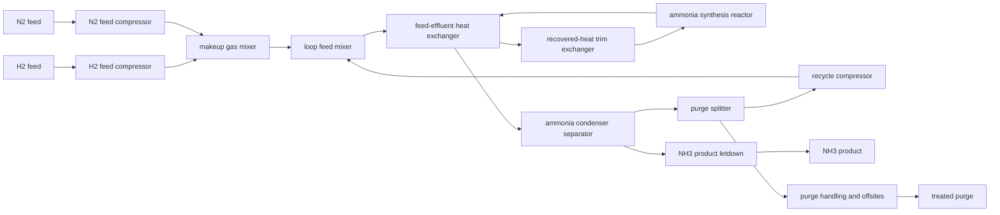

# Industrial catalyst choice for ammonia synthesis from N2 and H2

## Executive answer

- **Dataset:** 102 candidates were screened; 19 downloads were attempted (below the cap of 20), 15 PDFs were obtained and parsed, and **222 operating-point records from 12 papers** passed the completeness and plausibility gates.
- **Reference synthesis loop:** 657.94 USD/t NH3 at 773.15 K, 250 bar and 15% per-pass N2 conversion. H2 feed is 532.68 USD/t (81.0% of total).
- **Plant choice among measured records:** **BaH2-BaO/Fe/CaH2** from 10_1021_jacs_2c13015, measured at 100 °C, with modeled cost **603.95 USD/t**. The plant operates this record at 573.15 K, 80 bar and 15% per-pass conversion.
- **Does the laboratory ranking predict the plant ranking?** Only partly. At operating-point level the top choice changed in **11/26 groups (42.3%, 95% bootstrap interval 24.2–66.7%)**; at catalyst level it changed in **4/25 groups (16.0%, 95% interval 5.0–27.3%)**. Most changes were small: no changed case had more than 5% regret, and the median regret among changed operating-point choices was 0.46%.
- **Why rankings change:** the plant transfers productivity to a common pressure/temperature, enforces reversible equilibrium, sizes catalyst inventory and reactor volume, and trades per-pass conversion against recycle compression and condensation. Seven of the eleven point-level changes selected another temperature of the same catalyst; four selected another catalyst.
- **What controls cost:** the absolute cost is controlled by H2 feed, not catalyst. Within the catalyst-property attribution, metal cost contributes 80.7%, activity 10.9%, temperature 8.4%, and measured selectivity/stability 0% because the usable records reported unity NH3 selectivity and almost no comparable lifetime data. Doubling reference activity lowers cost by about 14.02 USD/t.
- **Attenuation:** feedstock cost strongly compresses catalyst differences. Equilibrium and the 15% conversion bound make additional laboratory conversion less valuable; recycle/separation penalize low conversion; equipment scaling attenuates activity gains once catalyst inventory is no longer the dominant capital item; expensive Ru can erase activity advantages.

## 1. Search, screening, extraction and exclusions

### Inclusion criteria
Primary experimental heterogeneous thermal synthesis directly from molecular N2 and H2; named catalyst; temperature, pressure and feed composition; quantitative NH3 rate/productivity or conversion; conventional gas–solid reactor. NH3 selectivity was set to unity only where NH3 was the sole reported nitrogen product. Conversion was derived only where a published rate and flow/space-velocity basis allowed a stoichiometric calculation.

### Exclusion criteria
Reviews and perspectives; DFT-only studies; electrochemical, photochemical, plasma, microwave or electric-field-assisted routes; nitrate/nitrite feed; chemical looping or sacrificial nitrogen carriers; ammonia decomposition; homogeneous catalysis; process-only simulation; missing quantitative conditions. Screening excluded 82 of 102 candidates. Frequent explicit reasons were electrochemical nitrate/nitrite reduction, review/non-primary article, plasma-assisted synthesis, computation-only work and missing direct N2/H2 performance.

### Parsed experimental papers

| DOI | Title | Extracted records | Usable | Main disposition |
|---|---|---:|---:|---|
| 10.1016/j.ijhydene.2018.08.002 | Promotion effect of proton-conducting oxide BaZr0.1Ce0.7Y0.2O3−δ on the catalytic activity of Ni towards ammonia synthesis from hydrogen and nitrogen | 24 | 16 | Included in plant ranking |
| 10.1016/j.ijhydene.2024.08.408 | Development of ruthenium-based catalysts for ammonia synthesis via polyol reduction method | 36 | 34 | Included in plant ranking |
| 10.1021/acs.iecr.3c00384 | Simulation Analysis for Design of H2/N2 Ratio of Feed Gas to Ammonia Synthesis Process Using Ru/CeLaTiOx Catalyst | 17 | 0 | Excluded after extraction: no record with conversion or a complete derivation basis |
| 10.1021/acs.jpcc.1c04002 | Importance of Hydrogen Migration in Catalytic Ammonia Synthesis over Yttrium-Doped Barium Zirconate-Supported Ruthenium Nanoparticles: Visualization of Proton Trap Sites | 17 | 17 | Included in plant ranking |
| 10.1021/acssuschemeng.7b02812 | In-Situ Formation of Fe Nanoparticles from FeOOH Nanosheets on γ-Al2O3 as Efficient Catalysts for Ammonia Synthesis | 32 | 32 | Included in plant ranking |
| 10.1021/jacs.2c13015 | Low-Temperature Ammonia Synthesis on Iron Catalyst with an Electron Donor | 29 | 23 | Included in plant ranking |
| 10.1021/jacs.4c03875 | Unlocking the Potential of MXene in Catalysis: Decorated Mo2CTx Catalyst for Ammonia Synthesis under Mild Conditions | 11 | 11 | Included in plant ranking |
| 10.1021/jacs.5c09736 | Ru Single Atom and Nanoparticle Tandem Catalyst Unlocking High-Efficiency Ammonia Synthesis under Mild Conditions | 22 | 16 | Included in plant ranking |
| 10.1038/ncomms7731 | Electride support boosts nitrogen dissociation over ruthenium catalyst and shifts the bottleneck in ammonia synthesis | 8 | 0 | Excluded after extraction: plotted activities were not recovered as numeric NH3 rates |
| 10.1038/s41467-020-15868-8 | Solid solution for catalytic ammonia synthesis from nitrogen and hydrogen gases at 50 °C | 5 | 4 | Included in plant ranking |
| 10.1038/s41467-023-42050-7 | Multiple reaction pathway on alkaline earth imide supported catalysts for efficient ammonia synthesis | 27 | 26 | Included in plant ranking |
| 10.1038/s41467-025-63064-3 | Machine learning-assisted Ru-N bond regulation for ammonia synthesis | 32 | 32 | Included in plant ranking |
| 10.1038/s41929-022-00754-x | Potassium hydride-intercalated graphite as an efficient heterogeneous catalyst for ammonia synthesis | 36 | 1 | Included in plant ranking |
| 10.1039/d2ra06053a | On the effect of metal loading on the performance of Co catalysts supported on mixed MgO–La 2 O 3 oxides for ammonia synthesis | 10 | 10 | Included in plant ranking |

Four additional screened papers could not be used because no PDF was retrieved within the capped download campaign; one parsed high-entropy-alloy paper produced no extractable synthesis records. The final denominators are therefore 12 papers and 222 records, not the 20 title/abstract inclusions.

## 2. Mechanism and kinetic transfer

- Aggregate dissociative mechanism: N2 adsorption/dissociation, H2 dissociation, sequential N hydrogenation and NH3 desorption. Associative benefits of hydrides/single atoms remain embedded in each measured productivity anchor.
- Each record is anchored to measured NH3 productivity. Transfer to plant conditions uses an Arrhenius factor, aggregate pressure exponent, feed-composition correction and a reversible approach-to-equilibrium term. The lab conversion is used to estimate how equilibrium-suppressed the reported rate was; it is not copied as the plant conversion.
- The plant deterministically optimizes temperature, pressure and per-pass conversion. Equilibrium is solved for N2 + 3H2 ⇌ 2NH3; the checked operating conversion is capped at 15% nominal and never exceeds the independent equilibrium gate.
- Catalyst life uses a reported 10%-activity time where available; otherwise 48,000 h is assumed and varied. Sparse stability data mean the analysis cannot establish stability as a ranking control.

## 3. Boundary, reactor and flowsheet

Battery limit: Purified gaseous H2 and N2 at the synthesis-loop battery limit through compression, mixing, heat recovery, trim heating, catalytic conversion, NH3 condensation/separation, recycle, purge handling and product letdown; upstream H2 production, air separation, ammonia storage and export are excluded.

The model includes separate H2/N2 feed compressors, makeup and recycle mixing, feed/effluent heat recovery, recovered-heat trim exchange, a multi-bed fixed-bed converter, explicit interbed heat recovery, NH3 condensation/separation, recycle compression, purge splitting/handling, product letdown and offsites. Upstream H2 production and air separation, storage/export and catalyst regeneration are excluded. The nominal boundary uses impurity-free feeds and pure NH3; feed/product purity and purge are retained as sensitivities.

## 4. Model equations and represented effects

- Fresh stoichiometric feed is 0.8225 t N2 and 0.1776 t H2 per tonne NH3 before purge/selectivity losses. Reactor throughput increases as per-pass conversion falls; recycle, separator feed and recycle-compressor duty therefore change with conversion.
- Feed and recycle compressors use isothermal work with sourced/assumed efficiency. Sensible preheat is recovered from hot effluent; reaction heat is assigned to the interbed recovery exchanger. Condensation includes sensible cooling plus NH3 latent duty and a COP-dependent electric load.
- Catalyst mass equals hourly NH3 production divided by transferred productivity, multiplied by an inventory design factor. Reactor capital scales with both plant capacity and catalyst volume. Catalyst replacement is inventory × operating hours/life and uses fixed-table support/manufacturing and metal prices.
- Installed capital is calculated separately for every submitted flowsheet unit, summed once, and annualized by the fixed-table capital recovery factor plus fixed O&M. No published ammonia cost is copied into the result.

## 5. Parameter table

The full auditable table is also stored in `sources.csv`. Assumptions have explicit low/high values; all prices, the capital recovery factor and fixed O&M are frozen entries from `prices.json`.

| Parameter | Value | Unit | Type | Low | High | Source | Location |
|---|---:|---|---|---:|---:|---|---|
| basis.capacity_t_per_y | 600000 | t/y | assumption | 300000 | 1000000 |  |  |
| basis.operating_hours_per_y | 8000 | h/y | assumption | 7500 | 8400 |  |  |
| basis.feeds.H2.T_K | 298.15 | K | assumption | 288.15 | 313.15 |  |  |
| basis.feeds.H2.P_bar | 30.0 | bar | assumption | 20.0 | 40.0 |  |  |
| basis.feeds.H2.purity_mol_frac | 1.0 | mol/mol | assumption | 0.999 | 1.0 |  | Nominal impurity-free boundary; uncertainty permits trace impurity |
| basis.feeds.N2.T_K | 298.15 | K | assumption | 288.15 | 313.15 |  |  |
| basis.feeds.N2.P_bar | 30.0 | bar | assumption | 20.0 | 40.0 |  |  |
| basis.feeds.N2.purity_mol_frac | 1.0 | mol/mol | assumption | 0.999 | 1.0 |  | Nominal impurity-free boundary; uncertainty permits trace impurity |
| basis.product.NH3.P_bar | 20.0 | bar | assumption | 15.0 | 30.0 |  |  |
| basis.product.NH3.purity_mol_frac | 1.0 | mol/mol | assumption | 0.998 | 1.0 |  | Pure-NH3 accounting basis; uncertainty includes commercial specification |
| basis.utilities.cooling_water_supply_T | 298.15 | K | assumption | 288.15 | 303.15 |  |  |
| basis.utilities.cooling_water_return_T | 308.15 | K | assumption | 303.15 | 318.15 |  |  |
| basis.utilities.electricity_primary_energy_factor | 2.5 | GJ_primary/GJ_electric | assumption | 1.0 | 3.0 |  |  |
| basis.utilities.refrigeration_COP | 4.0 | GJ_cooling/GJ_electric | assumption | 2.5 | 6.0 |  |  |
| prices.hydrogen | 3.0 | USD/kg | price_table | 1.5 | 7.0 | prices.json:hydrogen | Becker, Penev & Braun, J. Energy Resour. Technol. 2019 anchor 3 USD/kg; grey about 2, electrolytic 5-7 (DOE Pathways to Commercial Liftoff: Clean Hydrogen, 2024) |
| prices.electricity | 80.0 | USD/MWh | price_table | 40.0 | 150.0 | prices.json:electricity | industrial power assumption used across the NCE chains; EIA 2024 US industrial average about 80 USD/MWh |
| prices.catalyst_support_and_manufacturing | 20.0 | USD/kg | price_table | 5.0 | 100.0 | prices.json:catalyst_support_and_manufacturing | NCE chain assumption for support plus manufacturing per kg of finished catalyst, excluding active metals |
| prices.metal_Ru | 53852.5 | USD/kg | price_table | 26926.25 | 107705.0 | prices.json:metal_Ru | frozen NH3 harness prices (Ru, Os, Fe, Rh, Ir, Co, Re, Mo, Ni, W, Pd, Pt, Cu, Ag, Au) + USGS Mineral Commodity Summaries 2026 per kg contained element; see analysis/meoh_catalyst_cost_2026_10_06/catalyst_prices.py (per kg contained element) |
| prices.metal_Fe | 8.0 | USD/kg | price_table | 4.0 | 16.0 | prices.json:metal_Fe | frozen NH3 harness prices (Ru, Os, Fe, Rh, Ir, Co, Re, Mo, Ni, W, Pd, Pt, Cu, Ag, Au) + USGS Mineral Commodity Summaries 2026 per kg contained element; see analysis/meoh_catalyst_cost_2026_10_06/catalyst_prices.py (per kg contained element) |
| prices.metal_Co | 56.28401553583051 | USD/kg | price_table | 28.142007767915256 | 112.56803107166103 | prices.json:metal_Co | frozen NH3 harness prices (Ru, Os, Fe, Rh, Ir, Co, Re, Mo, Ni, W, Pd, Pt, Cu, Ag, Au) + USGS Mineral Commodity Summaries 2026 per kg contained element; see analysis/meoh_catalyst_cost_2026_10_06/catalyst_prices.py (per kg contained element) |
| prices.metal_K | 1.4455393066229791 | USD/kg | price_table | 0.7227696533114896 | 2.8910786132459583 | prices.json:metal_K | frozen NH3 harness prices (Ru, Os, Fe, Rh, Ir, Co, Re, Mo, Ni, W, Pd, Pt, Cu, Ag, Au) + USGS Mineral Commodity Summaries 2026 per kg contained element; see analysis/meoh_catalyst_cost_2026_10_06/catalyst_prices.py (per kg contained element) |
| prices.capital_recovery_factor | 0.0944 | 1/y | price_table | 0.08 | 0.13 | prices.json:capital_recovery_factor | 7 %/y over 20 y (Enterprise Products PDH, EPA GHG permit application 2012); range 5-12 %/y |
| prices.fixed_om_fraction_of_capex | 0.04 | 1/y | price_table | 0.02 | 0.06 | prices.json:fixed_om_fraction_of_capex | NCE chain assumption, 4 %/y of installed capital |
| thermo.reaction_heat_J_per_mol_NH3 | 46110 | J/mol NH3 | published | 45900 | 46300 | https://webbook.nist.gov/cgi/cbook.cgi?ID=C7664417&Mask=1 | Gas-phase thermochemistry table: standard enthalpy of formation of NH3(g) about -46.11 kJ/mol |
| thermo.reaction_entropy_J_per_molrxn_K | -198.9 | J/mol-reaction/K | published | -205 | -190 | https://webbook.nist.gov/cgi/cbook.cgi?ID=C7664417&Mask=1 | Calculated from NIST standard molar entropies for NH3, N2 and H2 at 298.15 K for N2+3H2 to 2NH3 |
| thermo.gas_cp_GJ_per_kmol_K | 3.1e-05 | GJ/kmol/K | assumption | 2.8e-05 | 3.6e-05 | https://webbook.nist.gov/cgi/cbook.cgi?ID=C7727379&Mask=1 | NIST gas heat-capacity data near 300-800 K; rounded mixture-average engineering value |
| thermo.nh3_condensation_GJ_per_t | 1.37 | GJ/t NH3 | assumption | 1.1 | 1.6 | https://webbook.nist.gov/cgi/cbook.cgi?ID=C7664417&Mask=4 | NIST phase-change enthalpy data, converted and rounded to product-mass basis |
| compression.isentropic_efficiency | 0.75 | fraction | published | 0.7 | 0.9 | https://www.nrel.gov/docs/fy04osti/36219.pdf | NREL compressor analysis states isentropic efficiency is typically 70-90%, with 75% an appropriate assumption |
| compression.recycle_pressure_drop_fraction | 0.03 | fraction | assumption | 0.01 | 0.08 |  | Synthesis-loop pressure loss across beds, exchangers and separator |
| separation.nh3_recovery | 1.0 | fraction | assumption | 0.995 | 1.0 |  | Nominal complete NH3 recovery for pure-product accounting; lower bound covers small unrecovered fraction |
| separation.purge_fraction | 0.0 | fraction | assumption | 0.0 | 0.01 | https://www.linde-engineering.com/products-and-services/process-plants/hydrogen-and-synthesis-gas/gas-synthesis | Linde LAC description states inert-free synthesis gas avoids syngas purges and a purge-gas separation step |
| heat_exchange.effectiveness | 0.75 | fraction | assumption | 0.6 | 0.9 |  | Feed-effluent exchanger effectiveness |
| kinetics.apparent_Ea_J_per_mol | 80000 | J/mol | assumption | 40000 | 160000 |  | Cross-catalyst transfer parameter spanning reported apparent activation energies |
| kinetics.pressure_exponent | 0.7 | dimensionless | assumption | 0.0 | 1.5 |  | Aggregate pressure dependence used only to transfer each measured productivity |
| kinetics.composition_exponent | 1.0 | dimensionless | assumption | 0.0 | 2.0 |  | Stoichiometric-feed correction exponent around each laboratory anchor |
| kinetics.minimum_rate_kgkg_h | 1e-08 | kg NH3/kg catalyst/h | assumption | 1e-10 | 1e-06 |  | Numerical floor for catalyst inventory sizing |
| operation.T_min_K | 573.15 | K | assumption | 523.15 | 623.15 | https://www.mdpi.com/2077-0375/15/10/308 | Review discussion of industrial Fe catalyst synthesis-loop operation around 350-520 C |
| operation.T_max_K | 773.15 | K | assumption | 723.15 | 823.15 | https://www.mdpi.com/2077-0375/15/10/308 | Review discussion of industrial Fe catalyst synthesis-loop operation around 350-520 C |
| operation.P_min_bar | 80.0 | bar | assumption | 50 | 120 | https://valmet.com/insights/articles/services/taking-the-heat/ | Typical ammonia converter operation reported in the 100-200 bar range |
| operation.P_max_bar | 250.0 | bar | assumption | 180 | 300 | https://valmet.com/insights/articles/services/taking-the-heat/ | Typical ammonia converter operation reported in the 100-200 bar range |
| operation.X_min | 0.03 | fraction | assumption | 0.01 | 0.08 |  | Lower per-pass conversion bound to limit pathological recycle |
| operation.X_max | 0.15 | fraction | assumption | 0.10 | 0.20 | 10.1016/j.energy.2017.06.157 | Industrial ammonia-loop configurations and converter operation support a conservative per-pass conversion range around the 15% nominal bound |
| operation.equilibrium_margin | 0.97 | fraction | assumption | 0.9 | 0.995 |  | Keep numerical optimum below equilibrium conversion |
| catalyst.default_life_h | 48000 | h | published | 24000 | 80000 | https://www.clariant.com/en/Business-Units/Catalysts/Syngas-Catalysts/Ammonia | Industrial ammonia synthesis catalyst example reports six-year service life; converted at 8000 h/y |
| catalyst.bulk_density_kg_m3 | 1100 | kg/m3 | assumption | 700 | 1600 |  | Representative packed catalyst bulk density for reactor-volume sizing |
| catalyst.inventory_design_factor | 1.25 | dimensionless | assumption | 1.0 | 2.0 |  | Extra installed catalyst volume for maldistribution, aging and reserve activity |
| capital.scaling_exponent | 0.6 | dimensionless | assumption | 0.5 | 0.75 | https://www.netl.doe.gov/projects/files/QGESSCostEstimationMethodologyforNETLAssessmentsforEnergyAnalysisPerspective_040419.pdf | NETL cost-estimation methodology discusses capacity-factor scaling for conceptual equipment estimates |
| capital.reference_capacity_tpy | 600000 | t/y | assumption | 300000 | 1000000 | https://www.mdpi.com/2077-0375/15/10/308 | Industrial ammonia plant capacities discussed in the 1000-3000 t/day range; 600 kt/y reference is within that range |
| capital.H2_feed_compressor_usd | 28000000.0 | USD | assumption | 14000000.0 | 56000000.0 |  | Installed cost allocation at the 600 kt/y reference basis; summed loop cost is constrained by literature-scale conceptual estimates |
| capital.N2_feed_compressor_usd | 18000000.0 | USD | assumption | 9000000.0 | 36000000.0 |  | Installed cost allocation at the 600 kt/y reference basis; summed loop cost is constrained by literature-scale conceptual estimates |
| capital.makeup_gas_mixer_usd | 1000000.0 | USD | assumption | 500000.0 | 2000000.0 |  | Installed cost allocation at the 600 kt/y reference basis; summed loop cost is constrained by literature-scale conceptual estimates |
| capital.loop_feed_mixer_usd | 1000000.0 | USD | assumption | 500000.0 | 2000000.0 |  | Installed cost allocation at the 600 kt/y reference basis; summed loop cost is constrained by literature-scale conceptual estimates |
| capital.feed_effluent_heat_exchanger_usd | 22000000.0 | USD | assumption | 11000000.0 | 44000000.0 |  | Installed cost allocation at the 600 kt/y reference basis; summed loop cost is constrained by literature-scale conceptual estimates |
| capital.electric_trim_heater_usd | 6000000.0 | USD | assumption | 3000000.0 | 12000000.0 |  | Installed cost allocation at the 600 kt/y reference basis; summed loop cost is constrained by literature-scale conceptual estimates |
| capital.ammonia_synthesis_reactor_usd | 85000000.0 | USD | assumption | 42500000.0 | 170000000.0 |  | Installed cost allocation at the 600 kt/y reference basis; summed loop cost is constrained by literature-scale conceptual estimates |
| capital.ammonia_condenser_separator_usd | 55000000.0 | USD | assumption | 27500000.0 | 110000000.0 |  | Installed cost allocation at the 600 kt/y reference basis; summed loop cost is constrained by literature-scale conceptual estimates |
| capital.purge_splitter_usd | 500000.0 | USD | assumption | 250000.0 | 1000000.0 |  | Installed cost allocation at the 600 kt/y reference basis; summed loop cost is constrained by literature-scale conceptual estimates |
| capital.recycle_compressor_usd | 3500000.0 | USD | assumption | 1500000.0 | 7000000.0 |  | Installed recycle pressure-loss compressor allocation at the reference basis |
| capital.NH3_product_letdown_usd | 1500000.0 | USD | assumption | 750000.0 | 3000000.0 |  | Installed cost allocation at the 600 kt/y reference basis; summed loop cost is constrained by literature-scale conceptual estimates |
| capital.purge_handling_and_offsites_usd | 35000000.0 | USD | assumption | 17500000.0 | 70000000.0 |  | Installed cost allocation at the 600 kt/y reference basis; summed loop cost is constrained by literature-scale conceptual estimates |
| capital.catalyst_volume_reference_m3 | 250.0 | m3 | assumption | 100 | 600 |  | Reference converter catalyst volume used to scale reactor installed cost when low activity requires larger inventory |
| reference.T_K | 723.15 | K | published | 723.15 | 723.15 | 10.1021/acssuschemeng.7b02812 | Figure 5a, FeOOH/Al2O3 (25% Fe), 450 C |
| reference.P_bar | 90.0 | bar | published | 90 | 90 | 10.1021/acssuschemeng.7b02812 | Experimental section and Figure 5a |
| reference.X | 0.005814 | fraction | measured | 0.0055 | 0.0062 | 10.1021/acssuschemeng.7b02812 | Derived from published NH3 rate and 200 N mL/min feed over 1 g catalyst at N2:H2=1:3 |
| reference.S | 1.0 | fraction | measured | 1 | 1 | 10.1021/acssuschemeng.7b02812 | NH3 is the sole reported nitrogen-containing product |
| reference.r | 0.026502 | kg NH3/kg catalyst/h | measured | 0.024 | 0.029 | 10.1021/acssuschemeng.7b02812 | Figure 5a normalized record at 450 C |
| reference.y_key | 0.25 | mol/mol | published | 0.25 | 0.25 | 10.1021/acssuschemeng.7b02812 | Experimental stoichiometric N2:H2=1:3 feed |
| reference.y_cofeed | 0.75 | mol/mol | published | 0.75 | 0.75 | 10.1021/acssuschemeng.7b02812 | Experimental stoichiometric N2:H2=1:3 feed |
| thermo.R_J_per_mol_K | 8.314462618 | J/mol/K | published | 8.314462618 | 8.314462618 | 10.1103/RevModPhys.93.025010 | CODATA 2018 molar gas constant |
| catalyst.default_metal_loading_wt_frac | 0.05 | kg metal/kg catalyst | assumption | 0.01 | 0.2 |  | Fallback total active-metal loading where literature composition lacks weight percentages |
| capital.nominal_conversion | 0.15 | fraction | assumption | 0.1 | 0.22 |  | Nominal loop conversion for duty-ratio capital scaling |
| capital.nominal_pressure_bar | 150.0 | bar | assumption | 100 | 200 | https://valmet.com/insights/articles/services/taking-the-heat/ | Representative synthesis-loop pressure within the reported 100-200 bar range |
| capital.minimum_scale_factor | 0.05 | dimensionless | assumption | 0.02 | 0.2 |  | Lower bound preventing conceptual equipment costs from vanishing at low calculated duty |
| thermo.reaction_heat_temperature_coefficient_J_per_molNH3_K | 15.4 | J/mol NH3/K | assumption | 10.0 | 22.0 | https://webbook.nist.gov/cgi/cbook.cgi?ID=C7664417&Mask=1 | Effective temperature correction derived from NIST ideal-gas heat capacities over the synthesis range |
| capital.interbed_heat_recovery_usd | 20000000.0 | USD | assumption | 10000000.0 | 50000000.0 |  | Installed integrated interbed cooling and steam-generation allocation at the 600 kt/y basis |

## 6. Reference plant result and reconciliation

| Cost part | USD/t NH3 | Share |
|---|---:|---:|
| feed | 532.676 | 80.96% |
| energy | 41.530 | 6.31% |
| capital | 79.217 | 12.04% |
| catalyst | 4.513 | 0.69% |
| other | 0.000 | 0.00% |
| **Total** | **657.936** | **100%** |

- Purchased primary energy: **4.672 GJ/t**.
- Installed synthesis-loop capital: **353.65 million USD** at **600,000 t/y**.
- Annual capital plus fixed O&M contribution reconciles as capex × (CRF + fixed-O&M fraction) / annual capacity = **79.217 USD/t**.
- Reference catalyst inventory: **739,243 kg**, **672.0 m3**, transferred productivity **0.1268 kg NH3 kgcat-1 h-1**, life **48,000 h**.

### Unit capital and purchased energy

| Unit | Type | Capex, million USD | Purchased primary energy, GJ/t | Recovered/internal heat, GJ/t |
|---|---|---:|---:|---:|
| H2 feed compressor | compressor | 33.036 | 1.5431 | 0.0000 |
| N2 feed compressor | compressor | 21.237 | 0.5144 | 0.0000 |
| makeup gas mixer | other | 1.000 | 0.0000 | 0.0000 |
| loop feed mixer | other | 1.000 | 0.0000 | 0.0000 |
| feed effluent heat exchanger | heat_exchanger | 24.210 | 0.0000 | 8.5400 |
| recovered-heat trim exchanger | heat_exchanger | 0.000 | 0.0000 | 2.8467 |
| ammonia synthesis reactor | reactor | 153.848 | 0.0000 | 0.0000 |
| interbed heat recovery exchanger | heat_exchanger | 19.988 | 0.0000 | 3.1369 |
| ammonia condenser separator | separation | 55.000 | 2.4434 | 0.0000 |
| purge splitter | other | 0.500 | 0.0000 | 0.0000 |
| recycle compressor | compressor | 7.328 | 0.1713 | 0.0000 |
| NH3 product letdown | other | 1.500 | 0.0000 | 0.0000 |
| purge handling and offsites | offsites | 35.000 | 0.0000 | 0.0000 |

## 7. Laboratory versus plant ranking

| Laboratory metric used for ranking | Level | Groups | Changed | Fraction changed | Papers | Papers with change | >1% regret | >5% regret |
|---|---|---:|---:|---:|---:|---:|---:|---:|
| productivity | point level | 26 | 11 | 42.3% | 11 | 8 | 3 | 0 |
| productivity | catalyst level | 25 | 4 | 16.0% | 10 | 4 | 1 | 0 |
| conversion | point level | 26 | 11 | 42.3% | 11 | 8 | 3 | 0 |
| conversion | catalyst level | 25 | 4 | 16.0% | 10 | 4 | 1 | 0 |
| selectivity | point level | 26 | 0 | 0.0% | 11 | 0 | 0 | 0 |
| selectivity | catalyst level | 25 | 0 | 0.0% | 10 | 0 | 0 | 0 |

Of 222 records, **166** are cheaper than the reference. The cheapest measured record is BaH2-BaO/Fe/CaH2 at 603.950 USD/t. Productivity and conversion rankings have identical change counts because the normalized dataset derives conversion from product rate and gas throughput where direct conversion was absent; they are not independent observables. Selectivity does not discriminate because usable records are unity-selectivity direct NH3 synthesis.

### Property attribution

| Property | Share of one-at-a-time catalyst-property effect |
|---|---:|
| selectivity | 0.0% |
| activity | 10.9% |
| temperature | 8.4% |
| stability | 0.0% |
| metal | 80.7% |

“Metal” dominates this attribution because precious-metal inventory price can offset activity, but it does **not** dominate total ammonia cost: H2 feed does. Activity gains matter mainly for low-rate records by shrinking catalyst inventory/reactor volume. Temperature affects transferred rate, equilibrium and heat integration. Equilibrium/recycle attenuate nominal conversion gains, and common compression/separation equipment makes the cost surface flatter than laboratory rates suggest.

## 8. Deterministic sensitivity

The table below gives the largest reference-cost swings from `sensitivity.json`; each range is varied one at a time and the record ranking is recomputed.

| Parameter | Kind | Cost swing | Low cost | High cost | Cheapest changes? | Minimum Spearman rank correlation |
|---|---|---:|---:|---:|---|---:|
| prices.hydrogen | price_table | 148.43% | 391.60 | 1368.17 | no | 1.000 |
| capital.reference_capacity_tpy | assumption | 9.39% | 698.79 | 637.02 | no | 0.999 |
| prices.electricity | price_table | 8.66% | 637.17 | 694.17 | no | 1.000 |
| capital.ammonia_synthesis_reactor_usd | assumption | 7.88% | 640.55 | 692.40 | no | 0.995 |
| operation.T_max_K | assumption | 6.08% | 685.14 | 645.12 | no | 0.999 |
| capital.catalyst_volume_reference_m3 | assumption | 5.98% | 683.19 | 643.85 | no | 0.989 |
| separation.purge_fraction | assumption | 4.80% | 657.94 | 689.54 | no | 1.000 |
| prices.capital_recovery_factor | price_table | 4.48% | 649.45 | 678.92 | no | 1.000 |
| kinetics.apparent_Ea_J_per_mol | assumption | 4.46% | 670.51 | 641.14 | yes | 0.938 |
| kinetics.pressure_exponent | assumption | 4.36% | 670.75 | 642.06 | no | 0.898 |
| prices.fixed_om_fraction_of_capex | price_table | 3.58% | 646.15 | 669.72 | no | 0.999 |
| operation.X_max | assumption | 3.20% | 671.85 | 650.77 | no | 1.000 |
| basis.utilities.refrigeration_COP | assumption | 3.08% | 670.97 | 650.70 | no | 1.000 |
| prices.catalyst_support_and_manufacturing | price_table | 2.97% | 654.86 | 674.36 | no | 0.998 |
| catalyst.inventory_design_factor | assumption | 2.91% | 652.71 | 671.87 | no | 1.000 |

Hydrogen price changes absolute cost by 148.4% across its fixed-table range but leaves the catalyst ranking unchanged (Spearman 1.0): it is a common stoichiometric burden. The leading measured catalyst changes only for the broad apparent-activation-energy range, where the high end selects 12 wt% Ru/CaFH. Pressure exponent and activation energy are the main ranking uncertainties; capacity, electricity, reactor cost and heat integration change absolute cost more than rank.

## 9. Atomic, laboratory and industrial optima

- **Atomic optimum:** N-binding descriptor **-0.3725 eV/N**, log10 TOF **5.047** at 773.15 K and the reported N2/H2 partial pressures. This is the top of the one-descriptor Sabatier volcano.
- **Laboratory optimum:** BaH2-BaO/Fe/CaH2, record 1, productivity **12 kg NH3 kgcat-1 h-1**, modeled cost 603.950 USD/t.
- **Industrial measured optimum:** BaH2-BaO/Fe/CaH2, record 2, productivity **2**, modeled cost **603.950 USD/t**.
- **Descriptor-based industrial optimum:** all metal-price cases choose D = -0.4175 eV/N. Costs are 606.837 USD/t for Fe, 606.841 for Ni, 606.861 for Co, 606.878 for Mo and 614.117 for Ru. Thus backward design targets moderate N binding near -0.4 eV on a low-cost metal/support architecture rather than the most expensive metal at the exact atomic TOF maximum.
- The atomic optimum and plant descriptor optimum differ by about 0.045 eV. The plant shifts slightly toward stronger N binding because transferred activity, inventory/capital and metal price are optimized jointly. Many Ni records map outside the declared descriptor range, showing that support, proton conduction, hydrides and site-density differences cannot be collapsed into N binding alone.

## 10. Evidence debts and limitations

The following assumptions were searched and deliberately retained as uncertainty because no universal value was supported:
- **basis.feeds.H2.P_bar:** Retain 20–40 bar because no universal purified-hydrogen boundary pressure exists and the supply architecture determines it.
- **basis.utilities.electricity_primary_energy_factor:** Retain 1–3 because primary-energy conversion is an accounting convention tied to grid mix, not a unique plant constant.
- **basis.utilities.refrigeration_COP:** Retain the broad COP range because condensation configuration and temperature lift are design-specific and no unique public value applies.
- **heat_exchange.effectiveness:** Retain 0.60–0.90 because area, approach temperature, fouling and loop flow vary among catalyst cases.
- **kinetics.pressure_exponent:** Retain 0–1.5 because pressure dependence differs across Fe, Ru, Co, hydride and nitride catalysts.
- **operation.X_max:** Retain the narrowed 10–20% range because the 15% nominal is supported but no tighter bound is universal across catalyst thermodynamics.

- Rate transfer uses one apparent activation energy and aggregate pressure exponent across chemically diverse catalysts. The sensitivity table therefore carries more weight than the nominal cross-family kinetic extrapolation.
- Most papers did not report comparable catalyst lifetime; stability could not be ranked. Unity NH3 selectivity is chemically reasonable for direct thermal N2/H2 synthesis but prevents a selectivity ranking.
- Several conversions were derived from published rate plus flow/space velocity and catalyst basis. This is transparent in each record location, but digitization/normalization uncertainty remains.
- Catalyst support/promoter prices are represented by the fixed support/manufacturing entry unless a listed metal price is available. Cs and complex hydride/imide synthesis costs are not independently priced.
- The boundary excludes H2 production and air separation. Consequently the result is a synthesis-loop catalyst comparison, not a full green/grey ammonia levelized cost.
- The atomic model is a single-site, single-descriptor mean-field model. It is useful for backward design and disagreement diagnosis, not for claiming quantitative support/promoter microkinetics.

## 11. Bottom line

Laboratory ranking is directionally useful but not sufficient. The plant usually agrees on the best catalyst family, yet often chooses a different operating point after equilibrium, common-pressure transfer, recycle, condensation, catalyst inventory and metal price are imposed. Because H2 is about 81% of synthesis-loop cost, even large activity differences produce modest total-cost regret. The most useful catalyst target is therefore not simply the highest measured rate: it is a stable, low-cost material with moderate N binding near the volcano maximum, enough activity to make catalyst inventory non-dominant, and operation compatible with low pressure/temperature without sacrificing equilibrium-limited conversion.