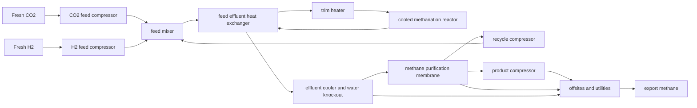

# CO2 methanation catalyst-to-plant ranking report

## Question and answer

**Question.** Does the laboratory ranking of CO2 methanation catalysts by activity, conversion or selectivity predict the catalyst and operating point an industrial plant would choose?

**Answer.** Only partly. In the validated model, the cheapest plant choice among the usable literature records is **Ni20-Al2O3 at 320 °C from 10_1007_s11244_019_01148_3**, at **$1412/t CH4**. A 50 kt/y reference 20 wt% Ni/Al2O3 plant costs **$1445/t CH4**. Laboratory rankings changed materially in a significant minority of comparisons: at the operating-point level, the plant optimum differed from the top lab productivity and conversion point in **5/11 paper groups (45.5%)**, and from the top selectivity point in **3/11 groups (27.3%)**. At the catalyst level, the plant choice differed from the top lab productivity and conversion catalyst in **2/9 groups (22.2%)** and from the top selectivity catalyst in **1/9 groups (11.1%)**.

**Why rankings change.** The plant is dominated by H2 and CO2 feed cost, so once a catalyst has sufficient activity and conversion, extra activity is attenuated by feedstock cost. Very low conversion is punished by recycle/separation/compression. High laboratory conversion is also attenuated by equilibrium and an approach-to-equilibrium catalyst inventory penalty. Selectivity matters strongly when it varies widely because non-CH4 carbon consumes H2/CO2 but does not become product. Expensive noble metals affect ranking mainly when catalyst inventory is large or activity is low.

## Literature search, screening and extraction

### Inclusion criteria

Included papers had to be primary experimental heterogeneous thermocatalytic gas-phase CO2 methanation studies with extractable:

- catalyst identity and composition;
- temperature, pressure or pressure statement;
- feed CO2/H2 composition;
- CO2 conversion;
- CH4 selectivity;
- reported CH4/CO2 rate/productivity, or flow and catalyst mass/WHSV/GHSV sufficient to derive kg CH4 kg_cat^-1 h^-1.

Out of scope were reviews, biological methanation, electrochemical/SOEC-only work, photocatalytic-only or plasma-only work, dry/steam reforming, CO-only methanation, sorption-enhanced cyclic capture/methanation without steady catalytic performance, process-only studies, and records missing the fields needed to normalize activity.

### Downloaded/OCRed papers and usable records

The workflow searched OpenAlex, screened title/abstracts with the above criteria, downloaded/OCRed 16 PDFs, and extracted 214 records. The validated record gate retained **161 usable records from 12 papers**:

| Paper key | Records | Usable | Main reason for unusable records |
|---|---:|---:|---|
| 10_1007_s11144_026_03116_x | 13 | 10 | rate or flow+mass missing for some records |
| 10_1007_s11144_026_03174_1 | 10 | 0 | conversion missing |
| 10_1007_s11244_019_01148_3 | 17 | 10 | conversion missing for some records |
| 10_1007_s11356_024_33327_5 | 36 | 36 | none |
| 10_1007_s42247_024_00929_1 | 8 | 7 | selectivity missing for one record |
| 10_1007_s42461_026_01516_0 | 3 | 3 | none |
| 10_1021_acs_iecr_1c00389 | 13 | 0 | selectivity missing |
| 10_1021_acsaem_8b01681 | 15 | 12 | rate or flow+mass missing for some records |
| 10_1038_s41467_022_27981_x | 9 | 2 | conversion missing for several records |
| 10_1038_s41598_023_31958_1 | 5 | 5 | none |
| 10_1039_d4cp04086d | 6 | 0 | selectivity missing |
| 10_3389_fchem_2022_1041843 | 32 | 32 | none |
| 10_3390_ma15227970 | 1 | 1 | none |
| 10_3390_nano13030506 | 15 | 15 | none |
| 10_62239_jca_2026_037 | 30 | 28 | conversion missing for some records |

The 12 usable-paper denominator excludes the zero-usable downloaded papers. Several otherwise relevant MDPI/Elsevier records were not used when the automated downloader could not obtain PDFs or when screening showed reviews, reforming, biological, plasma/photocatalytic-only, or process-only scope.

## Mechanism and kinetics representation

A single global kinetic law was not fitted because the extracted literature spans Ni, Ru, Co/CoO, Fe and promoted/support-varied systems with inconsistent rate bases and partial-pressure data. Instead, each record is treated as local evidence of apparent plant-relevant productivity at its reported temperature and pressure.

Model choices:

1. **Stoichiometry.** Main reaction is CO2 + 4H2 -> CH4 + 2H2O. Selectivity below unity is represented as carbon converted to CO by CO2 + H2 -> CO + H2O for elemental balance and feed penalty.
2. **Activity transfer.** Literature productivity, kg CH4 kg_cat^-1 h^-1, sets the catalyst inventory at the plant production rate.
3. **Equilibrium and approach.** Per-pass conversion is optimized but capped by the reported lab conversion, a process maximum, and a conservative temperature/pressure equilibrium cap. Catalyst mass rises with 1/(1-X/X_eq), so operation very near equilibrium is penalized.
4. **Selectivity.** Selectivity controls how much converted carbon becomes sale methane. Low selectivity consumes H2/CO2 and increases purge/separation duty.
5. **Stability.** Reported t_cycle_h is used when available; otherwise the default replacement life in sources.csv is used. The evidence was too sparse for deactivation kinetics.

## Reactor and flowsheet

The submitted and validated flowsheet hash is `a9a70b47a33aea89`. The plant is a continuous cooled fixed-bed methanation loop with recycle:

Represented units are: CO2 feed compressor, H2 feed compressor, feed mixer, feed/effluent heat exchanger, trim heater, cooled methanation reactor, effluent cooler and water knockout, methane purification membrane, product compressor, recycle compressor, and offsites/utilities. Catalyst regeneration is excluded because the literature basis generally supports replacement/time-on-stream comparison rather than an in-situ oxidative regeneration cycle.

## Parameters

The complete parameter table is in `sources.csv`. Key base-case parameters are:

| Parameter | Base | Low-high | Type |
|---|---:|---:|---|
| Plant capacity | 50,000 t CH4/y | 10,000-200,000 | assumption |
| Stream factor | 0.90 | 0.80-0.95 | assumption |
| H2 price | $2/kg | $1-5/kg | published/assumption around DOE Hydrogen Shot target |
| CO2 delivered price | $50/t | $20-150/t | published/assumption screening value |
| Electricity price | $0.0938/kWh | $0.05-0.18/kWh | EIA industrial electricity source |
| Catalyst default life | 2 y | 0.5-5 y | assumption |
| Purge fraction | 0.02 | 0.005-0.08 | assumption |
| Product pressure | 30 bar | 10-70 bar | assumption |
| Compressor efficiency | 0.72 | 0.60-0.85 | assumption |
| Methanation heat | -0.180 GJ/kmol CH4 | -0.190 to -0.165 | thermochemistry approximation matched to model checks |

All quoted costs in this report are generated by `model.py` and `run_analysis`, not copied from any techno-economic study.

## Model validation

`check_model` passed on **161 records**. The checker verified the submitted flowsheet, model contract, finite positive costs, parts sum, conversion range, stoichiometry, determinism, monotonicity, and independent physics checks for mass/elements, equilibrium, heat, compression, separation, unit accounting and flowsheet consistency.

Model SHA-256 used in analysis: `f266bc5963042ba7`.

## Reference plant cost

Reference plant: 50 kt/y CO2 methanation with 20 wt% Ni/Al2O3, T = 623.15 K, P = 20 bar, X = 0.75, S = 0.995, r = 1 kg CH4 kg_cat^-1 h^-1.

| Cost component | $/t CH4 | Share |
|---|---:|---:|
| Feed | 1152.12 | 79.7% |
| Energy | 152.52 | 10.6% |
| Capital | 88.80 | 6.1% |
| Catalyst | 15.78 | 1.1% |
| Other O&M | 35.52 | 2.5% |
| **Total** | **1444.73** | **100%** |

The largest component is feed, dominated by hydrogen. This is the central reason that catalyst ranking does not simply follow maximum lab activity.

## Literature catalyst ranking results

Cheapest record:

- Paper: `10_1007_s11244_019_01148_3`
- Catalyst: `Ni20-Al2O3`
- Lab/plant temperature: 320 °C
- Plant cost: **$1412.37/t CH4**
- Records below reference: **11** out of 161 usable records

Ranking-change summary:

| Lab ranking metric | Operating-point groups | Changed | Fraction | 95% CI | >1% regret | >5% regret | >10% regret | Typical cause |
|---|---:|---:|---:|---|---:|---:|---:|---|
| Productivity | 11 | 5 | 45.5% | 18.2-72.7% | 3 | 1 | 1 | activity gains attenuated after catalyst cost becomes small |
| Conversion | 11 | 5 | 45.5% | 18.2-72.7% | 4 | 2 | 2 | high conversion limited by equilibrium/approach; low conversion punished by recycle |
| Selectivity | 11 | 3 | 27.3% | 0-54.5% | 3 | 3 | 3 | low selectivity directly wastes H2/CO2 |

| Lab ranking metric | Catalyst-level groups | Changed | Fraction | 95% CI | Median regret where changed |
|---|---:|---:|---:|---|---:|
| Productivity | 9 | 2 | 22.2% | 0-55.6% | 1.1056 |
| Conversion | 9 | 2 | 22.2% | 0-55.6% | 0.0373 |
| Selectivity | 9 | 1 | 11.1% | 0-33.3% | 0.3086 |

Within changed operating-point comparisons, ranking switches were often to the **same catalyst at another temperature** rather than to a different catalyst: productivity and conversion each had 3 same-catalyst/other-temperature switches and 2 other-catalyst switches; selectivity had 2 same-catalyst/other-temperature switches and 1 other-catalyst switch.

## Controlling catalyst property

The one-at-a-time attribution from `run_analysis` gives the following shares of ranking-relevant cost variation:

| Property | Attribution share |
|---|---:|
| Selectivity | 0.413 |
| Activity/productivity | 0.411 |
| Metal cost | 0.170 |
| Temperature | 0.003 |
| Stability | 0.002 |

Thus, **selectivity and activity are co-controlling**, but in different regimes. Across the whole literature set, selectivity slightly leads because poor selectivity directly wastes expensive H2 and CO2. At the reference point, however, a **2x activity increase saves $11.97/t**, while **+1 percentage point selectivity saves $2.99/t**; this shows that local sensitivities depend on whether the catalyst already has high selectivity.

## Attenuation mechanisms

- **Feedstock cost:** H2 dominates total cost, so once catalyst cost and reactor size are small, further activity improvements have limited value.
- **Equilibrium:** high-temperature records with high apparent rates are capped by the conversion/equilibrium trade-off; pushing closer to equilibrium increases catalyst inventory.
- **Recycle:** low per-pass conversion increases unreacted CO2/H2 recycle flow, recycle compression and separation duty.
- **Separation:** low selectivity and low conversion increase dry gas flow through methane purification; this can overturn lab productivity rankings.
- **Equipment/capital:** capital is meaningful but smaller than feed. It mainly penalizes low activity, low conversion and large recycle loops.
- **Operation/temperature:** temperature alone has little attribution because heat recovery and equilibrium caps offset simple rate advantages; the plant often prefers a moderate-temperature point, not the maximum-rate point.
- **Metal cost:** noble-metal catalysts can lose plant ranking when their activity advantage is not large enough to offset high replacement value; metal cost share is 0.170 in the attribution.

## Sensitivity to uncertain parameters

A model-run sensitivity sweep is in `sensitivity.csv`. Main findings:

| Scenario | Best catalyst/condition | Best cost $/t | Reference cost $/t | Largest reference component |
|---|---|---:|---:|---|
| Base | Ni20-Al2O3, 320 °C | 1412.37 | 1444.73 | feed |
| H2 low, $1/kg | Ni20-Al2O3, 320 °C | 907.66 | 938.06 | feed |
| H2 high, $5/kg | Ni20-Al2O3, 320 °C | 2926.52 | 2964.75 | feed |
| Electricity low | Ni20-Al2O3, 320 °C | 1351.53 | 1377.51 | feed |
| Electricity high | Ni20-Al2O3, 320 °C | 1530.62 | 1577.03 | feed |
| CO2 low | Ni20-Al2O3, 320 °C | 1329.74 | 1361.47 | feed |
| CO2 high | Ni20-Al2O3, 320 °C | 1687.84 | 1722.28 | feed |
| Capex low | Ni20-Al2O3, 320 °C | 1386.86 | 1418.09 | feed |
| Capex high | Ni20-Al2O3, 320 °C | 1454.91 | 1489.13 | feed |
| Catalyst life short | Ni/N-CNT, 360 °C | 1431.61 | 1485.57 | feed |
| Catalyst life long | Ni20-Al2O3, 320 °C | 1406.20 | 1435.26 | feed |
| Purge high | Ni20-Al2O3, 320 °C | 1427.20 | 1470.16 | feed |

The main conclusion is robust to H2, CO2, electricity, capex and purge uncertainty: feed remains the largest reference cost and the same Ni20-Al2O3 point is usually selected. The top choice changes only in the short catalyst-life scenario, where Ni/N-CNT at 360 °C becomes cheapest because lower replacement/catalyst-inventory economics outweigh the base-case advantage of Ni20-Al2O3.

## Evidence gaps and limitations

1. Many papers report conversion/selectivity but not enough flow/catalyst-mass information to compute productivity.
2. Time-on-stream and deactivation are sparse and inconsistent; stability attribution is therefore uncertain and likely under-resolved.
3. The model uses apparent productivity rather than a fitted mechanistic rate law because the literature lacks common pressure-order and approach-to-equilibrium data.
4. CO byproduct is represented only as a stoichiometric/selectivity penalty; detailed downstream CO handling is not resolved.
5. Capex is screening-level and parameterized; it is not a vendor quote or a rigorous Aspen/FEED estimate.
6. Product purification is represented as a membrane/separation duty and recovery model; detailed methane-grid specifications are not optimized.

## Files produced

- `flowsheet.json`: validated plant flowsheet.
- `mechanism_kinetics.md`: kinetic/transfer rationale.
- `sources.csv`: parameter values, sources or assumptions, and uncertainty ranges.
- `model.py`: validated economic/physics model.
- `costs.csv`: plant cost for every usable record.
- `analysis.json`: ranking-change and attribution results.
- `sensitivity.csv`: uncertainty sweep.
