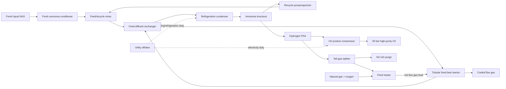

# Industrial ammonia decomposition catalyst-to-plant economic model

**Status:** screening-level open-literature model; `check_model` and `check_atomic` passed. Costs are model outputs in 2024 USD, not copied study estimates.

## Executive conclusions

- **Reference plant cost:** $7,346.82/t H2 at 30,000 t/y. Feed is $5,378.71/t (73.2%), energy $971.90/t (13.2%), capital $636.39/t (8.7%), catalyst $90.17/t (1.2%), and fixed/other $269.66/t (3.7%).
- **Plant choice among 227 usable points from 12 papers:** sole precipitated Fe powder (10.2320/matertrans.43.2763), $7,254.20/t H2. 221/227 points cost less than the Ru/SiC reference, but differences are small relative to total cost.
- **Does laboratory ranking predict plant choice?** Often not at operating-point level: productivity and conversion winners changed in 9/12 comparison groups (75%; 95% CI [0.4545, 1.0]). At catalyst level the winner changed in 2/9 groups (22.2%). However, no changed winner produced >1% regret; the ranking changes are economically shallow.
- **Controlling catalyst-linked property:** operating temperature accounts for 95.0% of modeled catalyst-attributable cost variation, activity 4.6%, stability 0.3%, and metal price 0.2%. Doubling reference activity saves only $45.09/t (0.61%).
- **Why laboratory advantages are attenuated:** ammonia purchase and conversion/recovery dominate; equilibrium and the conservative heat-transfer conversion cap limit usable conversion; recycle/refrigeration/VPSA and compression duties rise as conversion falls; reactor and catalyst costs are small fractions of total cost; higher temperature improves activity but raises sensible heat and materials/equipment burden.
- **Atomic/lab/plant disagreement:** atomic optimum D=-1.000 eV; lab productivity optimum is CeO2/Ni inverse catalyst at 9.628 kg H2 kg-cat^-1 h^-1; measured industrial optimum is Sole Fe powder prepared by precipitation at $7,254.20/t. Pairwise disagreement is 8883/19441 for lab versus industrial ordering.

## 1. Search, screening, papers and exclusions

Experimental screening criteria: primary heterogeneous thermal NH3 decomposition; catalyst identity; quantitative temperature and operating conditions; conversion and/or rate; sufficient flow/catalyst basis to normalize H2 productivity. Reviews, simulations-only, DFT-only, plasma/electrochemical/SOFC-only, ammonia synthesis, homogeneous chemistry, and nonquantitative records were excluded. The experimental search screened 123 candidates; 18 PDFs were successfully parsed (below the 20-download limit), and 12 papers yielded usable normalized data.

| Paper | Extracted | Usable | Decision |
|---|---:|---:|---|
| 10.1002.aic.70247 | 7 | 4 | Included if usable > 0 |
| 10.1002.slct.202405818 | 49 | 26 | Included if usable > 0 |
| 10.1016.j.jiec.2020.11.003 | 51 | 49 | Included if usable > 0 |
| 10.1021.acscatal.4c02313 | 23 | 3 | Included if usable > 0 |
| 10.1021.acssuschemeng.8b06308 | 37 | 32 | Included if usable > 0 |
| 10.1039.c4ra12816h | 48 | 48 | Included if usable > 0 |
| 10.1039.c7cy00086c | 2 | 2 | Included if usable > 0 |
| 10.1039.c8ra06100a | 76 | 0 | Included if usable > 0 |
| 10.1039.d1se00417d | 29 | 29 | Included if usable > 0 |
| 10.1246.bcsj.20200103 | 23 | 0 | Included if usable > 0 |
| 10.1246.cl.2010.918 | 4 | 4 | Included if usable > 0 |
| 10.2320.matertrans.43.2763 | 3 | 1 | Included if usable > 0 |
| 10.2320.matertrans.46.2709 | 19 | 0 | Included if usable > 0 |
| 10.2478.pjct.2014.0080 | 1 | 0 | Included if usable > 0 |
| 10.28948.ngumuh.1571359 | 26 | 26 | Included if usable > 0 |
| 10.3390.pr12061168 | 3 | 3 | Included if usable > 0 |

Downloaded papers excluded after full text:

- **10.1021/acs.jpclett.1c01242:** No experimental catalyst-performance records; mechanistic/theoretical content only.
- **10.18573/jae.33:** System/process paper without separable normalized catalyst performance.
- **10.1039/c8ra06100a:** 76 extracted points but none met the complete normalized productivity/condition gate.
- **10.1246/bcsj.20200103:** 23 extracted points lacked sufficient rate/flow/catalyst-mass basis.
- **10.2320/matertrans.46.2709:** 19 extracted points lacked the complete normalization fields required by the plant model.
- **10.2478/pjct.2014.0080:** Single extracted point lacked sufficient quantitative productivity basis.

Common title/abstract exclusion reasons for the wider candidate set: review/perspective; DFT-only; process simulation without catalyst data; plasma/electrochemical/combustion/SOFC route; wrong reaction (ammonia synthesis or ammonia-borane); no quantitative operating point; inaccessible or non-primary item.

## 2. Mechanism and laboratory-to-plant transfer

- Mechanism: NH3 adsorption, sequential NH3*→NH2*→NH*→N* dehydrogenation, H recombination/desorption, and N recombination/desorption. Nitrogen removal and H inhibition represent the transferable bottleneck.
- Kinetics: each record is anchored to reported H2 productivity and transferred with Arrhenius scaling, positive NH3 order, negative H2 order, and a reversible `(1-Q/K)` driving force. Apparent activation-energy evidence spans 80.2–197.1 kJ/mol.
- Stability: reported cycle time is used when available; otherwise an uncertain default life is applied. Selectivity is one in all usable records, so selectivity cannot be identified as a ranking driver.
- Limitation: a universal transfer law cannot represent every support interface, nitride vacancy, particle size, heat/mass-transfer artifact, or catalyst-specific reaction order.

## 3. Reactor and accepted flowsheet

- Externally heated multitubular packed fixed bed; plant optimizes temperature and per-pass conversion under equilibrium and a conservative heat-transfer/demonstrated-performance cap.
- Refrigerated NH3 condensation/knockout with a 50% central recovery and recycle; low-pressure VPSA for H2/N2 separation; PSA tail H2 is furnace fuel; product H2 is compressed to 30 bar.
- The base conversion cap is 35% of equilibrium (central per-pass conversion 0.3493), deliberately conservative; its 0.30–0.95 range is the largest design uncertainty.

Units: fresh_ammonia_conditioner, feed_recycle_mixer, feed_effluent_exchanger, fired_heater, tubular_fixed_bed_reactor, refrigeration_condenser, ammonia_knockout, recycle_pump_vaporizer, hydrogen_psa, tail_gas_splitter, hydrogen_product_compressor, utility_offsites.

Catalyst regeneration is excluded because the literature did not establish a common regenerable cycle; replacement is represented through cycle life. Upstream NH3 manufacture and downstream H2 use/storage are outside the battery limit.

## 4. Model, physics and reference plant

- `model.py` passed the contract and independent physics checks for the reference and all 227 usable records: elements, mass, equilibrium, reaction heat, heat supply, compression, separation, unit accounting, finite positive cost, parts sum, conversion range, stoichiometry, monotonicity and determinism.
- Reference operation: 923.15 K, 1.20 bar, per-pass conversion 0.3493.
- Reference purchased primary energy: 56.249 GJ/t H2; installed CAPEX $202,242,617; capacity 30,000 t/y.

| Cost component | USD/t H2 | Share |
|---|---:|---:|
| feed | 5,378.71 | 73.21% |
| energy | 971.90 | 13.23% |
| capital | 636.39 | 8.66% |
| catalyst | 90.17 | 1.23% |
| other | 269.66 | 3.67% |
| **Total** | **7,346.82** | **100%** |

## 5. Catalyst ranking results and denominators

| Metric | Level | Changed / groups | Fraction | Median regret when changed |
|---|---|---:|---:|---:|
| productivity | point_level | 9/12 | 0.750 | 0.0004 |
| productivity | catalyst_level | 2/9 | 0.222 | 0.0002 |
| conversion | point_level | 9/12 | 0.750 | 0.0008 |
| conversion | catalyst_level | 2/9 | 0.222 | 0.0002 |
| selectivity | point_level | 0/12 | 0.000 | 0.0000 |
| selectivity | catalyst_level | 0/9 | 0.000 | 0.0000 |

Interpretation: laboratory operating-point winners frequently move to another temperature on the same catalyst (7 of 9 productivity changes) rather than to a fundamentally different catalyst (2 of 9). Catalyst-level ordering is therefore more transferable than operating-point ordering, but total-cost differences are compressed by feed and common process costs.

## 6. One-at-a-time catalyst-property attribution

| Property | Share of catalyst-attributable cost variation |
|---|---:|
| selectivity | 0.00% |
| activity | 4.60% |
| temperature | 95.00% |
| stability | 0.30% |
| metal | 0.20% |

The plant does not primarily pay for intrinsic activity: it pays for ammonia lost/not recovered and for the common thermal/separation train. Activity changes catalyst inventory and reactor scaling, but that portion is small. Temperature dominates because it changes transferred rate and heat/equipment burdens simultaneously. Metal price is attenuated by low active-metal loading and small catalyst-cost share.

## 7. Atomic, laboratory and industrial optima

- Atomic volcano optimum: D = -1.000 eV at 923.15 K; log10 TOF = -0.420.
- Laboratory optimum: CeO2/Ni inverse catalyst, 9.62842 kg H2 kg-cat^-1 h^-1.
- Industrial measured optimum: Sole Fe powder prepared by precipitation, $7,254.20/t.
- Descriptor-based plant optimum: D = -0.896 eV and $7,265.06/t; metal-price differences are below the resolution of total cost in this mapping.
- Mapping denominator: 198/227 usable records mapped to a descriptor metal. Atomic-vs-lab disagreements: 7231/9847; atomic-vs-industrial: 5108/9863; lab-vs-industrial: 8883/19441.
- Backward design: 5% and 10% reductions from the reference cost are **not reachable by descriptor tuning alone**. The atomic optimum is already near the reference effective descriptor, and process/feed costs dominate.
- Atomic-model limitation: common linear scaling/BEP relations and one site type omit support interfaces, alkali promotion, nitride/amido mechanisms and dynamic reconstruction; many measured rates lie above the simple volcano and require residual multipliers.

## 8. Deterministic sensitivity (`run_sensitivity`)

The sensitivity ranking used 80 representative records. The cheapest catalyst was unchanged in 122/123 one-at-a-time cases; the minimum Spearman rank correlation was 0.719. Only apparent activation energy changed the winner in the reported leading cases. Full table:

| Parameter | Kind | Low cost | High cost | Cost swing | Cheapest changes | Min Spearman |
|---|---|---:|---:|---:|---|---:|
| price.ammonia | price_table | 5,594.21 | 12,846.41 | 98.71% | False | 1.000 |
| separation.nh3_recovery | assumption | 9,897.82 | 4,830.52 | 68.97% | False | 1.000 |
| operating.conversion_max_fraction_equilibrium | assumption | 8,207.36 | 3,999.77 | 57.27% | False | 1.000 |
| capital.reference_capacity_t_per_y | assumption | 8,291.24 | 6,855.04 | 19.55% | False | 1.000 |
| price.electricity | price_table | 6,878.50 | 8,166.39 | 17.53% | False | 1.000 |
| kinetics.activation_energy_kJ_per_mol | published | 7,999.69 | 7,256.30 | 10.12% | True | 0.719 |
| basis.capacity_t_per_y | assumption | 7,771.67 | 7,035.27 | 10.02% | False | 1.000 |
| separation.psa_h2_recovery | published | 7,346.82 | 6,845.81 | 6.82% | False | 1.000 |
| operating.temperature_max_K | assumption | 7,800.86 | 7,302.39 | 6.78% | False | 1.000 |
| kinetics.h2_order | assumption | 7,729.45 | 7,306.02 | 5.76% | False | 0.870 |
| price.capital_recovery_factor | price_table | 7,249.75 | 7,586.82 | 4.59% | False | 1.000 |
| basis.product.H2.P_bar | assumption | 7,281.58 | 7,578.37 | 4.04% | False | 1.000 |
| price.fixed_om_fraction_of_capex | price_table | 7,212.00 | 7,481.65 | 3.67% | False | 1.000 |
| capex.refrigeration_condenser_base_usd | assumption | 7,260.37 | 7,519.73 | 3.53% | False | 1.000 |
| capex.tubular_fixed_bed_reactor_base_usd | assumption | 7,272.23 | 7,496.02 | 3.05% | False | 1.000 |
| capital.capacity_exponent | assumption | 7,252.50 | 7,456.77 | 2.78% | False | 1.000 |
| capex.hydrogen_product_compressor_base_usd | assumption | 7,279.44 | 7,481.59 | 2.75% | False | 1.000 |
| operating.reactor_pressure_bar | assumption | 7,368.23 | 7,172.26 | 2.67% | False | 1.000 |
| capex.hydrogen_psa_base_usd | assumption | 7,284.10 | 7,472.26 | 2.56% | False | 1.000 |
| kinetics.scaleup_factor | assumption | 7,491.10 | 7,315.26 | 2.39% | False | 1.000 |
| capex.utility_offsites_base_usd | assumption | 7,292.92 | 7,454.64 | 2.20% | False | 1.000 |
| refrigeration.COP | assumption | 7,441.48 | 7,293.58 | 2.01% | False | 1.000 |
| kinetics.nh3_order | assumption | 7,421.37 | 7,273.85 | 2.01% | False | 0.913 |
| price.natural_gas | price_table | 7,339.77 | 7,480.78 | 1.92% | False | 1.000 |
| price.metal_Ru | price_table | 7,302.40 | 7,435.68 | 1.81% | False | 0.974 |
| capex.feed_effluent_exchanger_base_usd | assumption | 7,303.69 | 7,433.10 | 1.76% | False | 1.000 |
| compressor.isentropic_efficiency | assumption | 7,400.39 | 7,304.99 | 1.30% | False | 1.000 |
| catalyst.recovery_credit_fraction | assumption | 7,346.82 | 7,274.69 | 0.98% | False | 1.000 |
| catalyst.inventory_factor | assumption | 7,332.40 | 7,400.93 | 0.93% | False | 1.000 |
| capex.recycle_pump_vaporizer_base_usd | assumption | 7,324.52 | 7,391.44 | 0.91% | False | 1.000 |
| separation.psa_electricity_GJ_per_t_H2_feed | assumption | 7,339.42 | 7,396.21 | 0.77% | False | 1.000 |
| capex.fired_heater_base_usd | assumption | 7,328.21 | 7,384.05 | 0.76% | False | 1.000 |
| thermo.gas_cp_GJ_per_tK | assumption | 7,328.53 | 7,377.46 | 0.67% | False | 1.000 |
| compressor.inlet_temperature_K | assumption | 7,335.06 | 7,370.18 | 0.48% | False | 1.000 |
| capex.fresh_ammonia_conditioner_base_usd | assumption | 7,336.46 | 7,367.55 | 0.42% | False | 1.000 |
| capex.ammonia_knockout_base_usd | assumption | 7,336.46 | 7,367.55 | 0.42% | False | 1.000 |
| thermo.ammonia_vaporization_GJ_per_t | published | 7,335.14 | 7,364.33 | 0.40% | False | 1.000 |
| furnace.thermal_efficiency | assumption | 7,361.52 | 7,340.93 | 0.28% | False | 1.000 |
| compressor.heat_capacity_ratio | assumption | 7,338.51 | 7,351.77 | 0.18% | False | 1.000 |
| offsites.electricity_GJ_per_t | assumption | 7,343.49 | 7,355.71 | 0.17% | False | 1.000 |
| heat_recovery.effectiveness | assumption | 7,352.17 | 7,342.18 | 0.14% | False | 1.000 |
| price.catalyst_support_and_manufacturing | price_table | 7,345.84 | 7,352.10 | 0.09% | False | 0.910 |
| capex.feed_recycle_mixer_base_usd | assumption | 7,344.75 | 7,350.97 | 0.08% | False | 1.000 |
| basis.feeds.NH3.T_K | assumption | 7,350.08 | 7,346.17 | 0.05% | False | 1.000 |
| capex.tail_gas_splitter_base_usd | assumption | 7,345.70 | 7,349.06 | 0.05% | False | 1.000 |
| thermo.reaction_enthalpy_kJ_per_mol_reaction | published | 7,345.84 | 7,347.84 | 0.03% | False | 1.000 |
| thermo.h2_LHV_GJ_per_t | assumption | 7,347.10 | 7,346.55 | 0.01% | False | 1.000 |
| pump.efficiency | assumption | 7,347.20 | 7,346.66 | 0.01% | False | 1.000 |
| thermo.reaction_entropy_J_per_molK_reaction | published | 7,347.03 | 7,346.64 | 0.01% | False | 1.000 |
| basis.operating_hours_per_y | assumption | 7,346.82 | 7,346.82 | 0.00% | False | 1.000 |
| basis.feeds.NH3.P_bar | assumption | 7,346.82 | 7,346.82 | 0.00% | False | 1.000 |
| basis.feeds.NH3.purity_mol_frac | assumption | 7,346.82 | 7,346.82 | 0.00% | False | 1.000 |
| basis.feeds.CH4.T_K | assumption | 7,346.82 | 7,346.82 | 0.00% | False | 1.000 |
| basis.feeds.CH4.P_bar | assumption | 7,346.82 | 7,346.82 | 0.00% | False | 1.000 |
| basis.feeds.CH4.purity_mol_frac | assumption | 7,346.82 | 7,346.82 | 0.00% | False | 1.000 |
| basis.feeds.O2.T_K | assumption | 7,346.82 | 7,346.82 | 0.00% | False | 1.000 |
| basis.feeds.O2.P_bar | assumption | 7,346.82 | 7,346.82 | 0.00% | False | 1.000 |
| basis.feeds.O2.purity_mol_frac | assumption | 7,346.82 | 7,346.82 | 0.00% | False | 1.000 |
| basis.feeds.H2O.T_K | assumption | 7,346.82 | 7,346.82 | 0.00% | False | 1.000 |
| basis.feeds.H2O.P_bar | assumption | 7,346.82 | 7,346.82 | 0.00% | False | 1.000 |
| basis.feeds.H2O.purity_mol_frac | assumption | 7,346.82 | 7,346.82 | 0.00% | False | 1.000 |
| basis.product.H2.purity_mol_frac | assumption | 7,346.82 | 7,346.82 | 0.00% | False | 1.000 |
| basis.utilities.ambient_temperature | assumption | 7,346.82 | 7,346.82 | 0.00% | False | 1.000 |
| basis.utilities.cooling_water_supply_temperature | assumption | 7,346.82 | 7,346.82 | 0.00% | False | 1.000 |
| basis.utilities.ammonia_condensation_temperature | assumption | 7,346.82 | 7,346.82 | 0.00% | False | 1.000 |
| price.hydrogen | price_table | 7,346.82 | 7,346.82 | 0.00% | False | 1.000 |
| price.carbon_dioxide | price_table | 7,346.82 | 7,346.82 | 0.00% | False | 1.000 |
| price.propane | price_table | 7,346.82 | 7,346.82 | 0.00% | False | 1.000 |
| price.ethanol | price_table | 7,346.82 | 7,346.82 | 0.00% | False | 1.000 |
| price.metal_Os | price_table | 7,346.82 | 7,346.82 | 0.00% | False | 1.000 |
| price.metal_Fe | price_table | 7,346.82 | 7,346.82 | 0.00% | False | 1.000 |
| price.metal_Rh | price_table | 7,346.82 | 7,346.82 | 0.00% | False | 1.000 |
| price.metal_Ir | price_table | 7,346.82 | 7,346.82 | 0.00% | False | 1.000 |
| price.metal_Co | price_table | 7,346.82 | 7,346.82 | 0.00% | False | 0.998 |
| price.metal_Re | price_table | 7,346.82 | 7,346.82 | 0.00% | False | 1.000 |
| price.metal_Mo | price_table | 7,346.82 | 7,346.82 | 0.00% | False | 1.000 |
| price.metal_Ni | price_table | 7,346.82 | 7,346.82 | 0.00% | False | 1.000 |
| price.metal_W | price_table | 7,346.82 | 7,346.82 | 0.00% | False | 1.000 |
| price.metal_Pd | price_table | 7,346.82 | 7,346.82 | 0.00% | False | 1.000 |
| price.metal_Pt | price_table | 7,346.82 | 7,346.82 | 0.00% | False | 1.000 |
| price.metal_Cu | price_table | 7,346.82 | 7,346.82 | 0.00% | False | 1.000 |
| price.metal_Ag | price_table | 7,346.82 | 7,346.82 | 0.00% | False | 1.000 |
| price.metal_Au | price_table | 7,346.82 | 7,346.82 | 0.00% | False | 1.000 |
| price.metal_Al | price_table | 7,346.82 | 7,346.82 | 0.00% | False | 1.000 |
| price.metal_Bi | price_table | 7,346.82 | 7,346.82 | 0.00% | False | 1.000 |
| price.metal_Cd | price_table | 7,346.82 | 7,346.82 | 0.00% | False | 1.000 |
| price.metal_Cr | price_table | 7,346.82 | 7,346.82 | 0.00% | False | 1.000 |
| price.metal_Ga | price_table | 7,346.82 | 7,346.82 | 0.00% | False | 1.000 |
| price.metal_Hf | price_table | 7,346.82 | 7,346.82 | 0.00% | False | 1.000 |
| price.metal_Hg | price_table | 7,346.82 | 7,346.82 | 0.00% | False | 1.000 |
| price.metal_In | price_table | 7,346.82 | 7,346.82 | 0.00% | False | 1.000 |
| price.metal_La | price_table | 7,346.82 | 7,346.82 | 0.00% | False | 1.000 |
| price.metal_Mn | price_table | 7,346.82 | 7,346.82 | 0.00% | False | 1.000 |
| price.metal_Nb | price_table | 7,346.82 | 7,346.82 | 0.00% | False | 1.000 |
| price.metal_Pb | price_table | 7,346.82 | 7,346.82 | 0.00% | False | 1.000 |
| price.metal_Sc | price_table | 7,346.82 | 7,346.82 | 0.00% | False | 1.000 |
| price.metal_Sn | price_table | 7,346.82 | 7,346.82 | 0.00% | False | 1.000 |
| price.metal_Ta | price_table | 7,346.82 | 7,346.82 | 0.00% | False | 1.000 |
| price.metal_Ti | price_table | 7,346.82 | 7,346.82 | 0.00% | False | 1.000 |
| price.metal_Tl | price_table | 7,346.82 | 7,346.82 | 0.00% | False | 1.000 |
| price.metal_V | price_table | 7,346.82 | 7,346.82 | 0.00% | False | 1.000 |
| price.metal_Y | price_table | 7,346.82 | 7,346.82 | 0.00% | False | 1.000 |
| price.metal_Zn | price_table | 7,346.82 | 7,346.82 | 0.00% | False | 1.000 |
| price.metal_Zr | price_table | 7,346.82 | 7,346.82 | 0.00% | False | 1.000 |
| price.metal_Ce | price_table | 7,346.82 | 7,346.82 | 0.00% | False | 1.000 |
| price.metal_Si | price_table | 7,346.82 | 7,346.82 | 0.00% | False | 1.000 |
| price.metal_Mg | price_table | 7,346.82 | 7,346.82 | 0.00% | False | 1.000 |
| price.metal_Ca | price_table | 7,346.82 | 7,346.82 | 0.00% | False | 1.000 |
| price.metal_K | price_table | 7,346.82 | 7,346.82 | 0.00% | False | 1.000 |
| price.metal_Ba | price_table | 7,346.82 | 7,346.82 | 0.00% | False | 1.000 |
| price.metal_B | price_table | 7,346.82 | 7,346.82 | 0.00% | False | 1.000 |
| thermo.ch4_LHV_GJ_per_t | assumption | 7,346.82 | 7,346.82 | 0.00% | False | 1.000 |
| kinetics.default_cycle_h | assumption | 7,346.82 | 7,346.82 | 0.00% | False | 0.976 |
| kinetics.minimum_rate_kg_per_kg_h | assumption | 7,346.82 | 7,346.82 | 0.00% | False | 1.000 |
| operating.temperature_min_K | assumption | 7,346.82 | 7,346.82 | 0.00% | False | 1.000 |
| operating.temperature_grid_points | assumption | 7,346.82 | 7,346.82 | 0.00% | False | 1.000 |
| operating.conversion_min | assumption | 7,346.82 | 7,346.82 | 0.00% | False | 1.000 |
| operating.conversion_grid_points | assumption | 7,346.82 | 7,346.82 | 0.00% | False | 1.000 |
| furnace.excess_air_fraction | assumption | 7,346.82 | 7,346.82 | 0.00% | False | 1.000 |
| separation.psa_purity | assumption | 7,346.82 | 7,346.82 | 0.00% | False | 1.000 |
| capex.flow_floor_fraction | assumption | 7,346.82 | 7,346.82 | 0.00% | False | 1.000 |
| catalyst.default_named_metal_wt_fraction | assumption | 7,346.82 | 7,346.82 | 0.00% | False | 1.000 |
| capital.reference_catalyst_inventory_kg | assumption | 7,346.82 | 7,346.82 | 0.00% | False | 1.000 |

Largest total-cost swings are ammonia price (98.7%), NH3 recovery (69.0%), and conversion cap (57.3%). Heat recovery, furnace efficiency, refrigeration COP and product pressure move energy strongly but cost less because ammonia feed dominates.

## 9. Parameter and provenance table (`sources.csv`)

Every numeric model input is exposed in `PARAMS`; prices and financial factors are frozen entries from `prices.json`. The complete table follows.

| Parameter | Value | Unit | Type | Low | High | Source / location |
|---|---:|---|---|---:|---:|---|
| basis.capacity_t_per_y | 30000.0 |  | assumption | 10000.0 | 100000.0 |  |
| basis.operating_hours_per_y | 8000.0 |  | assumption | 7500.0 | 8400.0 |  |
| basis.feeds.NH3.T_K | 298.15 |  | assumption | 273.15 | 303.15 |  |
| basis.feeds.NH3.P_bar | 10.0 |  | assumption | 8.0 | 18.0 |  |
| basis.feeds.NH3.purity_mol_frac | 0.999 |  | assumption | 0.995 | 0.9999 |  |
| basis.feeds.CH4.T_K | 298.15 |  | assumption | 283.15 | 313.15 |  |
| basis.feeds.CH4.P_bar | 5.0 |  | assumption | 2.0 | 20.0 |  |
| basis.feeds.CH4.purity_mol_frac | 0.95 |  | assumption | 0.9 | 1.0 |  |
| basis.feeds.O2.T_K | 298.15 |  | assumption | 273.15 | 313.15 |  |
| basis.feeds.O2.P_bar | 1.01325 |  | assumption | 0.9 | 1.2 |  |
| basis.feeds.O2.purity_mol_frac | 1.0 |  | assumption | 0.95 | 1.0 |  |
| basis.feeds.H2O.T_K | 298.15 |  | assumption | 288.15 | 303.15 |  |
| basis.feeds.H2O.P_bar | 3.0 |  | assumption | 2.0 | 6.0 |  |
| basis.feeds.H2O.purity_mol_frac | 1.0 |  | assumption | 0.98 | 1.0 |  |
| basis.product.H2.P_bar | 30.0 |  | assumption | 20.0 | 100.0 |  |
| basis.product.H2.purity_mol_frac | 1.0 |  | assumption | 0.999 | 1.0 |  |
| basis.utilities.ambient_temperature | 298.15 | K | assumption | 283.15 | 308.15 |  |
| basis.utilities.cooling_water_supply_temperature | 298.15 | K | assumption | 288.15 | 303.15 |  |
| basis.utilities.ammonia_condensation_temperature | 238.0 | K | assumption | 225.0 | 250.0 |  |
| price.natural_gas | 2.5 | USD/GJ | price_table | 2.0 | 12.0 | prices.json:natural_gas high end covers European hub prices |
| price.electricity | 80.0 | USD/MWh | price_table | 40.0 | 150.0 | prices.json:electricity fixed workspace price table |
| price.hydrogen | 3.0 | USD/kg | price_table | 1.5 | 7.0 | prices.json:hydrogen fixed workspace price table |
| price.carbon_dioxide | 100.0 | USD/t | price_table | 20.0 | 200.0 | prices.json:carbon_dioxide fixed workspace price table |
| price.propane | 408.0 | USD/t | price_table | 300.0 | 700.0 | prices.json:propane fixed workspace price table |
| price.ammonia | 445.0 | USD/t | price_table | 300.0 | 900.0 | prices.json:ammonia fixed workspace price table |
| price.ethanol | 716.1 | USD/t | price_table | 500.0 | 1000.0 | prices.json:ethanol fixed workspace price table |
| price.catalyst_support_and_manufacturing | 20.0 | USD/kg | price_table | 5.0 | 100.0 | prices.json:catalyst_support_and_manufacturing fixed workspace price table |
| price.metal_Ru | 53852.5 | USD/kg | price_table | 26926.25 | 107705.0 | prices.json:metal_Ru fixed workspace price table |
| price.metal_Os | 142650.0 | USD/kg | price_table | 71325.0 | 285300.0 | prices.json:metal_Os fixed workspace price table |
| price.metal_Fe | 8.0 | USD/kg | price_table | 4.0 | 16.0 | prices.json:metal_Fe fixed workspace price table |
| price.metal_Rh | 265243.65919095 | USD/kg | price_table | 132621.829595475 | 530487.3183819 | prices.json:metal_Rh fixed workspace price table |
| price.metal_Ir | 252383.36056351 | USD/kg | price_table | 126191.680281755 | 504766.72112702 | prices.json:metal_Ir fixed workspace price table |
| price.metal_Co | 56.28401553583051 | USD/kg | price_table | 28.142007767915256 | 112.56803107166103 | prices.json:metal_Co fixed workspace price table |
| price.metal_Re | 5757.64 | USD/kg | price_table | 2878.82 | 11515.28 | prices.json:metal_Re fixed workspace price table |
| price.metal_Mo | 91.22728409215301 | USD/kg | price_table | 45.61364204607651 | 182.45456818430603 | prices.json:metal_Mo fixed workspace price table |
| price.metal_Ni | 16.9094555095895 | USD/kg | price_table | 8.45472775479475 | 33.818911019179 | prices.json:metal_Ni fixed workspace price table |
| price.metal_W | 149.97 | USD/kg | price_table | 74.985 | 299.94 | prices.json:metal_W fixed workspace price table |
| price.metal_Pd | 40670.694409279 | USD/kg | price_table | 20335.3472046395 | 81341.388818558 | prices.json:metal_Pd fixed workspace price table |
| price.metal_Pt | 51508.71107755406 | USD/kg | price_table | 25754.35553877703 | 103017.42215510811 | prices.json:metal_Pt fixed workspace price table |
| price.metal_Cu | 13.889122517655 | USD/kg | price_table | 6.9445612588275 | 27.77824503531 | prices.json:metal_Cu fixed workspace price table |
| price.metal_Ag | 1823.590345370992 | USD/kg | price_table | 911.795172685496 | 3647.180690741984 | prices.json:metal_Ag fixed workspace price table |
| price.metal_Au | 128732.2322756058 | USD/kg | price_table | 64366.1161378029 | 257464.4645512116 | prices.json:metal_Au fixed workspace price table |
| price.metal_Al | 3.9683 | USD/kg | price_table | 1.98415 | 7.9366 | prices.json:metal_Al fixed workspace price table |
| price.metal_Bi | 44.092 | USD/kg | price_table | 22.046 | 88.184 | prices.json:metal_Bi fixed workspace price table |
| price.metal_Cd | 3.9 | USD/kg | price_table | 1.95 | 7.8 | prices.json:metal_Cd fixed workspace price table |
| price.metal_Cr | 13.007 | USD/kg | price_table | 6.5035 | 26.014 | prices.json:metal_Cr fixed workspace price table |
| price.metal_Ga | 580.0 | USD/kg | price_table | 290.0 | 1160.0 | prices.json:metal_Ga fixed workspace price table |
| price.metal_Hf | 3800.0 | USD/kg | price_table | 1900.0 | 7600.0 | prices.json:metal_Hf fixed workspace price table |
| price.metal_Hg | 50.0 | USD/kg | price_table | 25.0 | 100.0 | prices.json:metal_Hg fixed workspace price table |
| price.metal_In | 370.0 | USD/kg | price_table | 185.0 | 740.0 | prices.json:metal_In fixed workspace price table |
| price.metal_La | 1.1728 | USD/kg | price_table | 0.5864 | 2.3456 | prices.json:metal_La fixed workspace price table |
| price.metal_Mn | 0.45 | USD/kg | price_table | 0.225 | 0.9 | prices.json:metal_Mn fixed workspace price table |
| price.metal_Nb | 40.0 | USD/kg | price_table | 20.0 | 80.0 | prices.json:metal_Nb fixed workspace price table |
| price.metal_Pb | 2.3369 | USD/kg | price_table | 1.16845 | 4.6738 | prices.json:metal_Pb fixed workspace price table |
| price.metal_Sc | 5200.0 | USD/kg | price_table | 2600.0 | 10400.0 | prices.json:metal_Sc fixed workspace price table |
| price.metal_Sn | 35.274 | USD/kg | price_table | 17.637 | 70.548 | prices.json:metal_Sn fixed workspace price table |
| price.metal_Ta | 219.78 | USD/kg | price_table | 109.89 | 439.56 | prices.json:metal_Ta fixed workspace price table |
| price.metal_Ti | 12.0 | USD/kg | price_table | 6.0 | 24.0 | prices.json:metal_Ti fixed workspace price table |
| price.metal_Tl | 9300.0 | USD/kg | price_table | 4650.0 | 18600.0 | prices.json:metal_Tl fixed workspace price table |
| price.metal_V | 19.756 | USD/kg | price_table | 9.878 | 39.512 | prices.json:metal_V fixed workspace price table |
| price.metal_Y | 40.0 | USD/kg | price_table | 20.0 | 80.0 | prices.json:metal_Y fixed workspace price table |
| price.metal_Zn | 3.2849 | USD/kg | price_table | 1.64245 | 6.5698 | prices.json:metal_Zn fixed workspace price table |
| price.metal_Zr | 22.0 | USD/kg | price_table | 11.0 | 44.0 | prices.json:metal_Zr fixed workspace price table |
| price.metal_Ce | 2.1005306603773586 | USD/kg | price_table | 1.0502653301886793 | 4.201061320754717 | prices.json:metal_Ce fixed workspace price table |
| price.metal_Si | 2.866006 | USD/kg | price_table | 1.433003 | 5.732012 | prices.json:metal_Si fixed workspace price table |
| price.metal_Mg | 2.5 | USD/kg | price_table | 1.25 | 5.0 | prices.json:metal_Mg fixed workspace price table |
| price.metal_Ca | 0.3637940925436203 | USD/kg | price_table | 0.18189704627181014 | 0.7275881850872405 | prices.json:metal_Ca fixed workspace price table |
| price.metal_K | 1.4455393066229791 | USD/kg | price_table | 0.7227696533114896 | 2.8910786132459583 | prices.json:metal_K fixed workspace price table |
| price.metal_Ba | 0.3569000679809653 | USD/kg | price_table | 0.17845003399048265 | 0.7138001359619306 | prices.json:metal_Ba fixed workspace price table |
| price.metal_B | 1.0 | USD/kg | price_table | 0.5 | 2.0 | prices.json:metal_B fixed workspace price table |
| price.capital_recovery_factor | 0.0944 | 1/y | price_table | 0.08 | 0.13 | prices.json:capital_recovery_factor fixed workspace price table |
| price.fixed_om_fraction_of_capex | 0.04 | 1/y | price_table | 0.02 | 0.06 | prices.json:fixed_om_fraction_of_capex fixed workspace price table |
| thermo.reaction_enthalpy_kJ_per_mol_reaction | 91.88 | kJ/mol reaction | published | 91.18 | 92.58 | 10.18434/T4D303 NIST Chemistry WebBook gas-phase formation enthalpy for NH3; stoichiometric reaction value |
| thermo.reaction_entropy_J_per_molK_reaction | 198.109 | J/mol/K reaction | published | 197.8 | 198.4 | 10.18434/T4D303 NIST Chemistry WebBook standard gas entropies for H2, N2 and NH3; stoichiometric difference |
| thermo.ammonia_vaporization_GJ_per_t | 1.37 | GJ/t NH3 | published | 1.35 | 1.40 | 10.18434/T4D303 NIST Chemistry WebBook ammonia enthalpy-of-vaporization data |
| thermo.gas_cp_GJ_per_tK | 0.0023 | GJ/t/K reactor feed | assumption | 0.0018 | 0.0032 | Aggregate process-stream heat capacity assumption |
| thermo.h2_LHV_GJ_per_t | 120.0 | GJ/t H2 | assumption | 119.0 | 121.0 | Hydrogen lower heating value assumption |
| thermo.ch4_LHV_GJ_per_t | 50.0 | GJ/t CH4 | assumption | 47.0 | 52.0 | Natural-gas methane lower heating value assumption |
| kinetics.activation_energy_kJ_per_mol | 113.8 | kJ/mol | published | 80.2 | 197.1 | 10.1016/j.jiec.2020.11.003 Table 4, 2.5Ru/SiC reduced at 673 K; broader extracted range includes 80.2-197.1 kJ/mol |
| kinetics.nh3_order | 0.25 | dimensionless | assumption | 0.05 | 0.8 | 10.1021/acscatal.4c02313 Section 3.3 and Figure 4b show small positive NH3 orders; central magnitude assumed |
| kinetics.h2_order | -0.25 | dimensionless | assumption | -0.8 | -0.05 | 10.1021/acscatal.4c02313 Section 3.3 and Figure 4c show small negative H2 orders; central magnitude assumed |
| kinetics.default_cycle_h | 8000.0 | h | assumption | 500.0 | 40000.0 | 10.1021/acscatal.4c02313 100 h tests do not establish industrial life; one operating year used as uncertain interval |
| kinetics.minimum_rate_kg_per_kg_h | 1e-06 | kg H2/kg catalyst/h | assumption | 1e-08 | 0.0001 | Numerical floor for near-zero transferred activity |
| kinetics.scaleup_factor | 0.65 | fraction of transferred lab rate | assumption | 0.25 | 1.0 | Pellet diffusion, maldistribution, fouling and scale-up factor |
| operating.reactor_pressure_bar | 1.2 | bar | assumption | 1.05 | 5.0 | Low pressure favors equilibrium while retaining moderate PSA feed pressure |
| operating.temperature_min_K | 623.15 | K | assumption | 573.15 | 673.15 | Lower industrial optimization bound |
| operating.temperature_max_K | 923.15 | K | assumption | 823.15 | 973.15 | Upper industrial optimization bound |
| operating.temperature_grid_points | 13 | count | assumption | 9 | 25 | Deterministic temperature-grid resolution |
| operating.conversion_min | 0.5 | fraction | assumption | 0.3 | 0.7 | Lower per-pass conversion bound |
| operating.conversion_max_fraction_equilibrium | 0.35 | fraction of equilibrium conversion | assumption | 0.30 | 0.95 | Conservative central conversion cap chosen with active ammonia recycle; industrial intensified high bound retained |
| operating.conversion_grid_points | 16 | count | assumption | 10 | 30 | Deterministic conversion-grid resolution |
| heat_recovery.effectiveness | 0.75 | fraction | assumption | 0.5 | 0.9 | Feed-effluent exchanger effectiveness assumption |
| furnace.thermal_efficiency | 0.85 | fraction | assumption | 0.7 | 0.93 | Fired-heater efficiency assumption |
| furnace.excess_air_fraction | 0.15 | fraction | assumption | 0.05 | 0.3 | Combustion excess-air assumption |
| separation.nh3_recovery | 0.50 | fraction | assumption | 0.0 | 0.99 | Screening central case for refrigerated ammonia recovery; full range retained |
| separation.psa_h2_recovery | 0.90 | fraction | published | 0.90 | 0.98 | 10.1007/978-981-19-4767-4_25 High-purity hydrogen from ammonia decomposition and PSA reports recovery at least 90% |
| separation.psa_purity | 0.9999 | mole fraction | assumption | 0.999 | 0.99999 | Hydrogen PSA purity assumption consistent with commercial high-purity service |
| separation.psa_electricity_GJ_per_t_H2_feed | 2.0 | GJ/t H2 feed | assumption | 1.7 | 4.0 | Conservative PSA duty above ideal mixing work for H2/N2/NH3 feed |
| refrigeration.COP | 2.5 | dimensionless | assumption | 1.5 | 4.0 | Low-temperature ammonia condensation refrigeration COP |
| pump.efficiency | 0.7 | fraction | assumption | 0.5 | 0.85 | Liquid-ammonia recycle-pump efficiency |
| compressor.isentropic_efficiency | 0.75 | fraction | assumption | 0.65 | 0.85 | Hydrogen compressor isentropic efficiency |
| compressor.inlet_temperature_K | 300.0 | K | assumption | 290.0 | 320.0 | Intercooled compressor inlet temperature |
| compressor.heat_capacity_ratio | 1.405 | dimensionless | assumption | 1.38 | 1.42 | Hydrogen ideal-gas heat-capacity ratio |
| offsites.electricity_GJ_per_t | 0.2 | GJ/t H2 | assumption | 0.05 | 0.6 | Controls, cooling-water circulation and auxiliaries |
| capital.capacity_exponent | 0.65 | dimensionless | assumption | 0.55 | 0.75 | Equipment scaling exponent assumption |
| capital.reference_capacity_t_per_y | 30000.0 | t H2/y | assumption | 10000.0 | 100000.0 | Matches central basis for base costs |
| capex.fresh_ammonia_conditioner_base_usd | 2500000 | USD installed | assumption | 1250000.0 | 5000000.0 | Class-4 installed base-cost assumption |
| capex.feed_recycle_mixer_base_usd | 500000 | USD installed | assumption | 250000.0 | 1000000.0 | Class-4 installed base-cost assumption |
| capex.feed_effluent_exchanger_base_usd | 8000000 | USD installed | assumption | 4000000.0 | 16000000.0 | Class-4 installed base-cost assumption |
| capex.fired_heater_base_usd | 8000000 | USD installed | assumption | 4000000 | 16000000 | Class-4 installed base-cost assumption |
| capex.tubular_fixed_bed_reactor_base_usd | 18000000 | USD installed | assumption | 9000000.0 | 36000000.0 | Class-4 installed base-cost assumption |
| capex.refrigeration_condenser_base_usd | 10000000 | USD installed | assumption | 5000000.0 | 20000000.0 | Class-4 installed base-cost assumption |
| capex.ammonia_knockout_base_usd | 2500000 | USD installed | assumption | 1250000.0 | 5000000.0 | Class-4 installed base-cost assumption |
| capex.recycle_pump_vaporizer_base_usd | 2500000 | USD installed | assumption | 1250000.0 | 5000000.0 | Class-4 installed base-cost assumption |
| capex.hydrogen_psa_base_usd | 28000000 | USD installed | assumption | 14000000.0 | 56000000.0 | Class-4 installed base-cost assumption |
| capex.tail_gas_splitter_base_usd | 500000 | USD installed | assumption | 250000.0 | 1000000.0 | Class-4 installed base-cost assumption |
| capex.hydrogen_product_compressor_base_usd | 15000000 | USD installed | assumption | 7500000.0 | 30000000.0 | Class-4 installed base-cost assumption |
| capex.utility_offsites_base_usd | 12000000 | USD installed | assumption | 6000000.0 | 24000000.0 | Class-4 installed base-cost assumption |
| capex.flow_floor_fraction | 0.1 | fraction of reference load | assumption | 0.03 | 0.25 | Minimum equipment-size fraction |
| catalyst.inventory_factor | 1.25 | dimensionless | assumption | 1.05 | 2.0 | Design margin over kinetic inventory |
| catalyst.default_named_metal_wt_fraction | 0.05 | mass fraction | assumption | 0.005 | 0.2 | Fallback active-metal loading when wt% is omitted |
| catalyst.recovery_credit_fraction | 0.0 | fraction | assumption | 0.0 | 0.8 | No spent-metal recovery credit in base case |
| capital.reference_catalyst_inventory_kg | 100000 | kg catalyst | assumption | 20000 | 500000 | Reference inventory used only to scale packed-reactor vessel and tube cost |

## 10. Evidence debt, critique and what the evidence cannot support

Retained high-impact uncertainties: basis.capacity_t_per_y, basis.product.H2.P_bar, operating.conversion_max_fraction_equilibrium, heat_recovery.effectiveness, furnace.thermal_efficiency, separation.nh3_recovery, refrigeration.COP, capital.reference_capacity_t_per_y.

- Screening-level equipment base costs and scaling exponents are assumptions, not vendor quotations.
- NH3 recovery is parameterized rather than predicted by a rigorous multicomponent VLE model; the central case is 50% and the full 0–99% range is propagated.
- VPSA is represented as a packaged low-pressure/vacuum separation with aggregate power and capital; adsorption/desorption cycle design is not resolved.
- Product purity is idealized on a one-tonne-H2 basis; trace impurities are not propagated through the final compressor.
- The 35%-of-equilibrium conversion cap is conservative and dominates the reference; public industrial sources do not disclose a transferable value.
- Catalyst deactivation evidence is sparse (only six usable records contained a direct cycle-time field), so stability attribution is uncertain.
- The model does not support design-grade furnace, exchanger, refrigeration, pressure-vessel, or PSA sizing.
- The atomic model supports qualitative descriptor disagreement, not quantitative catalyst synthesis recipes for supports/promoters.

Independent critique produced ten issues. Fixed items included VPSA pressure interpretation, active central NH3 recycle, oxygen boundary consistency, and explicit screening-level labeling. Rejected items are documented in `critique.json` with physics-gate or scope reasons.

## 11. Answer to the research questions

1. **Does laboratory ranking predict plant choice?** Only partly. Catalyst-level activity is more transferable than the best reported operating point, but point-level winners change in 75% of comparable groups. Those changes almost never matter by more than 1% of total cost.
2. **Where does ranking change, and why?** Mostly between temperatures on the same catalyst, because plant optimization trades Arrhenius activity against heat, equilibrium, conversion cap, recycle, refrigeration, separation and compression. Different catalysts replace the lab winner less often.
3. **Which catalyst property controls plant cost?** Among catalyst properties, operating temperature dominates; intrinsic activity is second. Across the whole plant, ammonia price, NH3 recovery and allowable conversion dominate far more strongly than catalyst identity.
4. **Which effects are attenuated?** Selectivity is unidentifiable because all usable records report unity. Activity, stability and metal price are attenuated by the small catalyst/reactor share. Temperature effects are partly attenuated by heat recovery but remain the largest catalyst-linked lever. Equilibrium and the conversion cap attenuate high laboratory conversions; recycle and separation convert low conversion into circulation and energy/capital penalties.

## Artifacts

`flowsheet.json`, `flowsheet.md`, `basis.json`, `sources.csv`, `model.py`, `atomic.py`, `records.csv`, `costs.csv`, `analysis.json`, `sensitivity.json`, `three_optima.json`, `evidence_debt.json`, and `critique.json`.