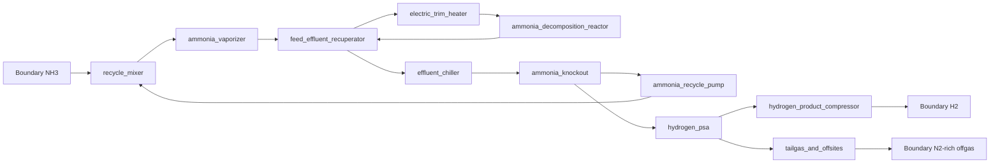

# Industrial ammonia decomposition to hydrogen: catalyst-to-plant economic ranking

## Executive answer

The laboratory ranking is **directionally useful but not sufficient**. Across **358 usable operating records from 14 papers**, the plant-selected operating point differed from the highest-productivity laboratory point in **8/19 groups (42.1%)** and from the highest-conversion point in **9/19 groups (47.4%)**. At catalyst identity level the disagreement was smaller: **2/17 groups (11.8%)** for either productivity or conversion.

The least-cost measured record is **12Ni3Co/Al** at **350 °C**, from DOI 10.1021/acs.energyfuels.5c01772, at **$3,713/t H2**. The highest laboratory productivity instead belongs to **CeO2/Ni inverse catalyst** (9.628 kg H2 kgcat^-1 h^-1), whose modeled plant cost is **$3,773/t H2**.

The controlling catalyst property is **mass-specific activity/productivity**, not conversion or selectivity by itself: one-at-a-time attribution assigns 94.0% of catalyst-dependent cost variation to activity, 4.2% to metal price, 1.5% to stability and 0.3% to temperature; selectivity contributes 0% because eligible thermal NH3 decomposition records produce the stoichiometric H2/N2 pair. Doubling activity at the reference lowers cost by $521/t H2. Feedstock cost attenuates all catalyst improvements because it is the largest invariant cost floor; equilibrium, recycle, heat integration, separation recovery, catalyst replacement and installed inventory determine where activity gains stop translating one-for-one into plant savings.

## 1. Literature search, screening and extraction

**Inclusion criteria.** Primary experimental thermal catalytic NH3 decomposition; identifiable catalyst and temperature/pressure/feed; quantitative conversion or rate plus catalyst mass/flow or direct productivity; sufficient composition information. **Exclusions.** Reviews, DFT-only work, ammonia synthesis/nitriding-only work, oxidative, plasma or microwave-only decomposition, membrane-system results without separable catalyst performance, duplicates/corrigenda, and records lacking rate-or-flow/mass or conversion.

Search/screening produced 175 candidate records. Sixteen PDFs were successfully acquired (failed retrievals were not counted as downloads), 16 were parsed/extracted, 15 contained experimental records, and 14 papers supplied usable normalized records. DOI 10.1021/acs.jpclett.1c01242 was excluded after full-text review because it is DFT/machine-learning work citing rather than reporting experimental activity. One extracted experimental paper had no record meeting all normalization fields; individual unusable rows in otherwise included papers were rejected mainly for missing conversion or missing rate/flow-and-catalyst-mass data.

| Paper | Title | records | usable |
|---|---|---:|---:|
| 10_1002_cssc_201501498 | Ammonia Decomposition with Manganese Nitride–Calcium Imide Composites as Efficient Catalysts | 67 | 46 |
| 10_1016_j_jiec_2020_11_003 | Hydrogen production by ammonia decomposition over ruthenium supported on SiC catalyst | 51 | 50 |
| 10_1021_acs_energyfuels_5c01772 | Cobalt-Promoted Ni/Al2O3 Catalyst for Efficient Ammonia Decomposition | 65 | 65 |
| 10_1021_acsaem_0c00754 | Air-Stable Calcium Cyanamide-Supported Ruthenium Catalyst for Ammonia Synthesis and Decomposition | 30 | 26 |
| 10_1021_acscatal_4c02313 | CeO
                    2
                    /Ni Inverse Catalyst as a Highly Active and Stable Ru-free Catalyst for Ammonia Decomposition | 23 | 3 |
| 10_1021_acscatal_5c00078 | Amorphous LiN
                    
                      <i>x</i>
                    
                    H
                    
                      <i>y</i>
                    
                    Boosts Low-Temperature Ammonia Decomposition over the Co/MgO Catalyst | 57 | 5 |
| 10_1021_acsenergylett_5c01389 | Ammonia Decomposition in the Presence of Water: A Resilient Barium Cobalt Catalyst | 17 | 17 |
| 10_1021_acssuschemeng_8b06308 | Highly Active Ruthenium Catalyst Supported on Barium Hexaaluminate for Ammonia Decomposition to CO
                    
                      <i>x</i>
                    
                    -Free Hydrogen | 37 | 32 |
| 10_1038_s41467_019_11848_9 | Highly efficient decomposition of ammonia using high-entropy alloy catalysts | 14 | 14 |
| 10_1039_c4ra12816h | Covalent triazine-based framework as an efficient catalyst support for ammonia decomposition | 48 | 48 |
| 10_1039_c5fd00179j | Ammonia decomposition catalysis using lithium–calcium imide | 49 | 44 |
| 10_1039_c5sc00205b | Ammonia decomposition catalysis using non-stoichiometric lithium imide | 8 | 4 |
| 10_1039_c6ra21211e | Fe-assisted Ru clusters supported on porous and graphitic carbon for ammonia decomposition to CO
                    x
                    free hydrogen | 34 | 2 |
| 10_1039_c7cy00086c | Cobalt nanoparticles embedded in a porous carbon matrix as an efficient catalyst for ammonia decomposition | 2 | 2 |
| 10_1039_c8ra06100a | Ammonia decomposition over Ni catalysts supported on perovskite-type oxides for the on-site generation of hydrogen | 20 | 0 |

**Selectivity normalization.** When authors identified only N2 and H2 as products and reported no alternative products, H2 selectivity was set to 1.0 as a stoichiometric qualifier, not as an independently measured selectivity. This is why selectivity cannot discriminate the screened catalysts.

## 2. Mechanism, kinetic transfer and atomic model

The common surface mechanism is reversible NH3 adsorption; NH3*→NH2*→NH*→N* dehydrogenation; H* recombination/desorption; and N* recombinative desorption. Strong N binding produces an N-covered/N2-desorption-limited branch, while weak N binding makes NH3 activation/dehydrogenation limiting. The atom-scale descriptor is N adsorption energy relative to 1/2 N2; the microkinetic solver is reversible and checked for equilibrium direction.

Each literature point anchors catalyst productivity at its reported condition. Plant catalyst mass scales inversely with measured H2 productivity and includes a plug-flow conversion correction, an explicit lab-to-plant inventory factor, and replacement according to measured time-to-10%-loss where available or a ranged default life. Plant per-pass conversion is optimized but bounded below by recycle operability and above by equilibrium, a 0.98 approach margin, and a heat-transfer/operability ceiling.

Atomic optimum: **D = -1.271 eV**, log10(TOF/s/site) = 2.086 at 623 K and 10 bar NH3. Of 358 usable records, 262 mapped to a declared metal descriptor. The atomic, laboratory and industrial rankings disagree substantially: atomic-vs-lab 13608/19730 (69.0%); atomic-vs-industrial 17128/19749 (86.7%); lab-vs-industrial 8072/34130 (23.7%).

Backward design: to remain within 10% of the reference plant cost, the descriptor window is [[-1.5964999999999998, -0.9139999999999999]]; within 5%, it is [[-1.6069999999999998, -0.9035]]. Descriptor-only improvement from the mapped reference to the atomic optimum changes cost by only $14.6/t, showing that feed and balance-of-plant costs strongly attenuate atom-scale gains once adequate activity is reached.

## 3. Plant boundary and accepted flowsheet

Delivered anhydrous ammonia at the plant gate through ammonia vaporization, recycle mixing, feed-effluent heat recovery, electric trim heating, externally heated catalytic decomposition, effluent cooling, ammonia condensation and recycle, hydrogen PSA purification, product compression, and tail-gas/offsites handling. Upstream ammonia manufacture and downstream hydrogen storage/distribution are excluded; no nitrogen coproduct credit is taken.

Reactor: externally heated multitubular packed bed. Separation: cool/condense 99.5% of unreacted NH3 for recycle, then PSA at 98% H2 recovery to 99.99 mol% H2, followed by product compression to 30 bar. Upstream NH3 synthesis, downstream H2 storage/distribution and N2 credit are excluded. Catalyst regeneration is excluded because the screened records do not establish a regenerable cycle; catalyst replacement is costed instead.

## 4. Reference plant and cost breakdown

Basis: 50,000 t H2/y, 8,000 h/y. Optimized reference operation: 623.0 K, 10.0 bar, per-pass conversion 0.560. Fresh NH3 = 5.770 t/t H2; reactor NH3 feed = 10.257 t/t; recycle NH3 = 4.488 t/t; purchased primary energy = 107.93 GJ/t; installed CAPEX = $90.9 million.

| Cost part | USD/t H2 | share |
|---|---:|---:|
| feed | 2,567.5 | 53.9% |
| energy | 959.3 | 20.1% |
| capital | 171.7 | 3.6% |
| catalyst | 991.2 | 20.8% |
| other | 72.7 | 1.5% |
| **total** | **4,762.4** | **100%** |

The reference cost is a model result, not copied from a study. Feed is 53.9% of total cost, catalyst 20.8%, energy 20.1%, capital 3.6% and fixed/other 1.5%. Thus the ammonia price fixes a large common floor, while catalyst productivity and life chiefly determine the remaining spread.

## 5. Ranking results and why rankings change

- Productivity ranking changed at operating-point level in 8/19 groups (42.1%; paper-bootstrap 95% interval 25.0–62.5%): six changes selected another temperature for the same catalyst and two selected another catalyst. Five changes exceeded 1% regret, three exceeded 5%, and two exceeded 10%; median regret among changed groups was 3.06%.
- Conversion ranking changed in 9/19 groups (47.4%; 95% interval 29.2–68.8%): seven changes were another temperature and two another catalyst. Median regret among changes was 1.75%.
- At catalyst level, both productivity and conversion rankings changed in 2/17 groups (11.8%); median regret among changed groups was 9.91%.
- Selectivity ranking changed in 0/19 point groups and 0/17 catalyst groups because S=1 for all eligible records.
- 234/358 records cost less than the reference record under the common plant model.

Rank changes arise because the plant does not maximize a single-pass laboratory number. It trades catalyst inventory/replacement against temperature-dependent heat, equilibrium conversion, recycle circulation and condensation, PSA loss, compression, and equipment scale. High conversion can merely reflect low space velocity or high temperature; high productivity can be offset by expensive metal or short life. Conversely, inexpensive Ni/Co systems can win with lower measured productivity because their catalyst replacement burden is low and plant feed/energy costs dominate once activity is adequate.

## 6. Deterministic one-at-a-time sensitivity

Sensitivity was run exactly by the fixed harness over every sourced range, assumption and price-table range on the reference and an 80-record ranking subset. The cheapest identity is unchanged for 63/69 perturbations; minimum Spearman rank correlation is 0.952.

| parameter | kind | low → high | reference cost swing | cheapest changes? | min Spearman |
|---|---|---|---:|---|---:|
| default_catalyst_life_h | assumption | 1000 → 40000 | 141.56% | yes (ceo2/niinversecatalyst / 12co/al) | 0.952 |
| price.ammonia | price_table | 300 → 900 | 72.69% | no (12ni/al / 12ni/al) | 1.000 |
| catalyst_void_and_scale_factor | assumption | 1.2 → 5 | 37.67% | yes (12co/al / 12ni/al) | 0.985 |
| price.metal_Ru | price_table | 26926 → 1.077e+05 | 30.42% | no (12ni/al / 12ni/al) | 0.997 |
| price.electricity | price_table | 40 → 150 | 27.42% | yes (12ni/al / 12co/al) | 0.990 |
| catalyst_inventory_factor | assumption | 1.05 → 1.75 | 11.48% | no (12ni/al / 12ni/al) | 0.997 |
| basis.capacity_t_per_y | assumption | 10000 → 2e+05 | 5.85% | no (12ni/al / 12ni/al) | 0.999 |
| psa_h2_recovery | assumption | 0.95 → 1 | 4.87% | no (12ni/al / 12ni/al) | 1.000 |
| recuperator_effectiveness | assumption | 0.5 → 0.9 | 3.63% | yes (12co/al / 12ni/al) | 0.991 |
| psa_base_capex_usd | assumption | 8e+06 → 5e+07 | 3.00% | no (12ni/al / 12ni/al) | 1.000 |
| nh3_vaporization_GJ_per_t_NH3 | assumption | 1.1 → 1.6 | 2.74% | no (12ni/al / 12ni/al) | 1.000 |
| electric_heater_efficiency | assumption | 0.85 → 0.99 | 2.73% | no (12ni/al / 12ni/al) | 1.000 |
| reactor_base_capex_usd | assumption | 7e+06 → 4e+07 | 2.33% | no (12ni/al / 12ni/al) | 1.000 |
| basis.product.H2.P_bar | published | 20 → 70 | 2.00% | no (12ni/al / 12ni/al) | 1.000 |
| price.capital_recovery_factor | price_table | 0.08 → 0.13 | 1.91% | no (12ni/al / 12ni/al) | 1.000 |

The strongest uncertainty is catalyst life (141.6% cost swing and winner changes), followed by ammonia price (72.7% cost swing but no winner change), lab-to-plant inventory scale factor (37.7%, winner changes), Ru price (30.4%, no winner change), and electricity price (27.4%, winner changes). Therefore the conclusion that laboratory point rankings often change is robust, but the exact Ni-versus-Co winner is conditional on life, scale-up and electricity/heat integration assumptions.

## 7. Evidence debts retained as uncertainty

- **basis.utilities.electricity_primary_energy_factor** [1.0, 3.2]: Primary-energy accounting varies with generation mix and convention; retain 1.0–3.2 because no uniquely applicable marginal US industrial factor was found. Evidence search: OpenAlex search for electricity primary-energy factors returned context-specific studies, not an ammonia-cracker-specific factor.
- **recuperator_effectiveness** [0.5, 0.9]: Recuperator effectiveness depends on exchanger area, pressure drop and approach temperature; retain the broad 0.50–0.90 design range. Evidence search: DOI:10.1016/j.ijheatmasstransfer.2013.10.008 demonstrates geometry-specific gas-to-gas exchanger performance.
- **electric_heater_efficiency** [0.85, 0.99]: Equipment-boundary electric-to-heat efficiency depends on insulation and electrical losses; retain 0.85–0.99 as explicit uncertainty. Evidence search: OpenAlex electric-heater search found application-specific results and no transferable ammonia-cracker industrial value.
- **default_catalyst_life_h** [1000.0, 40000.0]: Published time-on-stream tests do not establish commercial replacement life; retain 1,000–40,000 h and flag life as a dominant evidence gap. Evidence search: OpenAlex stability search found DOI:10.1002/ente.202400678, while extracted papers mostly report short laboratory stability tests.
- **catalyst_inventory_factor** [1.05, 1.75]: Loading, containment, spares and handling are absent from activity papers; retain the 1.05–1.75 installed-to-bare catalyst multiplier. Evidence search: OpenAlex scale-up search found no transferable installed catalyst inventory factor for ammonia decomposition.
- **catalyst_void_and_scale_factor** [1.2, 5.0]: Pellet dilution, binder, maldistribution and heat-transfer reserve are unquantified in powder tests; retain the 1.2–5.0 scale penalty. Evidence search: OpenAlex scale-up search found no ammonia-decomposition study quantitatively linking powder productivity to industrial bed inventory.

## 8. Full parameter table (`sources.csv`)

| parameter | value | unit | type | source | location | low | high |
|---|---:|---|---|---|---|---:|---:|
| basis.capacity_t_per_y | 50000 | t_H2/y | assumption |  |  | 10000 | 200000 |
| basis.operating_hours_per_y | 8000 | h/y | assumption |  |  | 7000 | 8500 |
| basis.feeds.NH3.T_K | 298.15 | K | assumption |  |  | 273.15 | 313.15 |
| basis.feeds.NH3.P_bar | 10.0 | bar | assumption |  |  | 8.0 | 20.0 |
| basis.feeds.NH3.purity_mol_frac | 0.999 | mol/mol | assumption |  |  | 0.995 | 1.0 |
| basis.product.H2.P_bar | 30.0 | bar | published | https://www.energy.gov/cmei/fuels/gaseous-hydrogen-compression | Page statement: hydrogen is typically produced at 20-30 bar and compressed prior to transport. | 20.0 | 70.0 |
| basis.product.H2.purity_mol_frac | 0.9999 | mol/mol | assumption |  |  | 0.999 | 0.99999 |
| basis.utilities.cooling_water_supply_temperature | 298.15 | K | assumption |  |  | 288.15 | 308.15 |
| basis.utilities.chilled_water_supply_temperature | 278.15 | K | assumption |  |  | 273.15 | 288.15 |
| basis.utilities.electricity_primary_energy_factor | 2.5 | GJ_primary/GJ_electric | assumption |  |  | 1.0 | 3.2 |
| price.ammonia | 445.0 | USD/t | price_table | prices.json:ammonia | prices.json entry ammonia | 300.0 | 900.0 |
| price.electricity | 80.0 | USD/MWh | price_table | prices.json:electricity | prices.json entry electricity | 40.0 | 150.0 |
| price.catalyst_support_and_manufacturing | 20.0 | USD/kg | price_table | prices.json:catalyst_support_and_manufacturing | prices.json entry catalyst_support_and_manufacturing | 5.0 | 100.0 |
| price.metal_Ru | 53852.5 | USD/kg | price_table | prices.json:metal_Ru | prices.json entry metal_Ru | 26926.25 | 107705.0 |
| price.metal_Fe | 8.0 | USD/kg | price_table | prices.json:metal_Fe | prices.json entry metal_Fe | 4.0 | 16.0 |
| price.metal_Co | 56.28401553583051 | USD/kg | price_table | prices.json:metal_Co | prices.json entry metal_Co | 28.142007767915256 | 112.56803107166103 |
| price.metal_Mo | 91.22728409215301 | USD/kg | price_table | prices.json:metal_Mo | prices.json entry metal_Mo | 45.61364204607651 | 182.45456818430603 |
| price.metal_Ni | 16.9094555095895 | USD/kg | price_table | prices.json:metal_Ni | prices.json entry metal_Ni | 8.45472775479475 | 33.818911019179 |
| price.metal_Cu | 13.889122517655 | USD/kg | price_table | prices.json:metal_Cu | prices.json entry metal_Cu | 6.9445612588275 | 27.77824503531 |
| price.metal_Ba | 0.3569000679809653 | USD/kg | price_table | prices.json:metal_Ba | prices.json entry metal_Ba | 0.17845003399048265 | 0.7138001359619306 |
| price.metal_Mg | 2.5 | USD/kg | price_table | prices.json:metal_Mg | prices.json entry metal_Mg | 1.25 | 5.0 |
| price.metal_Al | 3.9683 | USD/kg | price_table | prices.json:metal_Al | prices.json entry metal_Al | 1.98415 | 7.9366 |
| price.metal_Si | 2.866006 | USD/kg | price_table | prices.json:metal_Si | prices.json entry metal_Si | 1.433003 | 5.732012 |
| price.capital_recovery_factor | 0.0944 | 1/y | price_table | prices.json:capital_recovery_factor | prices.json entry capital_recovery_factor | 0.08 | 0.13 |
| price.fixed_om_fraction_of_capex | 0.04 | 1/y | price_table | prices.json:fixed_om_fraction_of_capex | prices.json entry fixed_om_fraction_of_capex | 0.02 | 0.06 |
| reactor_pressure_bar | 10.0 | bar | assumption |  | Pressure-basis assumption aligned with delivered NH3 pressure, NH3 condensation, and PSA adsorption pressure. | 5.0 | 15.0 |
| nh3_knockout_recovery | 0.995 | mol/mol | assumption |  | Model boundary assumes residual NH3 is fully recovered across knockout plus PSA polishing; uncertainty spans 98-100%. | 0.98 | 1.0 |
| psa_h2_recovery | 0.98 | mol/mol | assumption |  | Assume hydrogen losses are recovered within PSA equalization/purge handling inside the battery limit; uncertainty spans 95-100%. | 0.95 | 1.0 |
| psa_h2_purity | 0.9999 | mol/mol | assumption |  | Engineering/modeling assumption documented in report | 0.999 | 0.99999 |
| recuperator_effectiveness | 0.75 | fraction | assumption |  | Engineering/modeling assumption documented in report | 0.5 | 0.9 |
| electric_heater_efficiency | 0.95 | fraction | assumption |  | Engineering/modeling assumption documented in report | 0.85 | 0.99 |
| compressor_isentropic_efficiency | 0.75 | fraction | assumption |  | Engineering/modeling assumption documented in report | 0.6 | 0.85 |
| compressor_stage_pressure_ratio | 3.0 | ratio | assumption |  | Engineering/modeling assumption documented in report | 2.0 | 4.0 |
| psa_electricity_MWh_per_t_H2 | 0.25 | MWh/t_H2 | assumption |  | Engineering/modeling assumption documented in report | 0.05 | 0.6 |
| chilling_electricity_MWh_per_GJ_removed | 0.05 | MWh/GJ | published | https://betterbuildingssolutioncenter.energy.gov/sites/default/files/attachments/Better%20Plants-%20Process%20Cooling%20System%20Cheat%20Sheet.pdf | Water-cooled chiller comparison table gives COP ranges 4.2-7.1; 1/(3.6 COP) gives about 0.039-0.066 MWh/GJ cooling, widened for auxiliaries. | 0.039 | 0.08 |
| pump_electricity_MWh_per_t_recycle | 0.002 | MWh/t | assumption |  | Engineering/modeling assumption documented in report | 0.0005 | 0.01 |
| offsites_electricity_MWh_per_t_H2 | 0.08 | MWh/t_H2 | assumption |  | Engineering/modeling assumption documented in report | 0.03 | 0.2 |
| nh3_vaporization_GJ_per_t_NH3 | 1.37 | GJ/t_NH3 | assumption |  | Engineering/modeling assumption documented in report | 1.1 | 1.6 |
| feed_sensible_heat_kJ_per_kmol_K | 80.0 | kJ/kmol/K | assumption |  | Engineering/modeling assumption documented in report | 60.0 | 110.0 |
| product_sensible_heat_kJ_per_kmol_K | 65.0 | kJ/kmol/K | assumption |  | Engineering/modeling assumption documented in report | 45.0 | 90.0 |
| minimum_approach_temperature_K | 30.0 | K | assumption |  | Engineering/modeling assumption documented in report | 15.0 | 60.0 |
| default_catalyst_life_h | 8000.0 | h | assumption |  | Engineering/modeling assumption documented in report | 1000.0 | 40000.0 |
| minimum_catalyst_life_h | 500.0 | h | assumption |  | Engineering/modeling assumption documented in report | 100.0 | 2000.0 |
| catalyst_inventory_factor | 1.25 | installed/bare | assumption |  | Engineering/modeling assumption documented in report | 1.05 | 1.75 |
| catalyst_void_and_scale_factor | 2.0 | dimensionless | assumption |  | Engineering/modeling assumption documented in report | 1.2 | 5.0 |
| reactor_base_capex_usd | 15000000.0 | USD | assumption |  | Engineering/modeling assumption documented in report | 7000000.0 | 40000000.0 |
| vaporizer_base_capex_usd | 3000000.0 | USD | assumption |  | Engineering/modeling assumption documented in report | 1000000.0 | 8000000.0 |
| recuperator_base_capex_usd | 5000000.0 | USD | assumption |  | Engineering/modeling assumption documented in report | 2000000.0 | 12000000.0 |
| heater_base_capex_usd | 8000000.0 | USD | assumption |  | Engineering/modeling assumption documented in report | 3000000.0 | 20000000.0 |
| chiller_base_capex_usd | 4000000.0 | USD | assumption |  | Engineering/modeling assumption documented in report | 1500000.0 | 12000000.0 |
| knockout_base_capex_usd | 1000000.0 | USD | assumption |  | Engineering/modeling assumption documented in report | 300000.0 | 3000000.0 |
| recycle_pump_base_capex_usd | 500000.0 | USD | assumption |  | Engineering/modeling assumption documented in report | 150000.0 | 2000000.0 |
| psa_base_capex_usd | 20000000.0 | USD | assumption |  | Engineering/modeling assumption documented in report | 8000000.0 | 50000000.0 |
| compressor_base_capex_usd | 12000000.0 | USD | assumption |  | Engineering/modeling assumption documented in report | 5000000.0 | 30000000.0 |
| offsites_fraction_of_direct_capex | 0.25 | fraction | assumption |  | Engineering/modeling assumption documented in report | 0.15 | 0.45 |
| mixer_base_capex_usd | 250000.0 | USD | assumption |  | Engineering/modeling assumption documented in report | 100000.0 | 1000000.0 |
| capacity_scaling_exponent | 0.65 | dimensionless | assumption |  | Engineering/modeling assumption documented in report | 0.55 | 0.8 |
| reference_capacity_t_per_y | 50000.0 | t_H2/y | assumption |  | Engineering/modeling assumption documented in report | 50000.0 | 50000.0 |
| capital_activity_multiplier | 0.15 | fraction | assumption |  | Engineering/modeling assumption documented in report | 0.0 | 0.5 |
| reactor_reference_catalyst_kg | 100000.0 | kg | assumption |  | Engineering/modeling assumption documented in report | 20000.0 | 500000.0 |
| ambient_temperature_K | 298.15 | K | assumption |  | Engineering/modeling assumption documented in report | 288.15 | 308.15 |
| reactor_pressure_drop_bar | 0.2 | bar | assumption |  | Engineering/modeling assumption documented in report | 0.05 | 1.0 |
| compression_heat_capacity_ratio | 1.4 | dimensionless | assumption |  | Engineering/modeling assumption documented in report | 1.35 | 1.42 |
| gas_constant_kJ_per_kmol_K | 8.314462618 | kJ/kmol/K | assumption |  | Engineering/modeling assumption documented in report | 8.314462618 | 8.314462618 |
| reaction_heat_GJ_per_kmol_NH3 | 0.04611 | GJ/kmol_NH3 | assumption |  | Engineering/modeling assumption documented in report | 0.045 | 0.048 |
| maximum_recycle_ratio | 20.0 | mol/mol fresh | assumption |  | Engineering/modeling assumption documented in report | 5.0 | 50.0 |
| minimum_per_pass_conversion | 0.2 | fraction | assumption |  | Engineering/modeling assumption documented in report | 0.1 | 0.4 |
| equilibrium_margin | 0.98 | fraction | assumption |  | Engineering/modeling assumption documented in report | 0.9 | 0.995 |
| reaction_entropy_kJ_per_kmol_K | 198.0 | kJ/kmol/K | assumption |  | Thermodynamic approximation bounded around standard-state value | 190.0 | 205.0 |
| reaction_heat_capacity_increment_kJ_per_kmol_K | 16.7 | kJ/kmol_NH3/K | assumption |  | Temperature correction matching gas-phase reaction enthalpy over the 523-723 K operating window | 14.0 | 20.0 |
| maximum_per_pass_conversion | 0.65 | fraction | assumption |  | Industrial operating constraint limiting catalyst-bed approach to equilibrium and local heat-transfer severity | 0.50 | 0.85 |

All prices, catalyst material prices, capital-recovery factor and fixed-O&M fraction are frozen entries from `prices.json`; the model does not replace them. Published/measured rows identify a DOI/URL and location; uncited engineering values are explicitly typed as assumptions with low/high bounds.

## 9. What is and is not represented

Represented: stoichiometric and elemental balances; reversible equilibrium ceiling; catalyst productivity and replacement; optimized per-pass conversion; NH3 recycle and purge; vaporization, sensible/reaction heat, recuperation and chilling; PSA recovery/purity; H2 compression; every accepted flowsheet unit in energy and CAPEX sums; catalyst composition-based material price; capacity scaling and fixed O&M.

Not supported well enough to represent mechanistically: catalyst pellet pressure drop/bed geometry, radial furnace temperature profiles and tube metallurgy, dynamic startup/shutdown, impurity poisoning from commercial NH3, validated commercial catalyst regeneration, detailed PSA cycle design, site-density measurements for every catalyst, support/promoter descriptor effects beyond the effective activity residual, and commercial catalyst life distributions. No N2 coproduct credit is taken.

## 10. Conclusion

Laboratory rankings predict broad catalyst quality but do not reliably select the plant operating point. Nearly half of within-study point rankings change after conversion, recycle, heat and catalyst inventory are optimized, although catalyst identity changes only about one time in nine. The plant favors an inexpensive Ni–Co formulation rather than the maximum-productivity CeO2/Ni point. Activity remains the dominant catalyst property, but its economic leverage is attenuated by the ammonia feed floor and, at high activity, by reaction heat, equilibrium/recycle, purification and equipment. The most valuable next evidence is long-duration catalyst life under commercial NH3 and a measured powder-to-pellet/industrial productivity scale factor; those two uncertainties are more decision-relevant than further small improvements in already-high intrinsic TOF.