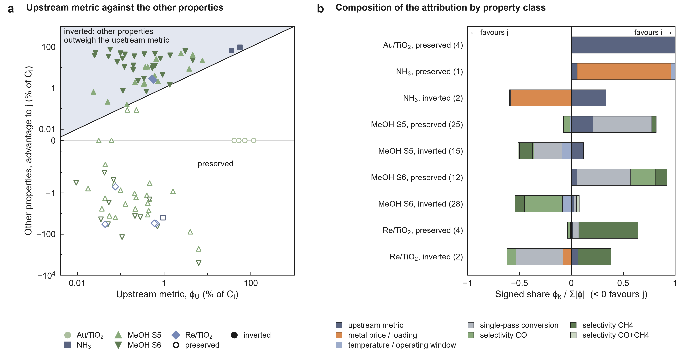

# When does an upstream advantage survive process economics? Leverage criterion (2026-10-12)

Pre-registered in [`PROTOCOL.md`](PROTOCOL.md), committed and pushed (0c94d80) before any decomposition, criterion
value or score was computed. Frozen models and outcomes only; nothing frozen was edited. Additions made after the first
scored run are marked **exploratory** and change no criterion.

For each pair (i = better upstream metric, j = its plant-cost competitor) the cost difference C_j − C_i is split over
the properties in which i and j differ by Shapley values through the frozen plant model, and the outcome is predicted
by the pre-declared rule **"inversion iff the non-upstream attribution is negative and larger than the upstream
attribution"** (U + O < 0), evaluated three ways:

- **C1 (primary, predictive):** first-order terms ε_k Δz_k at the upstream leader's own optimum (the manuscript's
  expansion Δln J ≈ −ε_s Δln s + Σ ε_k Δz_k, operating point frozen).
- **C2 (secondary):** Shapley values with the operating point frozen at the upstream leader's optimum.
- **D (exact):** Shapley values with the plant re-optimized for every hybrid. Its sum is C_j − C_i, so the rule applied
  to D is an identity (53/53 and 40/40 by construction); D is used for attribution only.

## Results

### Confusion matrices, C1 (primary)

| Set | n | inverted | TP | FN | FP | TN | accuracy | always-preserve | sensitivity | specificity |
|---|---:|---:|---:|---:|---:|---:|---:|---:|---:|---:|
| Au/TiO2, adjacent sizes | 4 | 0 | 0 | 0 | 0 | 4 | 1.000 | 1.000 | – | 1.000 |
| Au/TiO2, 10,000 draws × 4 pairs | 40,000 | 0 | 0 | 0 | 0 | 40,000 | 1.000 | 1.000 | – | 1.000 |
| NH3 (Ru-Os, Ru-Fe, Os-Fe) | 3 | 2 | 2 | 0 | 0 | 1 | 1.000 | 0.333 | 1.000 | 1.000 |
| MeOH field, S5 | 40 | 15 | 14 | 1 | 3 | 22 | **0.900** | 0.625 | 0.933 | 0.880 |
| MeOH field, S6 | 40 | 28 | 13 | 15 | 0 | 12 | **0.625** | 0.300 | 0.464 | 1.000 |
| Re/TiO2, 6 pairs | 6 | 2 | 2 | 0 | 0 | 4 | 1.000 | 0.667 | 1.000 | 1.000 |
| **pooled: Au + NH3 + MeOH S5 + Re** | 53 | 19 | 18 | 1 | 3 | 31 | **0.925** | 0.642 | 0.947 | 0.912 |
| pooled: Au + NH3 + MeOH S6 + Re | 53 | 32 | 17 | 15 | 0 | 21 | **0.717** | 0.396 | 0.531 | 1.000 |

TP: inversion predicted and observed; FN: observed, not predicted; FP: predicted, not observed. "Always-preserve" is
the accuracy of predicting no inversion anywhere.

Methanol, paper-cluster bootstrap (10,000 resamples of the 28 papers, seed 20261006):

| Set | accuracy | 95 % CI |
|---|---:|---|
| S5, 40 groups, C1 | 0.900 | 0.774–0.980 |
| S6, 40 groups, C1 | 0.625 | 0.447–0.766 |
| S5, all 1,976 STY-ordered within-group pairs, C1 | 0.882 (always-preserve 0.846) | 0.847–0.960 |
| S6, all 1,976 pairs, C1 | 0.679 (always-preserve 0.642) | 0.604–0.764 |

All-pairs confusion: S5 TP 263, FN 41, FP 193, TN 1,479 (304 inversions, the frozen count); S6 TP 214, FN 493,
FP 142, TN 1,127 (707 inversions).

### Confusion matrices, C2 (secondary)

| Set | n | inverted | TP | FN | FP | TN | accuracy |
|---|---:|---:|---:|---:|---:|---:|---:|
| NH3 | 3 | 2 | 2 | 0 | 0 | 1 | 1.000 |
| MeOH field, S6 | 40 | 28 | 7 | 21 | 0 | 12 | 0.475 (CI 0.289–0.617) |
| Au, MeOH S5, Re/TiO2 | 50 | 17 | 17 | 0 | 0 | 33 | 1.000 by construction |

C2 equals the outcome by construction wherever i and j share the operating point: Au/TiO2 and Re/TiO2 have no
operating optimization, and under S5 every entry sits at the 0.5 % purge floor. It is informative for NH3 and S6 only.

### Regret explained (inverted cases; exact decomposition D)

R = C_i − C_j. Shares are fractions of R; the upstream metric works against the inversion, so its share is negative
and the carrying property's share exceeds 1.

| System | inverted | carrying property (cases) | carrying share, median | upstream share, median | share of R in the pre-declared pathway pools | C1-reproduced R / actual R | Spearman, C1 vs actual ln(C_j/C_i) |
|---|---:|---|---:|---:|---:|---:|---:|
| NH3 | 2 | metal price / molar mass (2) | 2.28 | −1.28 | 0.13 (inventory + reactor) | 1.17 | 1.00 (n = 3) |
| MeOH S5 | 15 | conversion (8), CH4 (3), temperature (3), CO (1) | 1.53 | −0.18 | 1.11 (loop pools) | 1.75 | 0.78 |
| MeOH S6 | 28 | CO (17), conversion (6), CH4 (3), temperature (2) | 1.38 | −0.03 | 1.01 (loop pools) | 0.37 | 0.44 |
| Re/TiO2 | 2 | conversion (2) | 1.91 | −0.26 | 0.92 (loop pools) | 1.46 | 1.00 (n = 6) |

NH3, Ru vs Fe (USD/t, D): upstream activity +7.99, operating window −2.09, metal price and molar mass −12.63; sum −6.74
= C_Fe − C_Ru. Of the 6.74 USD/t regret, catalyst inventory carries 1.76 and the reactor −0.82 (14 % together), and
compression and refrigeration 5.80: the price effect is paid at Ru's re-optimized point (450 °C, 425 bar) against Fe's
(425 °C, 180 bar). Os vs Fe: 12 % in inventory and reactor, 9.27 of 10.54 USD/t in compression and refrigeration.

Methanol, carrying property by kind of disagreement (exploratory cross-tab): under S6, CO selectivity carries 8 of the
12 same-catalyst-other-temperature inversions as well as 8 of the 12 other-catalyst-same-temperature ones; under
S5, conversion carries all 4 joint catalyst-and-temperature changes, and temperature itself carries 3 of the 5
same-catalyst inversions.

### Attribution by property class (exact D)

Mean φ as % of C_i [mean signed share of Σ|φ|]; negative favours j. A class that is not a player in a case counts 0.
The % means of the methanol rows are dominated by Bansode 2013 hybrids (φ up to ±5,500 % of C_i, physically remote
property combinations); the bracketed shares are robust to that.

| System / scenario / outcome | n | upstream metric | metal price / loading | temperature / operating window | single-pass conversion | selectivity CO | selectivity CH4 | selectivity CO+CH4 |
|---|---:|---:|---:|---:|---:|---:|---:|---:|
| Au / preserved | 4 | +70.7 [+1.00] | 0 | 0 | 0 | 0 | 0 | 0 |
| NH3 / preserved | 1 | +0.953 [+0.06] | +15.6 [+0.90] | +0.693 [+0.04] | 0 | 0 | 0 | 0 |
| NH3 / inverted | 2 | +46.2 [+0.33] | −83.4 [−0.59] | +1.46 [−0.01] | 0 | 0 | 0 | 0 |
| MeOH S5 / preserved | 25 | +0.647 [+0.21] | 0 | −0.18 [−0.01] | +20.1 [+0.57] | +6.53 [−0.06] | +0.603 [+0.04] | 0 |
| MeOH S5 / inverted | 15 | +1.49 [+0.12] | 0 | +25.9 [−0.09] | −61.8 [−0.27] | +24.8 [−0.02] | −0.683 [−0.12] | −0.155 [−0.01] |
| MeOH S6 / preserved | 12 | +0.69 [+0.05] | 0 | +0.0282 [+0.00] | +15.4 [+0.52] | +215 [+0.24] | +3.69 [+0.11] | 0 |
| MeOH S6 / inverted | 28 | +0.637 [+0.03] | 0 | +82.7 [−0.09] | −400 [+0.02] | +13.3 [−0.37] | +12 [−0.09] | +266 [+0.03] |
| Re/TiO2 / preserved | 4 | +0.341 [+0.01] | −0.372 [−0.01] | 0 | −2.96 [+0.06] | −0.123 [−0.03] | +26.8 [+0.57] | 0 |
| Re/TiO2 / inverted | 2 | +0.545 [+0.06] | −0.709 [−0.08] | 0 | −4.22 [−0.46] | −0.721 [−0.08] | +2.93 [+0.32] | 0 |

Per-case values for Au, NH3 and Re/TiO2: `results_tables.md`; every case: `cases.csv`, `properties.csv`, `pools.csv`.

### Figure



`fig_attribution.{svg,pdf,png}`: **a**, upstream attribution φ_U against the other properties' advantage to j
(−Σφ_k), % of C_i, every case; filled inverted, open preserved; above the diagonal the other properties outweigh the
upstream metric. **b**, signed property-class composition of the attribution per system and outcome.

## Plain summary

1. Applied to an exact decomposition, the rule "inversion when the other properties outweigh the upstream metric" is
   always right by construction; the test is whether it predicts from the upstream leader's own plant optimum.
2. That first-order criterion is right in 49 of 53 primary cases (0.925; always-preserve 0.642) under S5, and in 38 of
   53 (0.717; always-preserve 0.396) with the methanol inlet limit S6.
3. Au/TiO2 is a trivial pass: the candidates differ only in activity, so no inversion can be predicted or occurs.
4. Ammonia: metal price and molar mass carry both inversions (Ru–Fe, Os–Fe); 3 of 3 correct.
5. In ammonia only 12–14 % of the regret stays in catalyst inventory and reactor; re-optimization moves the rest into
   compression and refrigeration.
6. Methanol S5: 36 of 40 groups correct (CI 0.77–0.98), but the inversion is carried mostly by single-pass conversion
   (8 of 15), not by CO/CH4 selectivity (4 of 15).
7. Methanol S6: 25 of 40 (CI 0.45–0.77). The criterion misses 15 of 28 inversions; in all 15 the plant leader runs
   at a lower purge than the STY leader (median 1.1 % vs 4.2 %), so the inversion comes through the inlet limit, which
   a frozen operating point cannot see. CO selectivity carries 17 of the 28 inversions here, as hypothesized.
8. Re/TiO2: 6 of 6 correct; the inversions are carried by conversion and Re loading, while CH4 selectivity works
   against the plant leader.
9. Over all 1,976 within-group methanol pairs the criterion adds little to always-preserve (0.882 vs 0.846 under S5,
   0.679 vs 0.642 under S6).
10. Mixed result: the mechanism holds as accounting, the expected carrier is confirmed for ammonia (price) and S6 (CO)
    but not for S5 or Re/TiO2 (conversion), and its local form fails where the inversion runs through re-optimization.

## Exploratory (after the first scored run; descriptive, no criterion changed)

- Bracketed shares in the attribution table and panel b of the figure (normalization chosen after seeing the
  Bansode 2013 hybrids dominate the % means).
- S6 diagnostic: in all 15 C1 misses the plant leader's own S6 purge is below the STY leader's (median 1.1 % vs
  4.2 %), and in 14 of them the non-upstream first-order term at the STY leader's purge is positive (j looks worse at
  i's operating point). Among the 13 inversions C1 does predict, 9 also have the leader at a lower purge (median 2.9 %
  vs 4.6 %).
- Carrying property by disagreement kind (`summary.json` exploratory.carrying_class_by_disagreement_kind).

## Notes on the implementation

- Hybrid candidates take the properties of a coalition from j and the rest from i; NH3 hybrids combine one metal's
  reference activity with the other's state TOF profile; methanol hybrids close S_MeOH = 1 − S_CO − S_CH4. Four
  Bansode 2013 pairs (two per scenario) had invalid hybrids and use one merged CO+CH4 selectivity player, as the
  protocol specifies; no case is undefined; every NH3 hybrid has a state within 90 m3.
- Gates passed: Au masses (1e-12), NH3 Ru/Os/Fe = `results.json` (1e-9 USD/t), methanol end points and every entry's
  cost at its own purge = `literature_candidates.csv` (1e-6 EUR/t), 15/40 and 28/40 leader mismatches, 304 and 707
  pairwise inversions, Re/TiO2 943.30/961.51/966.96/1258.17, Shapley efficiency and pool sums (1e-9 relative).

## Files and rerun

| File | Content |
|---|---|
| `PROTOCOL.md` | pre-registration (unchanged since 0c94d80) |
| `run_leverage_criterion.py` | the four systems through the frozen models, decompositions, gates → `cases.csv`, `properties.csv`, `pools.csv`, `meoh_pairwise.csv`, `run_record.json`; then calls the scorer |
| `score_leverage_criterion.py` | confusion matrices, bootstrap, regret, attribution → `summary.json`, `results_tables.md` |
| `make_figure.py` | `fig_attribution.{svg,pdf,png}` (shared composite style, read only) |

```
python analysis/leverage_criterion_2026_10_12/run_leverage_criterion.py   # LEV_WORKERS=6: about 11 min
python analysis/leverage_criterion_2026_10_12/make_figure.py
```

Python 3.12, `requirements.txt` + pyyaml. The NH3 harness root is rebuilt in a temporary folder from `provenance/`
(as `analysis/nh3_actual_ru_params_2026_10_07/build_harness_root.py` does; the analysis needs only the Ru, Os and Fe
state vectors, so no response cache). `.github/workflows/leverage-criterion.yml` reruns everything on ubuntu-latest
and compares outcomes, predictions and `summary.json` with the committed files.
