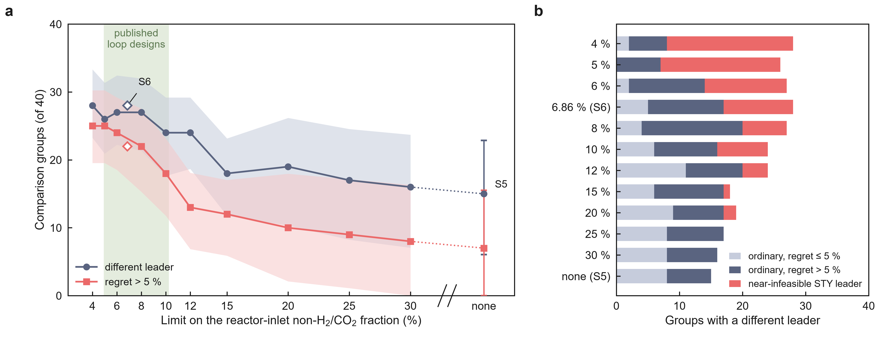

# Methanol: decision boundary in process-constraint space, and laboratory-only rules (2026-10-12, unfrozen)

Inputs: the frozen printed-cohort candidates `analysis/meoh_literature_inversion_2026_10_05/literature_candidates.csv`
(40 comparison groups, 310 entries, 28 papers), read as they are and scored with that folder's own code
(`meoh_candidates.aggregate`, `mismatch_kinds.classify`). Nothing frozen, no manuscript text and no figure is changed.
Scenarios: S5 = no limit on the reactor-inlet non-H2/CO2 fraction (frozen primary, `cost_recycled_opt`); limits of 4–30 %
(`cost_recycled_opt_lim*`); S6 = 6.86 %, the cost model's anchor loop (`cost_recycled_opt_inlet`); S4 = no limit with the
laboratory conversion not capped at equilibrium (`cost_recycled_opt_uncapped`). Published CO2-to-methanol loop designs
span 4.92–10.25 % (`inlet_inert_literature.csv`). Bansode 2013 = 10.1039/c2cy20604h (8 of the 40 groups).

## Summary

1. Under S5 the STY leader is not the plant-cost leader in 15 / 40 groups (7 with a regret > 5 %, 6 of them Bansode 2013); bounding the inlet fraction raises this to 16 / 40 at 30 %, 18–19 at 15–20 %, 24 at 10–12 % and 26–28 at 4–8 % (S6 28).
2. The count with a regret > 5 % rises from 7 (S5) to 8–13 at 12–30 %, 18 at 10 %, 22 at 8 % and S6, and 24–25 at 4–6 %; contributing papers rise from 9 to 18–23.
3. Trend over the ten limits: Cochran–Armitage z = −4.16 (p = 3e-5) for a different leader and z = −6.19 (p = 6e-10) for a regret > 5 %; shuffling the limit labels within each paper (or each group) gives p ≤ 1e-4 for both (none of 10,000 permutations as extreme).
4. Over the published loop range (5–10 %, S6) the paper-bootstrap interval of the excess over S5 excludes zero for both measures; without Bansode 2013, 18–22 of 32 groups disagree, 13–20 with a regret > 5 % (S5: 8, 1).
5. Near-infeasibility: at 4–5 % limits 19–20 of the 26–28 disagreements have an STY leader whose cost more than doubles (median 3.5–4.2x its S5 cost); at S6 11 of 28, at 10 % 8 of 24, at 15–30 % at most 2, at S5 none.
6. Without those, 7–20 disagreements remain at every limit (S6 17, 12 above 5 %; 8 % 20, 16 above 5 %), against 15 (7 above 5 %) at S5: in number the ordinary disagreements stay near the S5 level, but at 6–15 % more of them exceed 5 % (9–16 against 7); at 4–5 % the excess is almost all near-infeasible.
7. The near-infeasible STY leaders are not at the edge of feasibility (they could meet a limit 2–11x tighter); their cost comes from the purge needed to hold the limit (at 4 %–S6 a median 9–22 % against 3–7 % for the STY leaders of ordinary disagreements).
8. Mechanism: under a limit the plant-cost leader is the more selective, lower-CO entry (89 % / 86 % of disagreements at 4 %, 68 % / 64 % at S6); without a limit it is more often the higher-conversion one (60 % at S5); the more-selective share falls below half between 15 and 20 %.
9. Task B (pre-registered): leave-one-paper-out selection keeps STY under S5 and at 15–30 % (no gain); at 4–8 % it picks selectivity and gains 9–18 groups (McNemar p = 0.0003–0.064; the paper-bootstrap interval excludes zero only at 4 %); at 10–12 % it gains nothing (15–16 vs 16), and at 8–12 % its mean regret is worse than STY's (34–46 % vs 12–31 %).
10. The loop-aware rule LA1 beats every single rule pooled over the 12 scenarios (232 vs at most 216 of 480 correct) but clearly only against selectivity, and its mean regret is twice STY's (53 % vs 25 %); the binding-check variant LA2 wins clearly on accuracy (278 / 480, every interval above zero) but also has a higher mean regret than STY (35 % vs 25 %). Pooled over the scenarios, no laboratory-only rule is both more often right than STY and lower in mean regret.

## Task A: decision boundary

**A1. Disagreements per scenario.** 95 % intervals: paper-cluster bootstrap (10,000 resamples of the 28 papers, the frozen
seed 20261006 and paper order, the same resamples in every scenario; the S5 interval reproduces the frozen 15–57 %).

| Inlet limit | Different leader / 40 [95 % CI] | > 1 % | > 5 % [95 % CI] | > 10 % | Papers (with > 5 %) | Without Bansode / 32 (> 5 %) | Regret median of disagreements / max |
|---|---|---|---|---|---|---|---|
| 4 % | 28 [23–33] | 27 | 25 [20–30] | 23 | 23 (20) | 23 (20) | 63.5 % / 289 % |
| 5 % | 26 [21–31] | 26 | 25 [20–30] | 23 | 21 (20) | 21 (20) | 67.4 % / 242 % |
| 6 % | 27 [22–32] | 25 | 24 [19–29] | 22 | 22 (19) | 22 (19) | 34.6 % / 244 % |
| 6.86 % (S6) | 28 [22–33] | 25 | 22 [16–27] | 20 | 21 (18) | 21 (17) | 22.4 % / 299 % |
| 8 % | 27 [21–32] | 25 | 22 [15–28] | 18 | 21 (17) | 21 (16) | 14.3 % / 463 % |
| 10 % | 24 [18–29] | 23 | 18 [12–23] | 11 | 18 (14) | 18 (13) | 9.7 % / 475 % |
| 12 % | 24 [19–29] | 22 | 13 [7–18] | 10 | 19 (10) | 19 (9) | 7.3 % / 106 % |
| 15 % | 18 [12–23] | 16 | 12 [6–17] | 9 | 14 (9) | 13 (8) | 8.9 % / 93 % |
| 20 % | 19 [10–26] | 16 | 10 [2–18] | 9 | 13 (5) | 12 (4) | 5.0 % / 241 % |
| 25 % | 17 [8–25] | 14 | 9 [1–17] | 7 | 11 (4) | 10 (3) | 5.0 % / 83 % |
| 30 % | 16 [7–24] | 13 | 8 [0–16] | 7 | 10 (3) | 9 (2) | 4.3 % / 83 % |
| none (S5) | 15 [6–23] | 12 | 7 [0–16] | 6 | 9 (2) | 8 (1) | 3.5 % / 83 % |
| none, X uncapped (S4) | 16 [7–24] | 12 | 8 [0–16] | 7 | 10 (3) | 9 (2) | 4.3 % / 141 % |

Excess over S5 (same resamples), 95 % interval in groups of 40: different leader +4 to +24 (4 %), +7 to +21 (S6),
+3 to +17 (10 %), +1 to +19 (12 %), −2 to +10 (15 %), +1 to +9 (20 %); regret > 5 %: +9 to +28 (4 %), +7 to +25 (S6),
+4 to +19 (10 %), −1 to +14 (12 %), −1 to +13 (15 %), 0 to +7 (20 %). Per scenario in `boundary_summary.json`
(`bootstrap.*_minus_S5`).

**Mismatch kinds** (`mismatch_kinds.classify`; groups, then regret > 5 % and papers in brackets; 32 groups hold ≥ 2
catalysts, 22 a temperature series):

| Inlet limit | Other catalyst, same T | Other catalyst and T | Other catalyst, total / 32 | Same catalyst, other T / 22 |
|---|---|---|---|---|
| 4 % | 12 (10, 11) | 5 (4, 4) | 17 (14, 15) | 11 (11, 9) |
| 5 % | 12 (11, 11) | 3 (3, 2) | 15 (14, 13) | 11 (11, 9) |
| 6 % | 12 (9, 11) | 4 (4, 3) | 16 (13, 14) | 11 (11, 9) |
| 6.86 % (S6) | 12 (8, 11) | 4 (3, 2) | 16 (11, 13) | 12 (11, 9) |
| 8 % | 12 (8, 11) | 3 (3, 1) | 15 (11, 12) | 12 (11, 10) |
| 10 % | 11 (8, 10) | 3 (3, 1) | 14 (11, 11) | 10 (7, 8) |
| 12 % | 13 (6, 12) | 4 (4, 2) | 17 (10, 14) | 7 (3, 6) |
| 15 % | 10 (6, 10) | 4 (4, 2) | 14 (10, 12) | 4 (2, 3) |
| 20 % | 9 (2, 9) | 4 (4, 1) | 13 (6, 10) | 6 (4, 4) |
| 25 % | 7 (1, 7) | 4 (4, 1) | 11 (5, 8) | 6 (4, 4) |
| 30 % | 6 (0, 6) | 4 (4, 1) | 10 (4, 7) | 6 (4, 4) |
| none (S5) | 6 (0, 6) | 4 (4, 1) | 10 (4, 7) | 5 (3, 3) |
| none, X uncapped (S4) | 7 (0, 7) | 4 (4, 1) | 11 (4, 8) | 5 (4, 3) |

No disagreement is two records of one catalyst at one temperature in any scenario.

**A2. Trend against the limit** (the ten absolute limits; the same 40 groups at every limit):

| Outcome | Scores | Cochran–Armitage on groups | Permutation within paper (28 blocks) | Permutation within group (40 blocks) |
|---|---|---|---|---|
| different leader | limit (%) | z = −4.16, p = 3.2e-5 | p ≤ 1e-4 | p ≤ 1e-4 |
| different leader | rank | z = −4.18, p = 2.9e-5 | p ≤ 1e-4 | p ≤ 1e-4 |
| regret > 5 % | limit (%) | z = −6.19, p = 6.0e-10 | p ≤ 1e-4 | p ≤ 1e-4 |
| regret > 5 % | rank | z = −6.54, p = 6.3e-11 | p ≤ 1e-4 | p ≤ 1e-4 |

Cochran–Armitage treats the 400 group-limit outcomes as independent; the permutation tests shuffle the limit labels within
each paper (or group), which keeps the correlation of one paper's outcomes across limits (10,000 permutations, seed
20261012; none was as extreme as the observed statistic).

**A3. Near-infeasibility.** A disagreement is *near-infeasible* when its regret is > 1 or the STY leader's cost is > 2x its
own S5 cost, otherwise *ordinary*. Both leaders are feasible in every scored group (the six entries infeasible at 4 % are
none of them an STY leader, and no S5 STY leader leaves its group in any scenario). The model sweep adds the purge each
STY leader needs and L_min, the tightest limit it can meet on the 0.5–40 % grid.

| Inlet limit | Disagreements | Ordinary (> 5 %) | Near-infeasible (> 5 %) | Regret > 1 / leader > 2x S5 cost / group-wide | Ordinary without Bansode | Ordinary / 40 [95 % CI] | STY-leader purge, ordinary / near-infeasible | L_min / limit of near-infeasible leaders |
|---|---|---|---|---|---|---|---|---|
| 4 % | 28 | 8 (6) | 20 (19) | 10 / 20 / 6 | 8 | 8 [3–15] | 6.5 % / 21.9 % | 0.49 |
| 5 % | 26 | 7 (7) | 19 (18) | 9 / 19 / 2 | 7 | 7 [2–13] | 5.8 % / 12.6 % | 0.39 |
| 6 % | 27 | 14 (12) | 13 (12) | 5 / 13 / 2 | 12 | 14 [9–20] | 5.1 % / 10.5 % | 0.24 |
| 6.86 % (S6) | 28 | 17 (12) | 11 (10) | 3 / 11 / 2 | 13 | 17 [11–22] | 3.1 % / 9.1 % | 0.21 |
| 8 % | 27 | 20 (16) | 7 (6) | 2 / 7 / 3 | 17 | 20 [15–27] | 2.2 % / 7.8 % | 0.18 |
| 10 % | 24 | 16 (10) | 8 (8) | 3 / 6 / 2 | 14 | 16 [11–23] | 1.7 % / 5.2 % | 0.13 |
| 12 % | 24 | 20 (9) | 4 (4) | 1 / 3 / 1 | 16 | 20 [14–26] | 1.2 % / 4.9 % | 0.12 |
| 15 % | 18 | 17 (11) | 1 (1) | 0 / 1 / 1 | 12 | 17 [10–23] | 0.8 % / 5.7 % | 0.13 |
| 20 % | 19 | 17 (8) | 2 (2) | 2 / 1 / 0 | 12 | 17 [10–23] | 0.5 % / 1.6 % | 0.09 |
| 25 % | 17 | 17 (9) | 0 | 0 / 0 / 0 | 10 | 17 [8–25] | 0.5 % / – | – |
| 30 % | 16 | 16 (8) | 0 | 0 / 0 / 0 | 9 | 16 [7–24] | 0.5 % / – | – |
| none (S5) | 15 | 15 (7) | 0 | 0 / 0 / 0 | 8 | 15 [6–23] | 0.5 % / – | – |
| none, X uncapped (S4) | 16 | 15 (7) | 1 (1) | 1 / 0 / 0 | 9 | 15 [7–22] | – | – |

*Group-wide*: near-infeasible by the cost criterion only, with the plant-cost leader's cost also more than doubled (the
whole group is expensive under the limit). A regret > 1 without the STY leader above 2x its S5 cost occurs only at 10 %
(2 groups), 12 % (1), 20 % (1) and S4 (1); everywhere else the regret criterion adds nothing to the cost criterion.

**A4. Mechanism** (disagreements; the plant-cost leader compared with the STY leader; laboratory values):

| Inlet limit | Disagreements | Plant leader more selective | Higher single-pass conversion | Cooler | Less CO | Ordinary only: more selective / higher X / cooler |
|---|---|---|---|---|---|---|
| 4 % | 28 | 25 (89 %) | 3 (11 %) | 14 (50 %) | 24 (86 %) | 8 / 0 / 2 of 8 |
| 5 % | 26 | 21 (81 %) | 5 (19 %) | 11 (42 %) | 20 (77 %) | 7 / 0 / 2 of 7 |
| 6 % | 27 | 19 (70 %) | 5 (19 %) | 11 (41 %) | 18 (67 %) | 9 / 2 / 5 of 14 |
| 6.86 % (S6) | 28 | 19 (68 %) | 7 (25 %) | 11 (39 %) | 18 (64 %) | 10 / 5 / 5 of 17 |
| 8 % | 27 | 19 (70 %) | 7 (26 %) | 10 (37 %) | 18 (67 %) | 14 / 5 / 8 of 20 |
| 10 % | 24 | 16 (67 %) | 7 (29 %) | 8 (33 %) | 15 (62 %) | 12 / 3 / 6 of 16 |
| 12 % | 24 | 14 (58 %) | 7 (29 %) | 6 (25 %) | 13 (54 %) | 11 / 6 / 5 of 20 |
| 15 % | 18 | 10 (56 %) | 7 (39 %) | 3 (17 %) | 9 (50 %) | 9 / 7 / 3 of 17 |
| 20 % | 19 | 8 (42 %) | 9 (47 %) | 4 (21 %) | 7 (37 %) | 7 / 8 / 3 of 17 |
| 25 % | 17 | 6 (35 %) | 9 (53 %) | 4 (24 %) | 5 (29 %) | 6 / 9 / 4 of 17 |
| 30 % | 16 | 5 (31 %) | 9 (56 %) | 4 (25 %) | 4 (25 %) | 5 / 9 / 4 of 16 |
| none (S5) | 15 | 4 (27 %) | 9 (60 %) | 3 (20 %) | 3 (20 %) | 4 / 9 / 3 of 15 |
| none, X uncapped (S4) | 16 | 4 (25 %) | 10 (62 %) | 3 (19 %) | 3 (19 %) | 3 / 10 / 2 of 15 |

The S5 row reproduces the frozen `mismatch_kinds.json` leader differences (4, 9, 3, 3 of 15).



`boundary_curve.png/.svg`: a, groups with a different leader and with a regret > 5 % against the limit, with the
bootstrap bands; S6 open diamonds; S5 the unconstrained end; published loop designs shaded. b, the disagreements split
into ordinary (regret ≤ 5 % / > 5 %) and near-infeasible.

PR #67 (unfrozen, not repeated here) reports S6 with the conversion raised by catalyst inventory: 23 / 40, 16 above 5 %
(12 papers), against 28 / 40, 22 above 5 % with the laboratory conversion in this table.

## Task B: laboratory-only rules (pre-registered, `PROTOCOL_B.md`)

`PROTOCOL_B.md` was committed (23604e6) before any Task B quantity was computed; `run_rules.py` follows it without
deviation, and `check_anchors.py` verifies the commit order. Rules: R1 STY, R2 methanol selectivity S, R3–R6 STY·S^n
(n = 1, 2, 4, 8), R7 single-pass yield X·S, R8 lowest CH4 selectivity, R9 lowest temperature; ties broken by the higher
STY. Correct = the rule's entry is the plant-cost leader; regret = its cost gap to the plant-cost leader.

**B1. Out-of-paper selection** (choose the rule with the best accuracy on 27 papers, score it on the held-out paper, 28
folds) against the STY baseline. Interval: paper-cluster bootstrap of the difference in correct groups (10,000
resamples, seed 20261012, the selection re-run in every resample).

| Scenario | STY: correct / 40, mean regret | Selection: correct / 40, mean regret | Difference [95 % CI] | McNemar p | Rule chosen (folds) | Secondary selection (min regret) | LA1 | LA2 |
|---|---|---|---|---|---|---|---|---|
| none (S5) | 25, 6 % | 25, 6 % | +0 [−4, +0] | 1 | STY 28 | 25, 6 % (STY 28) | 25, 6 % | 25, 6 % |
| 6.86 % (S6) | 12, 34 % | 23, 30 % | +11 [−5, +21] | 0.019 | S 28 | 20, 20 % (STY·S^8 28) | 23, 30 % | 23, 30 % |
| 4 % | 12, 63 % | 30, 11 % | +18 [+5, +28] | 0.0003 | S 28 | 24, 11 % (STY·S^8 27, S 1) | 30, 11 % | 30, 11 % |
| 5 % | 14, 50 % | 27, 22 % | +13 [−2, +24] | 0.011 | S 28 | 23, 17 % (STY·S^8 28) | 27, 22 % | 27, 22 % |
| 6 % | 13, 41 % | 24, 30 % | +11 [−5, +22] | 0.027 | S 28 | 20, 22 % (STY·S^8 28) | 24, 30 % | 24, 30 % |
| 8 % | 13, 31 % | 22, 34 % | +9 [−6, +19] | 0.064 | S 28 | 18, 23 % (STY·S^8 27, STY·S^2 1) | 22, 34 % | 22, 34 % |
| 10 % | 16, 29 % | 15, 42 % | −1 [−11, +12] | 1 | S 25, STY·S^8 3 | 17, 24 % (STY·S^2 28) | 19, 42 % | 19, 42 % |
| 12 % | 16, 12 % | 16, 46 % | +0 [−11, +12] | 1 | S 27, STY 1 | 14, 23 % (STY 27, STY·S^2 1) | 18, 45 % | 18, 45 % |
| 15 % | 22, 8 % | 22, 8 % | +0 [−11, +1] | 1 | STY 28 | 20, 31 % (STY 27, STY·S^4 1) | 15, 51 % | 20, 26 % |
| 20 % | 21, 16 % | 21, 16 % | +0 [−9, +4] | 1 | STY 28 | 21, 17 % (STY 27, STY·S 1) | 11, 121 % | 21, 92 % |
| 25 % | 23, 8 % | 23, 8 % | +0 [−7, +0] | 1 | STY 28 | 23, 8 % (STY 28) | 9, 121 % | 24, 73 % |
| 30 % | 24, 6 % | 24, 6 % | +0 [−4, +0] | 1 | STY 28 | 24, 6 % (STY 28) | 9, 119 % | 25, 7 % |

Groups with a regret > 5 % under the selection / under STY: S6 11 / 22, 4 % 8 / 25, 5 % 10 / 25, 6 % 11 / 24, 8 % 14 / 22,
10 % 17 / 18, 12 % 16 / 13, and equal elsewhere. Tie sensitivity (expected value over the one group with two STY-tied
entries): the counts that rest on that group drop by 0.5 (STY in 10 of 12 scenarios, the selection where it keeps
STY).

**B2. Every fixed rule on all 40 groups** (correct / 40, mean regret). Not fitted, so each cell is an out-of-sample
figure for that rule; the best cell of a row is picked after the fact.

| Scenario | STY | S | STY·S | STY·S^2 | STY·S^4 | STY·S^8 | X·S | low CH4 | low T |
|---|---|---|---|---|---|---|---|---|---|
| none (S5) | 25 (6 %) | 9 (119 %) | 20 (12 %) | 15 (17 %) | 14 (85 %) | 12 (89 %) | 25 (6 %) | 22 (9 %) | 16 (103 %) |
| 6.86 % (S6) | 12 (34 %) | 23 (30 %) | 16 (35 %) | 17 (24 %) | 17 (24 %) | 20 (20 %) | 12 (34 %) | 15 (71 %) | 16 (24 %) |
| 4 % | 12 (63 %) | 30 (11 %) | 16 (36 %) | 19 (22 %) | 20 (15 %) | 25 (8 %) | 12 (63 %) | 11 (192 %) | 20 (14 %) |
| 5 % | 14 (50 %) | 27 (22 %) | 17 (41 %) | 20 (28 %) | 20 (23 %) | 23 (17 %) | 14 (50 %) | 11 (243 %) | 18 (24 %) |
| 6 % | 13 (41 %) | 24 (30 %) | 16 (40 %) | 17 (30 %) | 17 (27 %) | 20 (22 %) | 13 (41 %) | 12 (263 %) | 16 (27 %) |
| 8 % | 13 (31 %) | 22 (34 %) | 16 (34 %) | 17 (23 %) | 17 (24 %) | 19 (21 %) | 13 (31 %) | 13 (57 %) | 17 (24 %) |
| 10 % | 16 (29 %) | 19 (42 %) | 17 (33 %) | 17 (24 %) | 16 (28 %) | 18 (26 %) | 16 (29 %) | 16 (58 %) | 16 (30 %) |
| 12 % | 16 (12 %) | 18 (45 %) | 15 (18 %) | 16 (19 %) | 16 (26 %) | 16 (26 %) | 16 (12 %) | 14 (49 %) | 14 (30 %) |
| 15 % | 22 (8 %) | 15 (51 %) | 19 (14 %) | 18 (18 %) | 18 (28 %) | 16 (30 %) | 22 (8 %) | 16 (13 %) | 14 (35 %) |
| 20 % | 21 (16 %) | 11 (121 %) | 20 (17 %) | 19 (24 %) | 18 (90 %) | 14 (94 %) | 21 (16 %) | 19 (24 %) | 14 (104 %) |
| 25 % | 23 (8 %) | 9 (121 %) | 18 (13 %) | 17 (20 %) | 16 (86 %) | 12 (90 %) | 23 (8 %) | 21 (15 %) | 16 (103 %) |
| 30 % | 24 (6 %) | 9 (119 %) | 19 (13 %) | 16 (18 %) | 15 (85 %) | 12 (89 %) | 24 (6 %) | 22 (12 %) | 16 (103 %) |

X·S picks the same entry as STY in 39 of 40 groups (the 40th holds two STY-tied entries) and scores identically
everywhere: within a group the STY is X·S times one feed rate. The frozen S5 leaderboards are reproduced (S: 31 / 40
different, X·S: 15 / 40).

**B3. Loop-aware rules against every single rule, pooled over the 12 scenarios** (480 group-scenarios). LA1: STY under
S5, selectivity under every limit. LA2: selectivity only in groups where the limit is below the STY leader's inlet
non-H2/CO2 fraction at its S5 optimum, otherwise STY (38–39 of 40 groups switch at 4–12 %, 26 at 15 %, 14 at 20 %, 6 at
25 %, 4 at 30 %).

| Rule | Correct / 480 | Mean regret | LA1 minus rule [95 % CI] | LA2 minus rule [95 % CI] |
|---|---|---|---|---|
| STY | 211 (44.0 %) | 25.3 % | +4.4 pp [−8.9, +20.3] | +14.0 pp [+1.0, +29.6] |
| S | 216 (45.0 %) | 62.2 % | +3.3 pp [+1.8, +5.4] | +12.9 pp [+6.7, +21.1] |
| STY·S | 209 (43.5 %) | 25.5 % | +4.8 pp [−7.7, +19.3] | +14.4 pp [+2.1, +28.7] |
| STY·S^2 | 208 (43.3 %) | 22.3 % | +5.0 pp [−7.2, +19.4] | +14.6 pp [+1.7, +29.9] |
| STY·S^4 | 204 (42.5 %) | 45.1 % | +5.8 pp [−5.3, +18.2] | +15.4 pp [+4.8, +28.2] |
| STY·S^8 | 207 (43.1 %) | 44.4 % | +5.2 pp [−2.0, +13.9] | +14.8 pp [+5.4, +26.3] |
| X·S | 211 (44.0 %) | 25.3 % | +4.4 pp [−8.9, +20.3] | +14.0 pp [+1.0, +29.6] |
| low CH4 | 192 (40.0 %) | 83.8 % | +8.3 pp [−4.0, +24.0] | +17.9 pp [+4.2, +34.9] |
| low T | 193 (40.2 %) | 51.7 % | +8.1 pp [−2.6, +18.1] | +17.7 pp [+7.4, +29.4] |
| **LA1** | **232 (48.3 %)** | **52.7 %** | – | – |
| **LA2** (secondary) | **278 (57.9 %)** | **34.8 %** | – | – |

Pre-registered verdict: LA1 beats every single rule (point estimates), not clearly (only the interval against S excludes
zero); it matches the best single rule of the scenario in 8 of 12 scenarios and loses 7–15 groups at 15–30 %, where STY
is best. LA2 beats every single rule clearly on accuracy and is at least the best single rule in 11 of 12 scenarios
(15 %: 20 vs 22). On mean regret neither loop-aware rule beats STY, X·S, STY·S or STY·S^2.

## Files

| File | Content |
|---|---|
| `common.py` | scenarios, leader identification checked against `meoh_candidates.aggregate` |
| `run_boundary.py` | Task A; writes `entry_feasibility.csv` (model sweep: purge levels open, purge chosen, L_min per entry and limit), `boundary_groups.csv` (one row per scenario and group: leaders, regret, kind, class, mechanism inputs), `boundary_curve.csv` (one row per scenario), `boundary_summary.json` |
| `make_boundary_figure.py` | `boundary_curve.png/.svg` |
| `PROTOCOL_B.md` | the pre-registered Task B protocol |
| `run_rules.py` | Task B; writes `rules_by_scenario.csv`, `rules_fixed.csv`, `rules_lopo_folds.csv` (rule chosen per fold), `rules_group_choices.csv` (every rule's choice per group and scenario), `rules_summary.json` |
| `check_anchors.py` | 94 reproduction checks (below) |

```bash
cd analysis/meoh_constraint_boundary_2026_10_12
python run_boundary.py          # ~1 min on 6 workers (BOUNDARY_WORKERS); BOUNDARY_REUSE_SWEEP=1 skips the model sweep
python make_boundary_figure.py
python run_rules.py             # ~40 s
python check_anchors.py
```

Reproduction anchors (`check_anchors.py`, all pass): the quick check the task started from (lim4 28 / 25 / 23, lim10
24 / 18 / 18, lim20 19 / 10 / 13, lim30 16 / 8 / 10, S5 15 / 7 / 9 as disagreements / > 5 % / papers; S6 28); the frozen
`summary.json` primary (counts, regret bins, maximum and median regret, bootstrap 15.2–57.1 %), every scenario of its
limit sweep (counts, papers, infeasible entries, regret bins, maximum regret), its S6, S4, without-Bansode, X·S and S
variants; the frozen `mismatch_kinds.json` kinds and leader differences; Task B's STY baseline equal to 40 minus Task A's
disagreements in every scenario; and the protocol committed before `run_rules.py` in a commit touching no Task B file.
The model sweep re-derives all twelve limit / S6 / S5 cost columns (largest relative difference 5e-12) and the frozen
`n_inlet_ok_recycled` exactly. `.github/workflows/meoh-constraint-boundary.yml` reruns A and B on ubuntu-latest, runs the
anchors and compares every output with the committed one.
