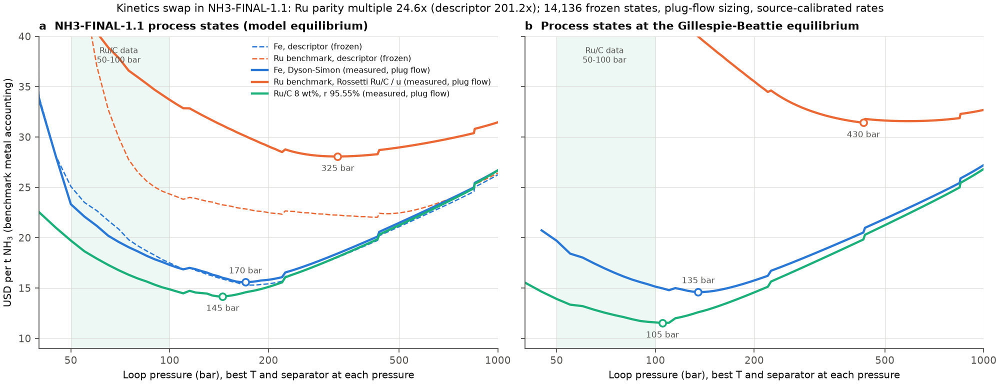
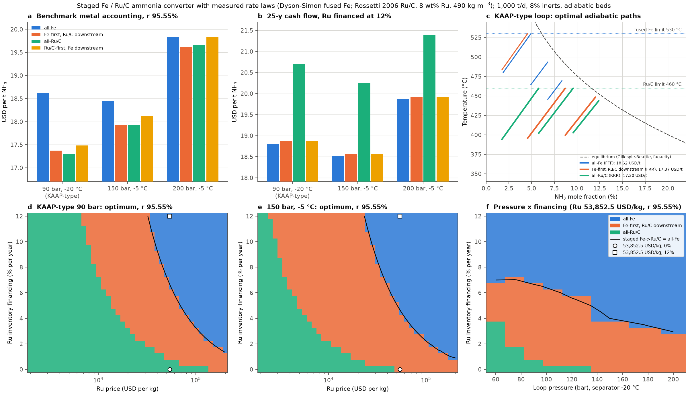

# Measured Fe and Ru/C rate laws in the NH₃ plant model: kinetics swap in NH3-FINAL-1.1, and a staged Fe → Ru/C converter (2026-10-12)

Exploratory analysis. No frozen output, manuscript text, figure or existing analysis folder is changed. Fe kinetics:
Dyson & Simon (1968) fused-iron (KM1) Temkin rate with fugacities; Ru kinetics: Rossetti et al. (2006) promoted Ru/C,
Temkin rate with H₂ and NH₃ adsorption terms. Every parameter and its source is in `parameters.yaml` and the table in
section 3.

NH3-FINAL-1.2 (2026-10-13): the same scripts with `NH3_MODEL=1.2` write to `nh3_1_2/`; results and the 1.1 → 1.2 table in
`nh3_1_2/README.md` (the staged converter is model-invariant, the kinetics swap changes).

## 1. Kinetics swap in NH3-FINAL-1.1 (primary)

Only the Fe and Ru catalyst masses change. The 14,136 process states (350–450 °C, 10–1000 bar, separator −40 to 30 °C,
per-pass conversion 0.8 of the loop equilibrium), compression, refrigeration, converter cost and the 90 m³ cap are those
of NH3-FINAL-1.1; the frozen Fe and Ru optima (15.2917 and 22.0306 USD/t) are reproduced to 1e-9 before the swap
(`kinetics_swap.py`, assertion). Headline mapping: **plug-flow sizing** (isothermal, inlet → outlet of each state) and
**each rate law at its own measured absolute rate**. The harness convention (inlet-rate sizing) and the NH3-FINAL-1.1
calibration logic (one factor fixed by the Fe bed of 66.007 m³ at 400 °C, 80 bar, −35 °C, applied to Fe and Ru alike)
are the other three variants; all four are repeated on process states rebuilt at the Gillespie–Beattie equilibrium
(PR #64, `analysis/verify_2026_10_12_nh3_equilibrium`, 14,498 states).

Catalyst mapping (as in NH3-FINAL-1.1 and `analysis/nh3_actual_ru_params_2026_10_07`): Fe bed volume from the rate per
m³, Fe metal = V × 0.7151 × 2,500 kg m⁻³ at 8 USD/kg. **Ru benchmark** (Ru in the fused-iron bed form, no recovery):
Ru metal = u × (Ru mass of the measured Ru/C catalyst), u = 11, V = Ru/(0.7151 × 2,500). **Supported Ru/C**: Ru metal
as measured, 8 wt% Ru, 490 kg m⁻³; recovery 90–95.55%; metal charged straight-line (benchmark accounting) or by the
25-year cash flow of `analysis/nh3_ru_net_recovery_boundary_2026_10_12/lifecycle_cashflow.py` at 0 or 12 %/y (Fe on the
same convention).

### Headline (plug flow, measured rates, NH3-FINAL-1.1 process states)

| | Descriptor kinetics (frozen) | Measured kinetics |
|---|---|---|
| Fe optimum (USD/t; T, P, separator; bed) | 15.29; 425 °C, 180 bar, 30 °C; 17.1 m³ | **15.58; 425 °C, 170 bar, 30 °C; 25.6 m³** |
| Ru benchmark optimum | 22.03; 450 °C, 425 bar, 25 °C | **28.07; 450 °C, 325 bar, 30 °C**; best at 100–200 bar 29.08 (200 bar) |
| Ru activity multiple for parity with Fe | 201.22× | **24.6×** |
| Supported Ru/C, global optimum, r 95.55% / 90% | 15.74 / – (PR #64) | **14.17 / 14.59** at 400 °C, 145 bar, 30 °C (vs Fe 15.58: −1.41 / −0.99) |
| … 25-y cash flow, financing 0% | – | 14.24 / 14.75 vs Fe 15.60 (**−1.36 / −0.85**) |
| … 25-y cash flow, financing 12% | – | 16.79 / 16.83 vs Fe 15.67 (**+1.12 / +1.17**), optimum 190 bar |
| KAAP-type loop (90 bar, −20 °C), r 95.55% / 90% | 18.67–19.08 vs Fe 19.07 | 18.24 / 18.62 vs Fe 19.35 (**−1.10 / −0.73**) |
| … financing 0% | 18.84 vs 19.09: −0.25 (manuscript) | 18.30 / 18.75 vs 19.37 (**−1.07 / −0.62**) |
| … financing 12% | 21.79 vs 19.14: +2.64 (manuscript) | 21.31 / 21.35 vs 19.45 (**+1.86 / +1.90**) |

### All eight variants

| States | Sizing | Rates | Fe optimum | Ru benchmark optimum | Ru parity multiple |
|---|---|---|---|---|---|
| NH3-FINAL-1.1 | plug | measured | 15.58 (425 °C, 170 bar, 30 °C) | 28.07 (450 °C, 325 bar) | **24.6×** |
| NH3-FINAL-1.1 | plug | F_CAL logic (×0.823) | 15.89 (425, 170, 30) | 30.15 (450, 395) | 20.6× |
| NH3-FINAL-1.1 | inlet | measured | 14.94 (400, 165, 30) | 24.21 (450, 355) | 37.4× |
| NH3-FINAL-1.1 | inlet | F_CAL logic (×0.187) | 17.37 (450, 220, 30) | 36.12 (450, **1000**) | 26.6× |
| Gillespie–Beattie | plug | measured | 14.60 (450, 135, 30) | 31.42 (450, 430) | 14.6× |
| Gillespie–Beattie | plug | F_CAL logic (×2.34) | 12.89 (425, 110, 30) | 23.24 (450, 220) | 17.6× |
| Gillespie–Beattie | inlet | measured | 12.90 (425, 110, 25) | 23.50 (450, 315) | 22.9× |
| Gillespie–Beattie | inlet | F_CAL logic (×0.155) | 16.61 (450, 200, 30) | 37.14 (450, **1000**) | 24.7× |

Supported Ru/C (8 wt%, 490 kg m⁻³, r 95.55%) minus Fe, USD/t:

| States / sizing / rates | Global, 0 %/y | Global, 12 %/y | KAAP, 0 %/y | KAAP, 12 %/y | Ru/C optimum P (0 / 12 %) |
|---|---|---|---|---|---|
| NH3-FINAL-1.1 / plug / measured | −1.36 | +1.12 | −1.07 | +1.86 | 145 / 190 bar |
| NH3-FINAL-1.1 / plug / F_CAL | −1.48 | +1.19 | −1.15 | +2.00 | 145 / 195 |
| NH3-FINAL-1.1 / inlet / measured | −0.89 | +1.42 | +0.07 | +2.78 | 145 / 195 |
| NH3-FINAL-1.1 / inlet / F_CAL | −1.54 | +4.37 | −1.28 | +5.56 | 185 / 220 |
| Gillespie–Beattie / plug / measured | −3.04 | +1.41 | −1.27 | +1.64 | 105 / 145 |
| Gillespie–Beattie / plug / F_CAL | −2.26 | +0.88 | −0.69 | +0.72 | 90 / 130 |
| Gillespie–Beattie / inlet / measured | −2.01 | +1.36 | −0.09 | +1.24 | 95 / 135 |
| Gillespie–Beattie / inlet / F_CAL | −3.29 | +5.10 | −1.07 | +6.08 | 110 / 220 |

(At r 90% the 0 %/y gaps are 0.4–0.9 USD/t smaller globally, all still negative, and 0.2–0.7 smaller in the KAAP-type
loop, where the two inlet-rate variants with measured rates are positive, +0.37 and +0.07.)
Full output: `kinetics_swap.json`, cost against pressure `kinetics_swap_pressure_profiles.csv`, figure
`kinetics_swap.png`.

### Answers

1. **Optima.** Fe 15.58 USD/t at 425 °C, 170 bar, 30 °C separator (variants 12.89–17.37 at 400–450 °C, 110–220 bar,
   25–30 °C). Ru benchmark 28.07 at 450 °C, 325 bar, 30 °C. Supported Ru/C 14.17 at 400 °C, 145 bar, 30 °C.
2. **Ru's optimal pressure.** In the benchmark formulation it falls from 425 to 325 bar, not to 100–200 bar (220–430 bar
   in the variants, 1,000 bar at the grid edge with inlet sizing and the F_CAL logic); at 100–200 bar it costs 1.0 USD/t
   more than at 325 bar. The measured Ru/C rate still rises with pressure: apparent orders at 90 bar, 400 °C, 2% NH₃ are
   N₂ +0.53, H₂ +0.32, NH₃ −0.39 (fused Fe: +1.00, +1.51, −1.01). H₂ inhibition lowers the H₂ order but does not make
   it negative in the fitted range, so the bulk-Ru inventory still pushes the optimum to high pressure. The supported
   Ru/C optimum is at 145 bar (90–220 bar across variants and financing).
3. **Activity multiple for parity: 24.6×** (14.6–37.4× across the eight variants) against 201.22× with the descriptor
   kinetics.
4. **Supported Ru/C vs Fe.** Cheaper than Fe in the global optimum at 0 %/y in all 8 variants (−0.89 to −3.29 USD/t at
   95.55%) and dearer at 12 %/y in all 8 (+0.88 to +5.10). KAAP-type loop: cheaper at 0 %/y in 7 of 8 (−1.28 to +0.07),
   dearer at 12 %/y in all 8 (+0.72 to +6.08).
5. **Gillespie–Beattie equilibrium.** Lowers every cost (Fe 14.60 at 135 bar headline), lowers the parity multiple to
   14.6×, widens the Ru/C advantage at 0 %/y (−3.04 globally) and keeps the 12 %/y result (+1.41).

The D–S Fe bed at the NH3-FINAL-1.1 calibration state (400 °C, 80 bar, −35 °C) is 54.3 m³ with plug flow against the
frozen 66.0 m³ (factor 0.823); with inlet-rate sizing it is 12.3 m³. Over the 14,136 states plug flow needs 2.1–356 times
(5th–95th percentile, median 39) the inlet-rate Fe mass and 1.4–6.1 times the Ru mass, because the Temkin rate of fused Fe falls steeply with NH₃
(order −1); the inlet-rate convention therefore misprices Fe under measured kinetics and plug flow is the headline.

## 2. Staged Fe → Ru/C converter (secondary)

Three adiabatic beds with indirect interbed cooling (isothermal beds as a variant), each fused Fe or Ru/C, plug flow,
1,000 t/d, H₂/N₂ = 3, 8% inerts at the converter inlet (0% as a sensitivity), recycle NH₃ from the separator
(y_NH₃,in = y_sep (1 − 4ξ)), loop costs from NH3-FINAL-1.1 (unit tests reproduce its compression, refrigeration and
converter costs to 1e-10). Bed inlet temperatures and catalyst masses (bed extents) are optimised (differential
evolution + Nelder–Mead, then restarts from the optima of the other arrangements) for every arrangement. Temperature
limits: fused Fe 350–530 °C, Ru/C 350–460 °C (top of the measured range; 500 °C as a sensitivity). Fused-Fe catalyst
8 USD/kg (4–16 as sensitivity); Ru/C at 8 wt% Ru, 53,852.5 USD/kg Ru, 490 kg m⁻³, plus 8 USD/kg non-recoverable
support; life 10 y.

### Cost per arrangement (USD/t NH₃, adiabatic beds; Ru/C share of the catalyst volume in brackets)

| Loop | Accounting | all-Fe | Fe-first, Ru/C downstream | all-Ru/C | Ru/C-first, Fe downstream | Optimum |
|---|---|---|---|---|---|---|
| KAAP-type 90 bar, −20 °C | benchmark, r 95.55% | 18.62 | 17.37 (FRR, 73%) | **17.30** | 17.48 (RRF) | all-Ru/C |
| | benchmark, r 90% | 18.62 | 17.61 (FRR, 61%) | **17.59** | 17.79 (RRF) | all-Ru/C |
| | 25-y cash flow 0%, r 95.55% | 18.67 | 17.42 (FRR, 72%) | **17.36** | 17.54 (RRF) | all-Ru/C |
| | 25-y cash flow 12%, r 95.55% | **18.80** | 18.88 (Ru 0%) | 20.71 | 18.88 (Ru 0%) | all-Fe |
| 150 bar, −5 °C | benchmark, r 95.55% | 18.45 | **17.92 (FRR, 62%)** | 17.93 | 18.13 (RRF) | Fe-first |
| | benchmark, r 90% | 18.45 | **18.05 (FRR, 49%)** | 18.11 | 18.33 (RRF) | Fe-first |
| | 25-y cash flow 0%, r 95.55% | 18.46 | **17.95 (FRR, 60%)** | 17.96 | 18.16 (RRF) | Fe-first |
| | 25-y cash flow 12%, r 95.55% | **18.51** | 18.56 (Ru 0%) | 20.24 | 18.56 (Ru 0%) | all-Fe |
| 200 bar, −5 °C | benchmark, r 95.55% | 19.84 | **19.61 (FRR, 57%)** | 19.66 | 19.83 (RRF) | Fe-first |
| | benchmark, r 90% | 19.84 | **19.69 (FRR, 46%)** | 19.79 | 19.87 (RFF) | Fe-first |
| | 25-y cash flow 0%, r 95.55% | 19.85 | **19.63 (FRR, 56%)** | 19.68 | 19.85 (RRF) | Fe-first |
| | 25-y cash flow 12%, r 95.55% | **19.88** | 19.91 (Ru 0%) | 21.40 | 19.91 (Ru 0%) | all-Fe |

Isothermal beds (benchmark, r 95.55% / cash flow 12%): KAAP-type all-Fe 18.56 / **18.73**, all-Ru/C **17.10** / 19.88,
Fe-first 17.11 / 18.76; 150 bar 18.39 / **18.45**, **17.68** / 19.43, 17.68 / 18.46; 200 bar 19.79 / **19.82**,
19.38 / 20.70, **19.38** / 19.82. Four beds in the KAAP-type loop (benchmark, r 95.55%): RRRR 17.22, FRRR (the KAAP
layout) 17.25, FFRR 17.36, FFFR 17.60, FFFF 18.59; at 12 %/y FFFF 18.77 and no Ru in any optimum. All 214 optimisations:
`arrangements.csv`, `sensitivities.csv`.

Optimal KAAP-type paths (benchmark, r 95.55%): all-Fe beds 480→530, 464→494, 446→470 °C, NH₃ 1.9 → 8.3%, 33.1 m³;
Fe-first: Fe 484→530 °C, then Ru/C 396→460 and 400→449 °C, NH₃ 1.7 → 12.0%, 11.7 m³ (Ru/C 8.6 m³);
all-Ru/C: 394→460, 402→460, 403→444 °C, NH₃ 1.7 → 12.4%, 10.0 m³.

### Decision boundaries

A design's cost is linear in the yearly Ru charge c_Ru = p_Ru · m(r, i)/L (m: 1 − r straight-line, or the 25-year
cash-flow multiplier at financing rate i) and the Fe charge, so the optimum at any Ru price, recovery and financing rate
is the lower envelope of a design library optimised at 12 Ru charges × 3 Fe charges for 10 loops (`design_library.csv`;
40 direct global optimisations at map points agree within 0.0042 USD/t, `envelope_checks.csv`).

| Loop | Staged Fe → Ru/C beats all-Fe below c_Ru (USD per kg Ru per year) | Fe-first staging is the optimum for c_Ru | all-Ru/C optimum below |
|---|---|---|---|
| 60 bar, −20 °C | 3,632–4,159 | 1,990–4,151 | 1,990–2,530 |
| 90 bar, −20 °C (KAAP-type) | 3,492–3,942 | 686–3,909 | 686–834 |
| 120 bar, −20 °C | 3,021–3,354 | 314–3,314 | 314–388 |
| 150 bar, −5 °C | 2,589–2,857 | 233–2,853 | 233–305 |
| 200 bar, −5 °C | 1,923–2,018 | up to 1,902–1,990 (from the bottom of the grid) | – |

(ranges over the benchmark accounting and the cash flow at 0–12 %/y, which set the Fe charge.) At the actual Ru price
(53,852.5 USD/kg) and 95.55% recovery, c_Ru = 240 (benchmark accounting), 288 (cash flow 0%) and 6,610 USD/kg/y (12%):

| Loop | all-Ru/C optimal for financing | Fe-first, Ru/C downstream optimal for | all-Fe optimal above | Ru/C share at 4 %/y |
|---|---|---|---|---|
| KAAP-type 90 bar, r 95.55% | 0–0.8 %/y | **0.8–6.7 %/y** | 6.7 %/y | 14% (FRR), −0.21 USD/t vs all-Fe |
| KAAP-type 90 bar, r 90% | 0–0.1 %/y | **0.15–6.1 %/y** | 6.1 %/y | 14% (FRR), −0.14 |
| 150 bar, −5 °C, r 95.55% | – | **0–4.7 %/y** | 4.7 %/y | 4% (FFR), −0.01 |
| 150 bar, −5 °C, r 90% | – | **0–4.1 %/y** | 4.1 %/y | 4% (FFR), −0.00 |
| 200 bar, −5 °C, r 95.55% | – | **0–3.2 %/y** | 3.2 %/y | 0 |

Ru price thresholds (KAAP-type loop, r 95.55%): staged beats all-Fe below 676,000 USD/kg at 0 %/y, 83,700 at 4 %/y,
45,800 at 8 %/y and 32,100 at 12 %/y (r 90%: 301,000 / 74,700 / 43,500 / 31,200). Optimal Ru fraction zero (all-Fe):
above those prices, i.e. at 53,852.5 USD/kg for financing above 6.7 %/y (90 bar), 4.7 %/y (150 bar), 3.2 %/y (200 bar);
in the pressure sweep at −20 °C the staged/all-Fe boundary falls from 6.7–7.0 %/y at 60–90 bar to 2.9 %/y at 200 bar
(`boundary_summary.json`, `boundary_price_financing.csv`, `boundary_pressure.csv`).

### Sensitivities (KAAP-type loop, adiabatic; benchmark r 95.55% / cash flow 12%)

| Case | all-Fe | best Fe-first | all-Ru/C | Optimum |
|---|---|---|---|---|
| base (8% inerts) | 18.62 / 18.80 | 17.37 / 18.88 | 17.30 / 20.71 | all-Ru/C / all-Fe |
| no inerts | 18.17 / 18.31 | 17.16 / 18.39 | 17.13 / 20.35 | all-Ru/C / all-Fe |
| Ru/C up to 500 °C | 18.62 / 18.80 | 17.30 / 18.88 | 17.19 / 19.37 | all-Ru/C / all-Fe |
| Ru/C 3.2 wt% as measured (590 kg m⁻³) | 18.62 / 18.80 | 17.58 / 18.88 | 17.55 / 20.81 | all-Ru/C / all-Fe |
| Ru/C bed 430 / 550 kg m⁻³ | 18.62 | 17.40 / 17.35 | 17.34 / 17.27 | all-Ru/C |
| Fe effectiveness 0.5 | 19.57 / 19.81 | 17.43 / 19.73 (FFR, 3%) | 17.30 / 20.71 | all-Ru/C / Fe-first |
| Fe and Ru/C effectiveness 0.5 | 19.57 / 19.81 | 17.82 / 19.88 | 17.73 / 23.14 | all-Ru/C / all-Fe |
| Fe = wustite fit (Tripodi 2018) | 17.89 / 18.00 | **17.25** / 18.07 | 17.30 / 20.71 | **Fe-first** / all-Fe |
| fused Fe 4 / 16 USD/kg | 18.51 / 18.83 | 17.36 / 17.39 | 17.30 | all-Ru/C |
| separator −5 °C | 17.04 / 17.30 | 15.15 / 17.41 | 15.01 / 19.17 | all-Ru/C / all-Fe |

### Does the measured kinetics reproduce the industrial choice?

- **Direction, yes.** The Ru/C to Fe rate ratio per kg rises with NH₃ (16 → 52 from 2 to 14% NH₃ at 90 bar, 400 °C;
  per m³ of bed 2.8 → 8.9), the NH₃ order is −0.4 for Ru/C against −1.0 for fused Fe, and Ru/C-first-then-Fe is never
  the optimum in any loop, accounting or bed mode.
- **Fe upstream, Ru/C downstream at low pressure: only inside a Ru-charge window.** In the KAAP-type loop it is the
  optimum for c_Ru 686–3,909 USD per kg Ru per year, i.e. at today's Ru price and 95.55% recovery for Ru inventory
  financing of 0.8–6.7 %/y, the optimal Ru/C share of the catalyst volume falling from 54% to 4% across the window. Charged only for lost metal (benchmark
  accounting) all-Ru/C is 0.07 USD/t cheaper than Fe-first; financed at the 12% equipment rate no Ru is used.
- **What puts Fe first** is the temperature window, not H₂ inhibition: the first adiabatic bed runs hottest, fused Fe
  takes it to 530 °C, Ru/C is held to 460 °C. With Ru/C allowed to 500 °C the lead of all-Ru/C over Fe-first grows from 0.07
  to 0.11 USD/t; with the more active wustite Fe the Fe-first design is the optimum at benchmark accounting.
- **At 150–200 bar** Fe-first is the optimum from 0 %/y up to 3–5 %/y and all-Ru/C never is.

## 3. Rate laws and parameters

| Quantity | Value | Source |
|---|---|---|
| Fe rate | r_NH₃ = 2k [Ka² a_N₂ (a_H₂³/a_NH₃²)^α − (a_NH₃²/a_H₂³)^(1−α)], kmol NH₃ m⁻³(cat) h⁻¹ | Dyson & Simon, Ind. Eng. Chem. Fundam. 7, 605 (1968), via Yancy-Caballero et al., Chem. Eng. Trans. 43, 1297 (2015), eq 5, p. 1298, and Tripodi et al., J. Ind. Eng. Chem. 66, 176 (2018), accepted manuscript Table 1 ("KM" column), p. 22 |
| k₀, E, α | 8.849 × 10¹⁴, 40,765 cal mol⁻¹, 0.5 | same; Tripodi's k₀ = 1.72 × 10⁸ kmol s⁻¹ kg⁻¹ = 2 × 8.849 × 10¹⁴/3,600/2.85 |
| Fe bed density (per-kg conversion only) | 2,850 kg m⁻³ | Tripodi 2018 AAM p. 8 |
| Ru/C rate | dη/dτ = k_f λ [a_N₂^0.5 a_H₂^0.375 a_NH₃^−0.25 − a_NH₃^0.75 a_H₂^−1.125 / Ka] / (1 + K_H₂ a_H₂^0.3 + K_NH₃ a_NH₃^0.2), mol N₂ h⁻¹ L⁻¹(cat) | Rossetti, Pernicone, Ferrero & Forni, Ind. Eng. Chem. Res. 45, 4150 (2006), eq 14, p. 4153 |
| k_f | 9.02 × 10⁸ exp(−23.0 kcal mol⁻¹/RT) | Table 3, p. 4153 |
| K_H₂, K_NH₃ = exp(ΔS/R − ΔH/RT) | ΔH −9.0, −7.0 kcal mol⁻¹; ΔS −13.6, −8.3 cal mol⁻¹ K⁻¹ | Table 3, p. 4153; convention confirmed by Tripodi 2018 AAM eqs 3–4, p. 5 |
| Ru/C catalyst | 3.2 wt% Ru, dispersion 11%, Ba/Ru 0.6, Cs/Ru 1, K/Ru 3.5; 0.59 kg L⁻¹ | Rossetti 2006 p. 4150; Tripodi 2018 AAM p. 8 |
| Equilibrium | Gillespie–Beattie log₁₀Ka (atm⁻¹) | Rossetti 2006 eq 4, p. 4151 |
| Fugacity coefficients | Newton–Cooper correlations | Rossetti 2006 eqs 5–7, p. 4151 |
| Enthalpy, heat capacity | NIST Shomate, ideal gas | NIST Chemistry WebBook |
| Alternative Fe (sensitivity) | wustite: k₀ 7.47 × 10⁸ kmol s⁻¹ kg⁻¹, E 45 kcal mol⁻¹, α 0.75; magnetite 3.23 × 10⁹, 47.5 | Tripodi 2018 AAM eq 5, Table 1, p. 22 |
| Cross-check Fe | α 0.75, E₂ 40,500 kcal kmol⁻¹, k₂₀ 80–90 kmol NH₃ h⁻¹ t⁻¹ at 723.2 K | Gramatica & Pernicone, in Catalytic Ammonia Synthesis (1991), eqs 6.82–6.87, pp. 247–248 |

Calibrations, all stated: (a) Ru/C at 8 wt% keeps the measured activity per kg of Ru (rate per kg catalyst × 8/3.2);
the 3.2 wt% catalyst as measured is a sensitivity. (b) The kinetics swap uses either the measured absolute rates or one
NH3-FINAL-1.1-type factor fixed by Fe at the calibration state; nothing is fitted to the cost results. Tripodi et al.
(2018) implement the Ru/C rate per mole of reaction (k₀ 426 kmol s⁻¹ kg⁻¹ = 9.02 × 10⁸/1,000/3,600/0.59), which halves
the NH₃ rate of the fit; the Rossetti data reject that reading (section 4).

Sources not used: the original Dyson & Simon paper (NUS access not available in this session; the two reproductions
agree on every parameter); the 2024 RSC study (doi 10.1039/D4SE00254G, Ru/CeO₂ rather than Ru/C; publisher page and
repository copy behind interactive bot checks). The branch `experiment/kaap-fe-ru-20261012-literature-kinetics` carries
parameters from that study; they are not checked here.

## 4. Validation

| Check | Result |
|---|---|
| Ru/C rate vs all 125 points of Rossetti 2006 Table 2 (370–460 °C, 50–100 bar, H₂/N₂ 1.5 and 3, GHSV 5 × 10⁴–4 × 10⁵ h⁻¹) | mean absolute error 10.1%, median 7.1%, mean bias −0.1%; H₂/N₂ = 3 points (36): 14.7%, bias +12.3% (above 400 °C: 11.1%) |
| Same, NH₃ rate per mole of reaction (Tripodi 2018 implementation) | mean error 35.5%, bias −35.5% → rejected |
| Equilibrium vs Rossetti's near-equilibrium tests (460 °C) | −1.7%, −2.5%, −9.2% |
| Rossetti 2006 p. 4153: same NH₃ at 460 °C, τ 0.0010 h L mol⁻¹: Ru/C at 57 bar = Fe magnetite at 100 bar (6.6%) | 8.03% and 8.11% (equal within 1%; both 22% above the stated 6.6%) |
| Fe (Dyson–Simon, KM1) vs micropilot commercial magnetite, 430 °C, 100 bar, 30,000 h⁻¹ (8%) | 8.20% (+2.5%) |
| Fe wustite fit vs micropilot wustite (12.5%); Ru/C at H₂/N₂ 1.5 (15.5%) | 11.47% (−8.2%); 15.05% (−2.9%) |
| Gramatica industrial Fe (k₂₀ 85) vs micropilot magnetite | 12.18% (+52%; more active catalyst, cross-check only) |
| Adiabatic temperature rise | 15.1–15.3 K per 1% NH₃ (industrial 14–15 K, Gramatica & Pernicone p. 245) |
| NH3-FINAL-1.1 loop costs (compression, refrigeration, converter) | reproduced to 1e-10 (`test_staged.py`) |
| Frozen Fe / Ru optima on the same states | 15.291705 / 22.030595 USD/t (`kinetics_swap.py`) |
| Plug-flow quadrature (81 points) | Fe 3 × 10⁻⁷, Ru 9 × 10⁻⁴ relative to 161 points |

The Ru/C rate law was fitted at 50–100 bar; D–S at 150–300 atm. The supported Ru/C optimum (145 bar) and the Ru
benchmark optimum (325 bar) are extrapolations in pressure; the Fe optimum (110–220 bar) is near the fitted range.
`validation_summary.json`, `validation_ru_rossetti2006.csv`.

## 5. Plain summary

1. Measured rate laws replace the descriptor kinetics for Fe and Ru only; NH3-FINAL-1.1 is otherwise unchanged.
2. Ru needs a 24.6-fold activity gain for parity with Fe (14.6–37.4 across sizing, calibration and equilibrium), not 201-fold.
3. The bulk-Ru (benchmark) optimum moves from 425 to 325 bar, not to 100–200 bar: Ru/C's fitted H₂ order is +0.3, not negative.
4. Supported Ru/C (8 wt%, 95.55% recovery) has its optimum at 145 bar and costs 14.17 USD/t against 15.58 for fused Fe.
5. With the Ru inventory financed at 0 %/y it beats Fe in all 8 variants globally and in 7 of 8 in the 90-bar KAAP-type loop.
6. Financed at 12 %/y it loses to Fe in all 8 variants, globally (+0.9 to +5.1) and in the KAAP-type loop (+0.7 to +6.1).
7. The Gillespie–Beattie equilibrium lowers all costs (Fe 14.60) and keeps every sign.
8. In a staged converter, Ru/C-first is never optimal; Ru/C's advantage over Fe grows with NH₃ along the converter.
9. Fe upstream with Ru/C downstream is the optimum at 90 bar for 0.8–6.7 %/y Ru financing (today's price, 95.55% recovery), at 150–200 bar from 0 to 3–5 %/y.
10. Below that window all-Ru/C wins at 90 bar (by 0.07 USD/t); above it, including the 12% equipment rate, the optimal Ru fraction is zero.

## 6. Files and rerun

| File | Content |
|---|---|
| `parameters.yaml`, `kinetics.py` | rate laws, equilibrium, fugacity, enthalpy |
| `validate_kinetics.py` | section 4 → `validation_summary.json`, `validation_ru_rossetti2006.csv` |
| `kinetics_swap.py`, `plot_swap.py` | section 1 → `kinetics_swap.json`, `kinetics_swap_pressure_profiles.csv`, `kinetics_swap.png` |
| `converter.py`, `run_staged.py` | section 2 → `arrangements.csv`, `sensitivities.csv`, `design_library.csv`, `envelope_checks.csv`, `summary.json` |
| `boundary.py`, `plot_staged.py` | maps → `boundary_*.csv`, `boundary_summary.json`, `staged_converter.png` |
| `test_staged.py`, `check_regression.py` | unit checks against NH3-FINAL-1.1; comparison of a rerun with the committed outputs |
| `manuscript_numbers.py` | the quoted numbers (financing windows, savings, shares, kinetics-swap headline) → `manuscript_numbers.json` |
| `staged_invariance_1_2.py`, `nh3_1_2/` | NH3-FINAL-1.2 (`NH3_MODEL=1.2`; `nh3_1_2/README.md`) |

    pip install -r requirements.txt pyyaml
    cd analysis/nh3_staged_converter_2026_10_12
    python -m unittest test_staged -v
    python validate_kinetics.py
    python kinetics_swap.py && python plot_swap.py         # about 2 min
    python run_staged.py --workers 8                       # about 1 h on 8 workers
    python boundary.py && python plot_staged.py

Workflow `.github/workflows/nh3-staged-converter.yml` reruns everything on a pull request touching this folder and
fails if a cost moves by more than 0.02 USD/t or a decision changes away from a boundary.
